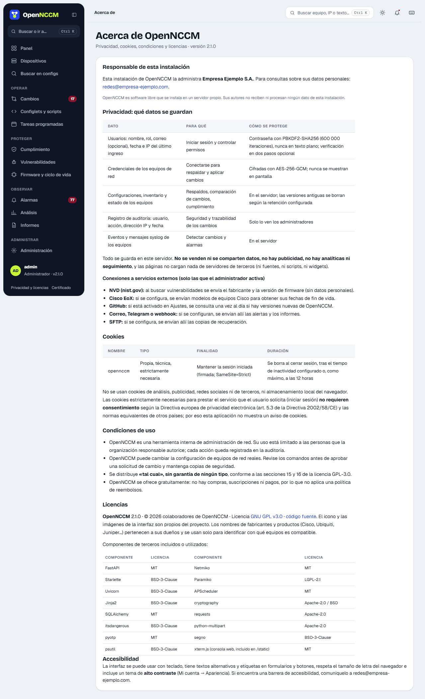

Los ajustes están en **Administración → Ajustes**, separados en secciones que se eligen a la izquierda: Seguridad y acceso, Organización, Flujo de cambios, Notificaciones, Fin de vida (Cisco EoX), Vulnerabilidades (NVD), Mapa de la red, Copia en Git, Recuperación ante desastres y Actualizaciones. Al modificar cualquier campo aparece abajo la barra **Tienes cambios sin guardar** con **Descartar** y **Guardar ajustes**; si intenta salir de la página sin guardar, el navegador lo advierte.

## Seguridad y acceso

| Ajuste | Qué hace |
| --- | --- |
| Cerrar la sesión tras N minutos sin actividad | 5 a 720 minutos (30 por omisión). |
| «Recordarme» mantiene la sesión abierta durante N días | 1 a 30 días (14 por omisión); 0 quita la casilla del inicio de sesión. Las sesiones recordadas no se cierran por inactividad. |
| Exigir verificación en dos pasos a los administradores | Un administrador sin ella solo puede entrar a «Mi cuenta» hasta activarla. |
| Idioma predeterminado | Español o inglés para quien no eligió idioma y cuyo navegador no pide uno disponible. |
| Consola SSH web | Quién puede abrirla y si entra con la credencial del equipo (ver capítulo 4). |

## Inicio de sesión con Active Directory y Microsoft Entra ID

En **Ajustes → Inicio de sesión** se puede permitir que las personas entren con su cuenta de la organización. Las cuentas locales de OpenNCCM siguen funcionando siempre (por ejemplo, la del administrador que lo instaló).

| Directorio | Cómo se entra | Qué hay que configurar |
| --- | --- | --- |
| **Active Directory** (LDAP) | Con el mismo formulario: usuario (o usuario@dominio) y la contraseña de la red. | Servidor (`ldaps://dc01.empresa.local`, o `ldap://` con StartTLS), base de búsqueda, una cuenta de servicio con permiso de lectura, el filtro de usuario y los grupos de cada rol. **Probar conexión** comprueba la cuenta de servicio y, si se escribe un usuario de prueba, qué rol tendría. |
| **Microsoft Entra ID** (Azure AD) | Botón **Entrar con Microsoft** en la pantalla de ingreso (inicio de sesión único con Microsoft 365). | Registre una aplicación en **Entra ID → Registros de aplicaciones** con la **URI de redirección** que muestra la página, y copie el ID de directorio (tenant), el ID de aplicación y un secreto de cliente. Para asignar roles, agregue la notificación **groups** en **Configuración del token** (o use roles de aplicación) y escriba el Object ID de cada grupo. |

-   **Roles:** cada rol (administrador, operador, lector) se asocia a uno o varios grupos (separados con «;»); si alguien está en varios, recibe el rol más alto. En Active Directory se admiten grupos anidados. Quien no esté en ningún grupo no entra, salvo que se elija un **rol por omisión**.
-   **Cuentas:** la cuenta se crea en OpenNCCM al primer ingreso y su rol se actualiza en cada ingreso. En **Usuarios** se marca su origen (AD o Microsoft); su contraseña no se guarda en OpenNCCM y se cambia en el directorio. Los administradores pueden desactivarla o restringirla a grupos de equipos como cualquier otra. Una cuenta local con el mismo nombre nunca se toma desde el directorio.
-   **Seguridad:** el ingreso con Microsoft usa el flujo de código con PKCE, *state* y *nonce*, y valida la firma, el emisor, la audiencia y la caducidad del token. La verificación en dos pasos de OpenNCCM, los bloqueos por intentos fallidos y la auditoría también se aplican a estas cuentas. Las contraseñas de la cuenta de servicio y el secreto de cliente se guardan cifrados.
-   **Otros proveedores:** en **Opciones avanzadas**, la URL de descubrimiento permite usar cualquier proveedor OpenID Connect (Google Workspace, Keycloak, Okta…), con el texto del botón que se quiera.

## Datos de la organización

Nombre, correo de contacto y dirección de quien administra esta instalación. Se muestran en la página **Privacidad, cookies y licencias** (enlace al pie de cada página y en el inicio de sesión), que explica qué datos guarda OpenNCCM, sus conexiones externas, la única cookie que usa (técnica, sin necesidad de consentimiento), las condiciones de uso y las licencias.

| Sección | Opciones |
| --- | --- |
| Flujo de cambios | Requiere aprobación o ejecución directa · auto-aprobación · avisar infracciones · versiones a conservar |
| Notificaciones | Severidad mínima · SMTP · destinatarios · webhook · Telegram · notificación de prueba |
| Fin de vida (Cisco EoX) | Client ID y Secret para fechas de ciclo de vida |
| Recuperación ante desastres | Copias a conservar · servidor SFTP remoto (servidor, puerto, usuario, contraseña, carpeta) |
| Actualizaciones | Buscar versiones nuevas cada día y avisar a los administradores |

Las contraseñas de SMTP, de la API de Cisco y del SFTP se guardan cifradas y no se muestran: el formulario indica «(guardada)».
