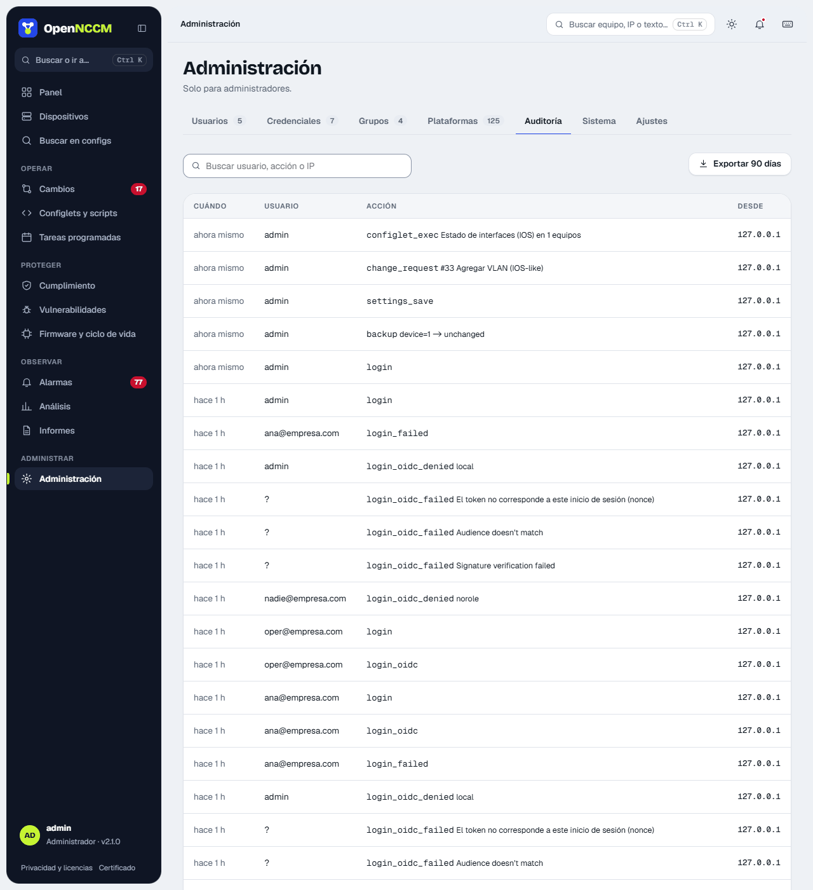

Registro de **quién hizo qué, cuándo y desde qué IP**: ingresos (y fallidos), respaldos, descargas de configuración, cambios de dispositivos y credenciales, solicitudes y aprobaciones, reversiones, firmware, informes y ajustes. Se puede buscar por usuario, acción o detalle y exportar.

