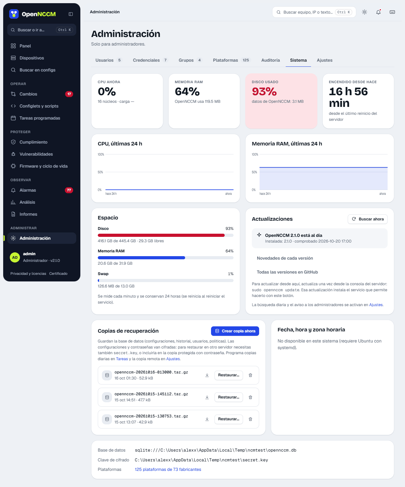

## Actualizaciones

La tarjeta **Actualizaciones** muestra la versión instalada y la última publicada. **Buscar ahora** consulta GitHub; OpenNCCM también lo hace una vez al día (desactivable en Ajustes) y, si hay una versión nueva, muestra a los administradores un aviso con sus novedades (**Ver y actualizar** o **Más tarde**, que no lo repite en esa sesión).

**Novedades de cada versión** abre una ventana con lo que agregó o corrigió cada versión (la instalada aparece marcada) y, si hay una nueva, sus novedades antes de actualizar. **Todas las versiones en GitHub** abre la página de publicaciones del proyecto.

**Actualizar ahora** (pide confirmación) hace lo mismo que `sudo opennccm update` en la consola: copia previa del código y la base, instalación, verificación y vuelta automática a la versión anterior si la nueva no arranca. Una página muestra el progreso; OpenNCCM se detiene 1-2 minutos. Por seguridad la aplicación no tiene permisos de administrador del sistema: solo deja una solicitud que atiende un servicio de systemd (`opennccm-webupdate`) instalado a partir de la 1.6.0.

## Copias de recuperación con la clave

Si marca «Incluir la clave de cifrado», el archivo completo se cifra (AES-256-GCM) con una contraseña de al menos 12 caracteres que usted elige, y termina en `.enc`. Sin esa contraseña no se puede restaurar: guárdela aparte. Al restaurar con `sudo opennccm restore ARCHIVO.enc` se la pide.

La pestaña **Sistema** muestra además el rendimiento del servidor, el **espacio**, la **fecha y hora del servidor**, la base de datos y la clave en uso, y las **copias de recuperación**: **Crear copia ahora** (con o sin la clave de cifrado), descargar, eliminar y **Restaurar…** (explica el comando de consola que la restaura). Se ven 4 a la vez; las demás, con la barra del borde (subir y bajar).

## Fecha, hora y zona horaria

-   **Zona horaria:** elíjala de la lista (agrupada por región) y pulse **Cambiar zona**. OpenNCCM se reinicia unos segundos para que el historial y las tareas programadas usen la nueva hora.
-   **Sincronizar con NTP:** interruptor que mantiene la hora exacta automáticamente (recomendado).
-   **Fijar fecha y hora a mano:** al desactivar NTP aparecen los campos de fecha y hora y el botón **Fijar**.

El servicio no tiene privilegios de administrador: el instalador le concede, mediante una regla de polkit, permiso **solo** para estas tres acciones. Cada cambio queda en Auditoría.

## Copia en Git

Con **Subir cada versión nueva a Git**, cada respaldo con cambios se sube como un commit a un repositorio Git (GitHub, GitLab, Gitea…), con un mensaje como «R1: +3/-1 líneas \[scheduled\]». Cada equipo es un archivo `<grupo>/<equipo>.cfg` con su última configuración. El repositorio se indica por HTTPS con usuario y **token** (se guarda cifrado y nunca se escribe en la URL ni en el disco) o por SSH con la clave del usuario del servicio. **Ocultar contraseñas y claves** (activado por omisión) sustituye por `<oculto>` los secretos, contraseñas, comunidades SNMP y claves que reconoce; aun así, use un repositorio privado. **Probar y subir todo ahora** exporta todos los equipos de una vez. Si la subida falla, se registra una alarma «Copia en Git fallida» y el respaldo no se ve afectado.

## Apoya OpenNCCM

OpenNCCM es software libre y gratis. Los administradores ven en la barra superior el botón **Apoya OpenNCCM**, y las páginas Sistema y Acerca de muestran una tarjeta con las formas de donar (GitHub Sponsors y Ko-fi). Tras actualizar a una versión nueva, el primer administrador que entra ve una vez un aviso con **Donar** y **Ahora no**. Los enlaces solo se abren si se pulsan, en una pestaña nueva, y no se envía ningún dato del servidor.

El procedimiento completo de copia, restauración en otro servidor, actualización y vuelta atrás está en [Copias y migrar](/instalacion/migrar/) y [Actualizar y volver atrás](/instalacion/actualizar/).
