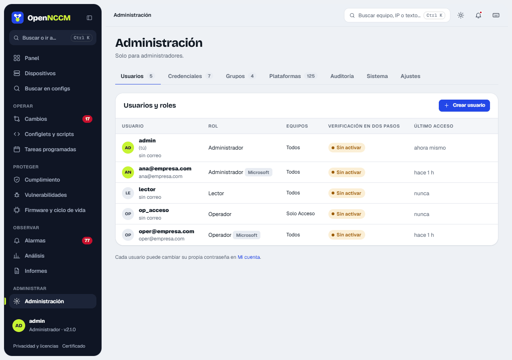
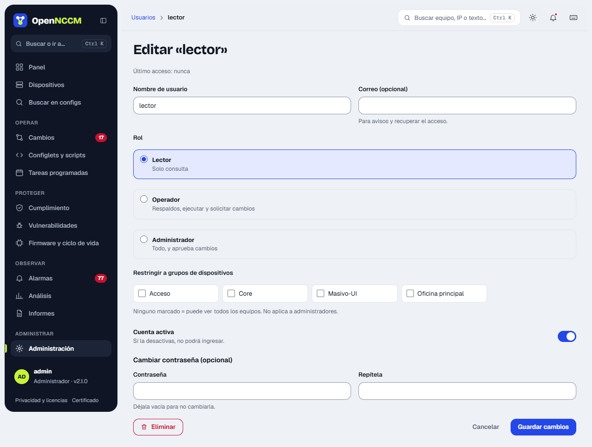
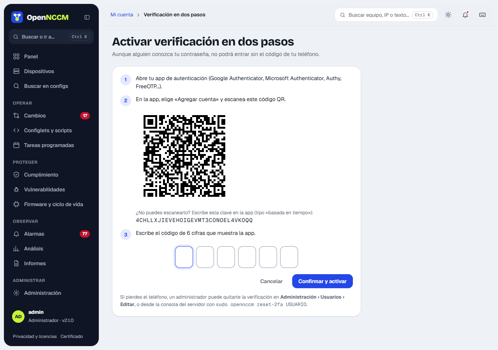
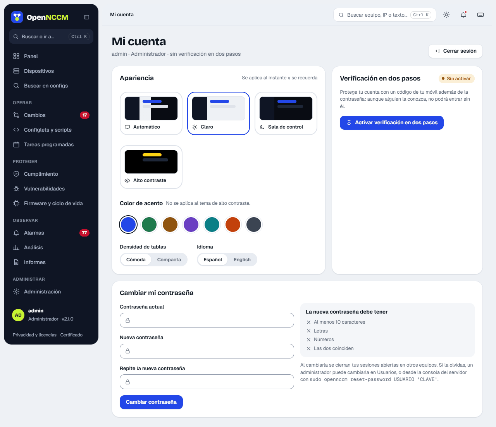
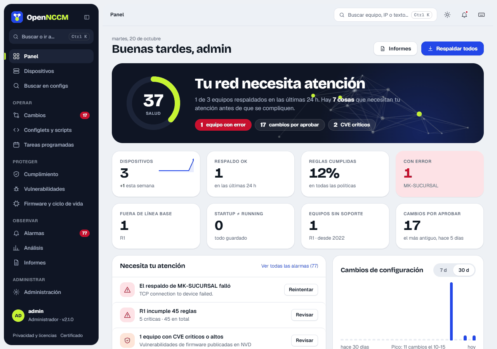
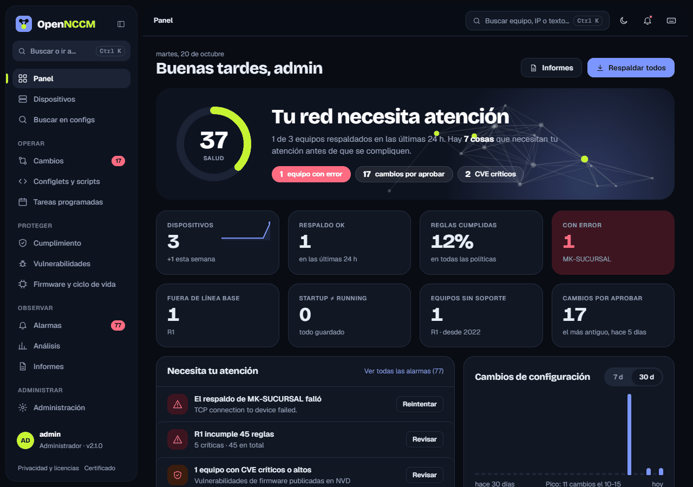
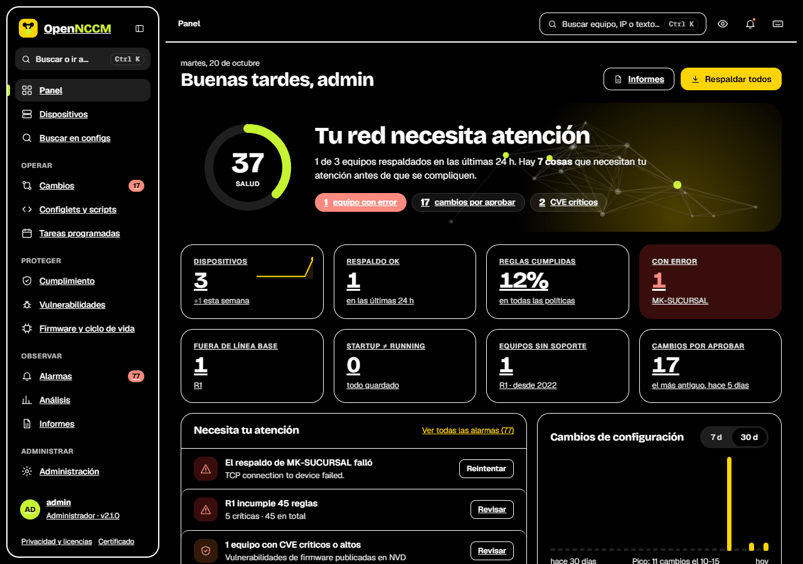
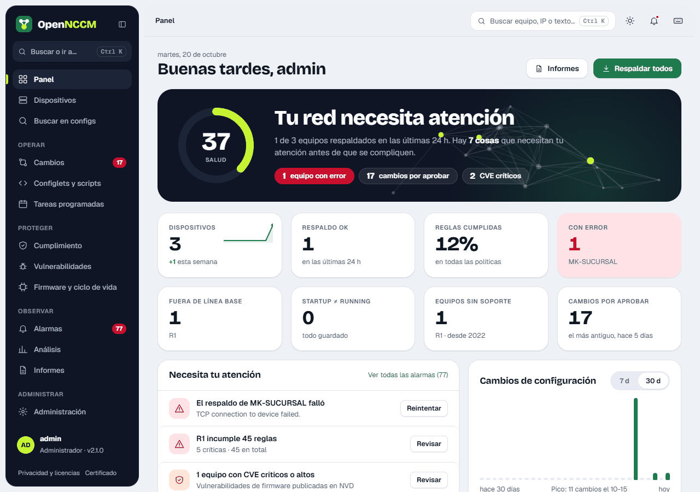
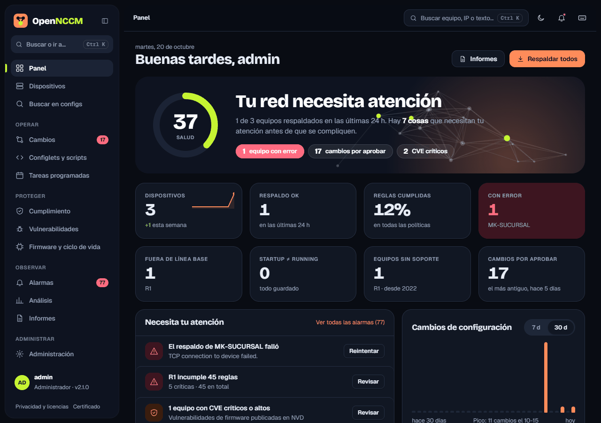

Cada usuario tiene un rol. Además, a los operadores y lectores se les puede restringir a uno o más **grupos de dispositivos**: solo verán y podrán actuar sobre esos equipos.

| Acción | viewer | operator | admin |
| --- | --- | --- | --- |
| Ver panel, dispositivos, versiones, comparaciones, búsqueda, alarmas, informes, análisis | ✓ | ✓ | ✓ |
| Respaldar, auditar cumplimiento, buscar CVE, reconocer alarmas |  | ✓ | ✓ |
| Ejecutar configlets de diagnóstico (exec) |  | ✓ | ✓ |
| Solicitar cambios, reversiones, correcciones y actualizaciones de firmware |  | ✓ | ✓ |
| Etiquetar versiones y marcar línea base; ejecutar tareas ya creadas |  | ✓ | ✓ |
| Aprobar o rechazar solicitudes de cambio |  |  | ✓ |
| Alta/baja de dispositivos, credenciales, grupos, configlets, políticas, tareas |  |  | ✓ |
| Usuarios, auditoría, ajustes, sistema, imágenes de firmware, base EOL |  |  | ✓ |

:::note[Restricción por grupos]
Un administrador siempre ve todo. Un usuario sin grupos asignados también ve todo. Si se le asignan grupos, la restricción se aplica en todas las páginas, la búsqueda, los informes, la API y las acciones (un intento sobre un equipo ajeno responde «403 — No tiene permisos»).
:::

## Crear un usuario (administradores)

1.  **Administración → Usuarios → Crear usuario** (se abre un panel lateral).
2.  Escriba el nombre (letras, números, punto, guion o @; sin espacios), elija el rol en sus tarjetas (Lector, Operador o Administrador) y escriba la contraseña dos veces (mínimo 10 caracteres, con letras y números, sin incluir el nombre de usuario). El correo es opcional.
3.  Para limitarlo a ciertos equipos, marque sus grupos. Sin grupos marcados verá todos los equipos.
4.  Pulse **Crear usuario**. El mensaje confirma el nombre y el rol; ya puede ingresar.

No se permiten dos usuarios con el mismo nombre (sin distinguir mayúsculas). Crear un usuario **nunca** modifica a otro.

## Editar un usuario

Pulse la fila o **Editar** para cambiar el rol, el correo, sus grupos, si la **cuenta está activa** o su contraseña (deje la contraseña vacía para no cambiarla). Al guardar, el mensaje indica exactamente qué cambió (por ejemplo «contraseña cambiada, rol lector»). Desactivar la cuenta impide el ingreso sin borrar el usuario ni su historial. **Eliminar** está en el mismo panel.

:::note[Protecciones]
Un administrador no puede quitarse a sí mismo el rol, bloquearse ni eliminarse, y siempre debe quedar al menos un administrador activo. Si se pierde el acceso, en la consola del servidor: `sudo opennccm users` lista los usuarios y `sudo opennccm reset-password USUARIO 'CLAVE'` fija una contraseña (y lo deja como administrador).
:::

## Verificación en dos pasos

Con la verificación en dos pasos, para ingresar hace falta además de la contraseña un código de 6 dígitos que cambia cada 30 segundos en el teléfono. Aunque alguien conozca la contraseña, no puede entrar sin el teléfono.

1.  Instale en el teléfono una app de autenticación (Google Authenticator, Microsoft Authenticator, Authy, FreeOTP…).
2.  En OpenNCCM: **Mi cuenta → Verificación en dos pasos → Activar**.
3.  En la app, «Agregar cuenta» y escanee el código QR (o escriba la clave que aparece debajo).
4.  Escriba el código de 6 dígitos que muestra la app en las seis casillas (se puede pegar) y pulse **Confirmar y activar**.

Desde entonces, tras la contraseña se pide el código. Un mismo código no sirve dos veces. Para desactivarla se pide la contraseña y un código (**Mi cuenta → Desactivar…**). Si alguien pierde el teléfono, un administrador la quita en **Usuarios → Editar → Quitarla (perdió su teléfono)**, o en la consola del servidor: `sudo opennccm reset-2fa USUARIO`. En **Ajustes** se puede exigir a todos los administradores (para activarlo, el administrador que lo activa debe tenerla ya).

## Bloqueos y sesiones

-   Tras **5 contraseñas incorrectas seguidas**, la cuenta se bloquea 15 minutos (aunque luego se escriba la correcta) y se genera la alarma «Cuenta bloqueada». Un administrador la desbloquea al fijarle una contraseña nueva. Además, 10 intentos fallidos desde una misma dirección IP bloquean esa dirección 15 minutos.
-   La sesión se cierra sola tras el tiempo sin actividad configurado en Ajustes (30 minutos por omisión) y, como máximo, a las 12 horas.
-   Al cambiar la contraseña (uno mismo o un administrador) se cierran las sesiones abiertas de ese usuario en otros equipos.

## Mi cuenta: cambiar mi contraseña

Cualquier usuario puede cambiar su propia contraseña en **Mi cuenta → Cambiar mi contraseña** (también desde Ctrl K): escriba la actual y la nueva dos veces. A la derecha, la lista **La nueva contraseña debe tener** marca en verde cada requisito cumplido (10 caracteres, letras, números y que las dos coincidan). Las mayúsculas y minúsculas cuentan.

## Idioma

La interfaz está en **español** e **inglés**. Cada usuario elige el suyo en **Mi cuenta → Idioma** o en la pantalla de ingreso (selector debajo del formulario); la elección se guarda en su usuario y se aplica en cualquier equipo desde el que ingrese. Si un usuario no eligió, se usa el idioma del navegador y, si no está disponible, el **idioma predeterminado** que fija el administrador en **Ajustes → Seguridad y acceso → Idioma**.

Se traducen los menús, páginas, avisos, gráficas y la consola SSH. Los datos siguen en el idioma en que se crearon: nombres de políticas y reglas, eventos ya registrados, descripciones de CVE, el registro de auditoría y estos documentos PDF. Los informes CSV mantienen sus encabezados en español para no romper integraciones.

## Temas

En **Mi cuenta → Apariencia** (o en el botón de tema de la barra superior) cada usuario elige, y se aplica al instante: **Automático** (claro u oscuro según el sistema del equipo), **Claro**, **Sala de control** (oscuro) o **Alto contraste** (para pantallas con mucho reflejo o baja visión), y un **color de acento** para botones y enlaces: cobalto, bosque, arena, lavanda, océano, atardecer o grafito. Todos cumplen el contraste mínimo de lectura WCAG 2.1 AA. La elección se guarda en el usuario y se aplica en cualquier equipo desde el que ingrese; quien usaba uno de los temas anteriores de colores conserva su color como acento. La **densidad de tablas** (cómoda o compacta) ajusta el alto de las filas; «Compacta» acorta además la tabla de Dispositivos y las listas de Cambios y Alarmas. Una vista previa muestra el cambio al instante.

**Paginador**: las listas de Cumplimiento, Vulnerabilidades, Alarmas, Usuarios, Credenciales, Grupos y Auditoría muestran 15 elementos por página, con la opción de ver 25, 50 o 100 debajo de la lista. La elección vale mientras se está en la página: al volver a entrar son 15 otra vez.

**Recordarme en este equipo**: la casilla del inicio de sesión recuerda el usuario en ese navegador y mantiene la sesión abierta los días que fije un administrador en Ajustes (14 por omisión), sin cerrarla por inactividad. Además pide al gestor de contraseñas del navegador que guarde la contraseña; OpenNCCM no la guarda. Los navegadores solo la guardan si confían en el certificado del servidor: si muestran «No es seguro», instale el certificado con el enlace del inicio de sesión. No conviene marcarla en equipos compartidos. Cambiar la contraseña cierra también las sesiones recordadas.

