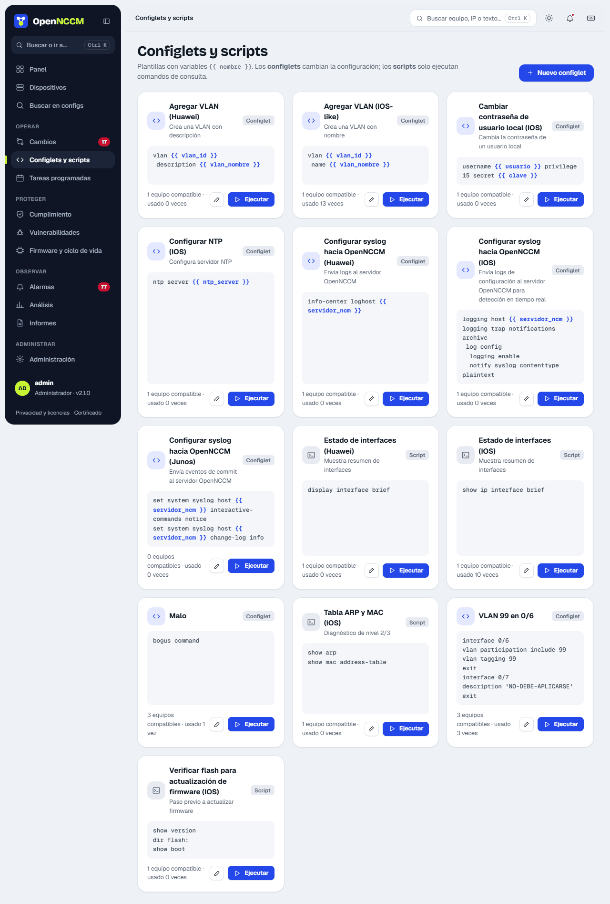
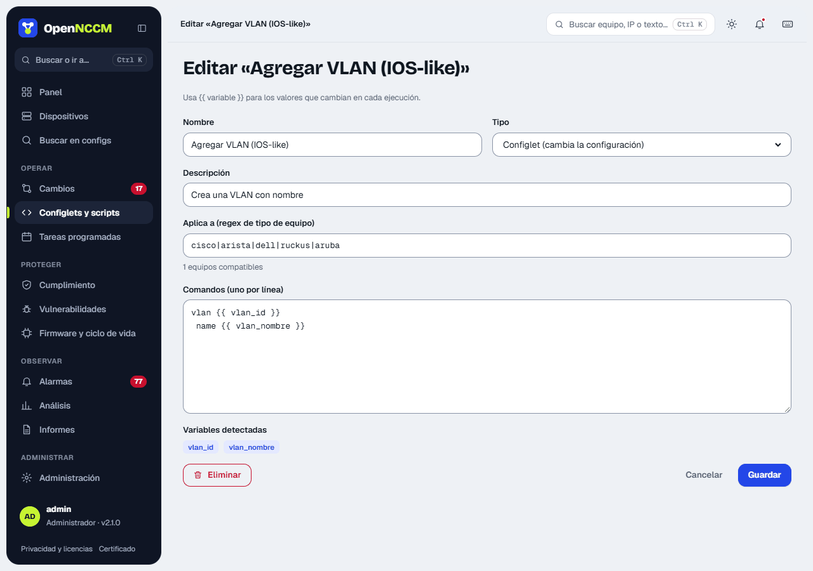
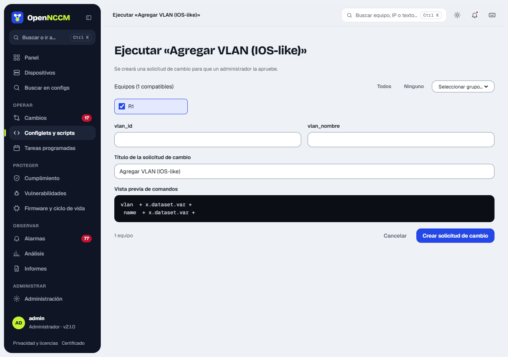
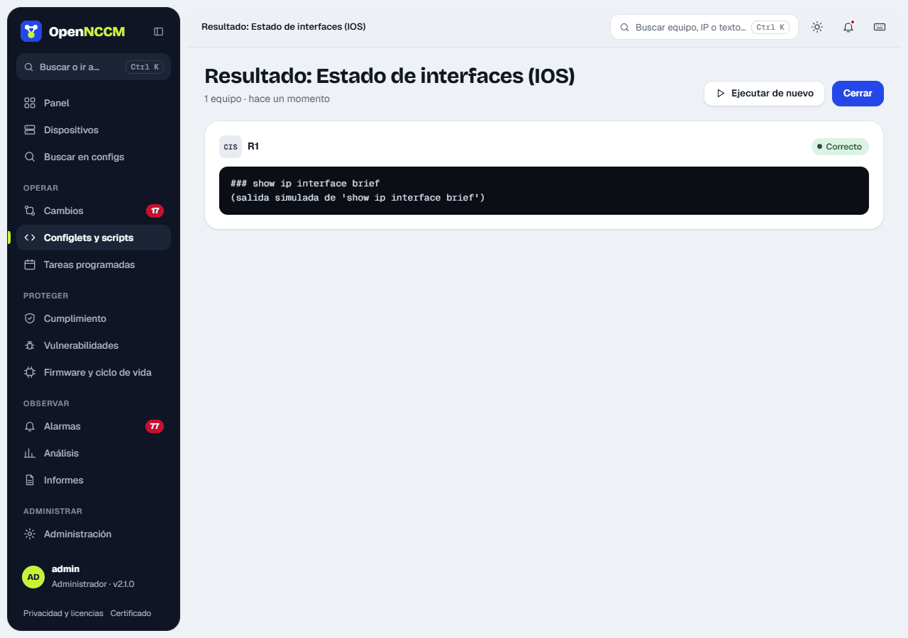

| Tipo | Qué hace | Aprobación |
| --- | --- | --- |
| **config** | Entra en modo configuración, aplica los comandos y guarda la configuración (o hace *commit* en Junos, IOS-XR, PAN-OS, VyOS…). | Sí: crea una solicitud de cambio. |
| **exec** | Ejecuta comandos de consulta (`show`, `display`…) y muestra la salida de cada equipo. | No: es inmediato. |

La página tiene tres columnas, como las [Recetas](/consola/consola/). A la izquierda, **Para tus equipos** (lo que se abre: solo lo que puede ejecutar) y las plataformas de su inventario; las que no tienen configlets van al final y, al elegirlas, ofrecen **Nuevo configlet para…** y **Ver sus recetas**. Debajo, en **No aplican a tus equipos**, las plataformas que no están en su inventario, con la nota «No hay en tu inventario equipos donde ejecutarlos»; se ven igual que en Recetas, sin atenuar. En el medio, los **configlets** (cambian la configuración) y los **scripts** (solo consulta), cada uno con su plataforma en palabras y cuántos equipos suyos lo pueden ejecutar; los que no aplican a sus equipos quedan plegados al final. A la derecha, el elegido: **Sirve para**, **Sello**, **Usado**, el aviso con el [foro](https://comunidad.opennccm.com/foro) y GitHub, los comandos con las variables resaltadas y **Ejecutar**, **Editar** y **Duplicar**. El buscador mira el nombre y los comandos.

:::caution[Revise los configlets antes de usarlos en producción]
Como las recetas, un configlet probado completo en un equipo lleva el sello **Verificada** con la versión del sistema; solo un administrador lo pone o lo quita, y queda en Auditoría. Los de ejemplo salen «Sin verificar». Desde la 2.34 se incluyen diez configlets y scripts para cada una de estas plataformas: MikroTik RouterOS, Extreme EXOS, Extreme VOSS / Fabric Engine, Ubiquiti EdgeSwitch y WatchGuard Fireware. Llegan una sola vez, y si borra uno no vuelve.
:::



## Variables

Los comandos son plantillas Jinja2. Puede usar datos del equipo y variables propias que se piden al ejecutar:

```bash
vlan {{ vlan_id }}
 name {{ vlan_nombre }}

spanning-tree vlan {{ vlan_id }} priority 4096

! aplicado en {{ device.name }} ({{ device.host }})
```

Variables del equipo: `device.name`, `device.host`, `device.model`, `device.os_version`, `device.serial`, `device.location`, `device.device_type`, `device.group`.



## Ejecutar

1.  Pulse **Ejecutar** en la tarjeta del configlet: se abre un panel lateral.
2.  Complete las variables detectadas: hay un campo por cada una, y la **vista previa de comandos** muestra los comandos con sus valores al escribir. Una variable sin valor se ve en ámbar y no se puede enviar.
3.  Elija los equipos compatibles (todos vienen marcados, con su versión del sistema): uno a uno, todos, ninguno o un grupo.
4.  Para **config**: marque «Revisé los comandos y entiendo que OpenNCCM no los probó en todas las plataformas…» (si el configlet está verificado y un equipo tiene otra versión, se avisa), pulse **Crear solicitud de cambio** y espere la aprobación. Para **exec**: verá la salida al instante.




