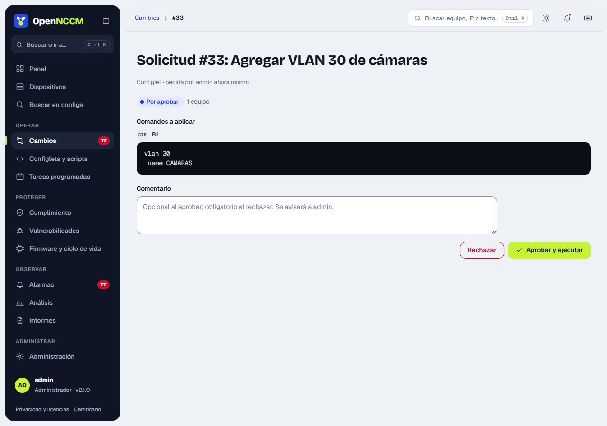
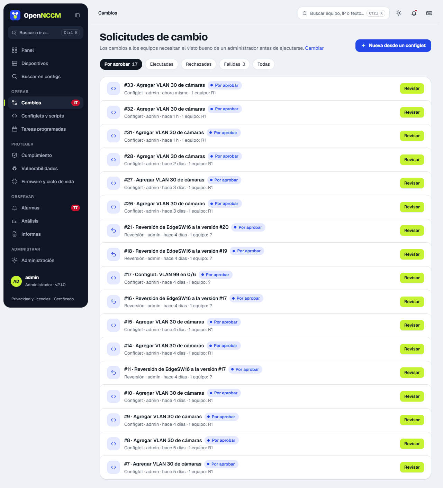

**Para qué sirven:** garantizar que ningún cambio llegue a la red sin revisión, y dejar constancia de quién lo pidió, quién lo aprobó, qué se aplicó y con qué resultado.

## Cómo usarlo

1.  Las solicitudes se crean desde configlets, correcciones de cumplimiento, reversiones y actualizaciones de firmware.
2.  El administrador abre la solicitud (menú **Cambios**, que se abre en «Por aprobar» si hay pendientes), revisa en el panel lateral la **vista previa de los comandos por equipo** y pulsa **Aprobar y ejecutar** o **Rechazar**. El comentario es opcional al aprobar y obligatorio al rechazar, para que quien la pidió sepa qué cambiar.
3.  Al ejecutarse, la sección **Resultado** muestra la salida de cada equipo. Los comandos se envían **de uno en uno**: si el equipo rechaza uno, OpenNCCM se detiene ahí, **no guarda** la configuración (ni hace commit; en Junos, IOS-XR, VyOS y similares descarta los cambios pendientes), indica qué comando falló y cuáles ya se aplicaron, y respalda el equipo para registrar su estado real. La solicitud queda como fallida para ese equipo.

:::note[Mensajes de error que se reconocen]
«% Invalid input» y similares (Cisco, Arista, Dell, Allied, Extreme), «% Unrecognized command» (HP Comware, Mellanox, A10), «Error:» (Huawei), «syntax error» y «unknown command» (Juniper), «bad command name», «expected end of command» y «failure:» (MikroTik), «Command fail» y «Unknown action» (FortiGate), «Invalid syntax» (Palo Alto), «MINOR:/MAJOR:» (Nokia), «!!%» (IOS-XR), «Set failed» (VyOS), «CLINFR» (Check Point) y «Failed to…» (EdgeSwitch, Netgear, Dell N-series). Si un comando pide confirmación («\[confirm\]», «(y/n)»), OpenNCCM no la responde: se detiene y lo informa.
:::

:::note[Opciones en Ajustes]
«Exigir aprobación» (activado por defecto) y «Permitir que un administrador apruebe sus propias solicitudes» (activado por defecto desde la versión 1.4.0; desactívelo si quiere que siempre revise otro administrador). Las actualizaciones de firmware siempre requieren aprobación.
:::
