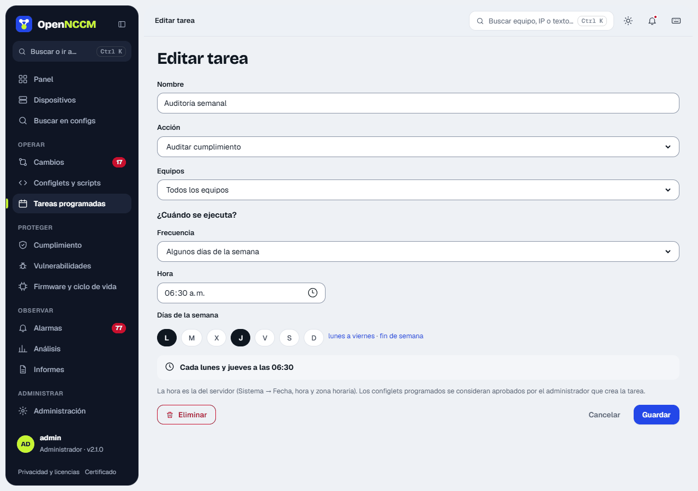
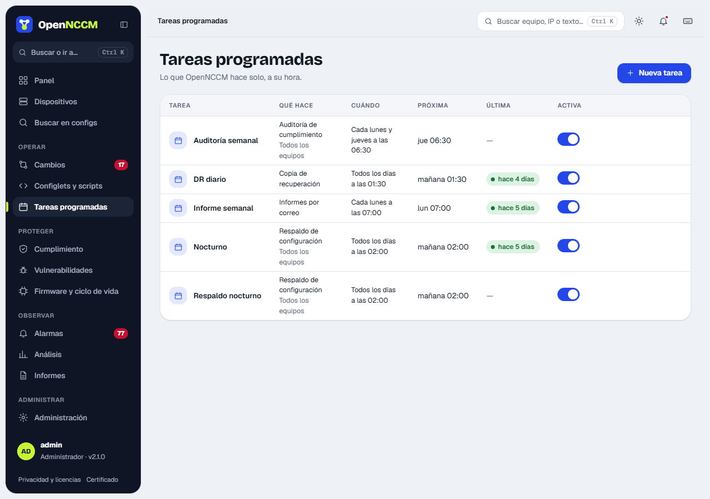

**Para qué sirven:** automatizar operaciones periódicas, para todos los equipos o para un grupo.

| Acción | Qué hace |
| --- | --- |
| Respaldo de configuración | Respalda los equipos habilitados (en paralelo). |
| Auditoría de cumplimiento | Re-evalúa todas las políticas. |
| Escaneo de vulnerabilidades | Consulta NVD para cada equipo. |
| Ejecutar configlet | Aplica un configlet (se considera aprobado por el administrador que crea la tarea). |
| Enviar informes por correo | Envía inventario, cambios, cumplimiento, conflictos, línea base y EOL en CSV. |
| Copia de recuperación | Crea una copia de la base de OpenNCCM (y la envía por SFTP si está configurado). |

**¿Cuándo se ejecuta?** Elija la frecuencia y complete solo lo que pide; debajo se muestra en palabras, por ejemplo «Se ejecutará: Cada lunes y jueves a las 02:30».

| Frecuencia | Qué se elige |
| --- | --- |
| Todos los días | La hora. |
| Algunos días de la semana | Los días (atajos «lunes a viernes» y «fin de semana») y la hora. |
| Una vez al mes | El día del mes (1 a 28) y la hora. |
| Cada hora | El minuto. |
| Cada pocos minutos | 5, 10, 15, 20 o 30 minutos. |
| Avanzado (expresión cron) | Para casos especiales: `minuto hora día mes día-semana`; 0 o 7 es domingo y 1 es lunes. |

La hora es la del servidor (Sistema → Fecha, hora y zona horaria). La tabla muestra cada tarea en palabras, su próxima ejecución («hoy 06:00», «lun 07:00»…) y un interruptor para pausarla o reanudarla. **Nueva tarea** y el lápiz de cada fila abren el asistente en un panel lateral; **Ejecutar ya** la lanza al momento y **Eliminar** está dentro del panel de edición.

