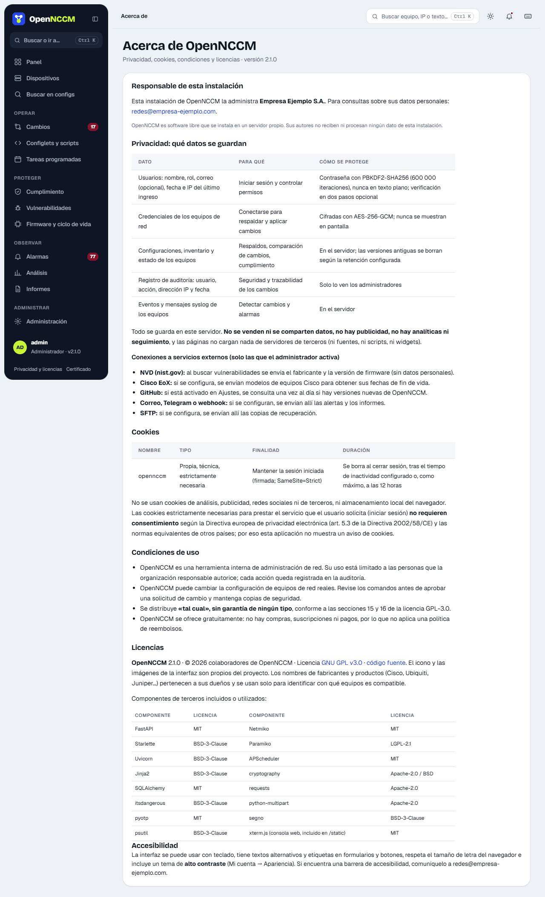

Settings are in **Administration → Settings**, split into sections chosen on the left: Security and access, Organization, Change workflow, Notifications, End of life (Cisco EoX), Vulnerabilities (NVD), Network map, Git copy, Disaster recovery and Updates. When you change any field, the **You have unsaved changes** bar appears at the bottom with **Discard** and **Save settings**; if you try to leave the page without saving, the browser warns you.

## Security and access

| Setting | What it does |
| --- | --- |
| Sign out after N minutes of inactivity | 5 to 720 minutes (30 by default). |
| "Remember me" keeps the session open for N days | 1 to 30 days (14 by default); 0 removes the checkbox from the sign-in screen. Remembered sessions do not close for inactivity. |
| Require two-step verification for administrators | An administrator without it can only reach "My account" until they turn it on. |
| Default language | Spanish or English for anyone who has not chosen a language and whose browser does not ask for an available one. |
| Web SSH console | Who can open it and whether it signs in with the device's credential (see [Console](/en/consola/consola/)). |

## Sign-in with Active Directory and Microsoft Entra ID

In **Settings → Sign-in** you can let people sign in with their organization account. OpenNCCM local accounts always keep working (for example, the account of the administrator who installed it).

| Directory | How users sign in | What to configure |
| --- | --- | --- |
| **Active Directory** (LDAP) | With the same form: user (or user@domain) and their network password. | Server (`ldaps://dc01.company.local`, or `ldap://` with StartTLS), search base, a service account with read permission, the user filter and the groups for each role. **Test connection** checks the service account and, if you type a test user, which role they would get. |
| **Microsoft Entra ID** (Azure AD) | **Sign in with Microsoft** button on the sign-in screen (single sign-on with Microsoft 365). | Register an application in **Entra ID → App registrations** with the **redirect URI** shown on the page, and copy the directory (tenant) ID, the application ID and a client secret. To assign roles, add the **groups** claim in **Token configuration** (or use app roles) and enter each group's Object ID. |

-   **Roles:** each role (administrator, operator, viewer) is mapped to one or more groups (separated with ";"); if someone is in several, they get the highest role. Nested groups are supported in Active Directory. Anyone not in any group cannot sign in, unless a **default role** is chosen.
-   **Accounts:** the account is created in OpenNCCM on first sign-in and its role is updated on every sign-in. **Users** marks its origin (AD or Microsoft); its password is not stored in OpenNCCM and is changed in the directory. Administrators can deactivate it or restrict it to device groups like any other. A local account with the same name is never taken over from the directory.
-   **Security:** Microsoft sign-in uses the authorization code flow with PKCE, *state* and *nonce*, and validates the token's signature, issuer, audience and expiry. OpenNCCM's two-step verification, lockouts after failed attempts and the audit log also apply to these accounts. The service account password and the client secret are stored encrypted.
-   **Other providers:** in **Advanced options**, the discovery URL lets you use any OpenID Connect provider (Google Workspace, Keycloak, Okta…), with the button text you want.

## Organization details

Name, contact email and address of whoever runs this installation. They are shown on the **Privacy, cookies and licenses** page (link at the bottom of every page and on the sign-in screen), which explains what data OpenNCCM keeps, its external connections, the only cookie it uses (technical, no consent needed), the terms of use and the licenses.

| Section | Options |
| --- | --- |
| Change workflow | Requires approval or direct execution · self-approval · report violations · versions to keep |
| Notifications | Minimum severity · SMTP · recipients · webhook · Telegram · test notification |
| End of life (Cisco EoX) | Client ID and Secret for lifecycle dates |
| Disaster recovery | Backups to keep · remote SFTP server (server, port, user, password, folder) |
| Updates | Check for new versions every day and notify administrators |

SMTP, Cisco API and SFTP passwords are stored encrypted and not shown: the form says "(saved)".
