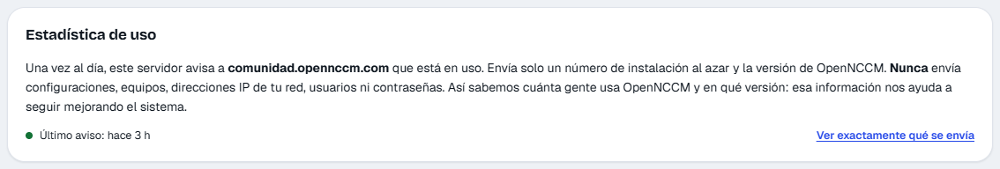
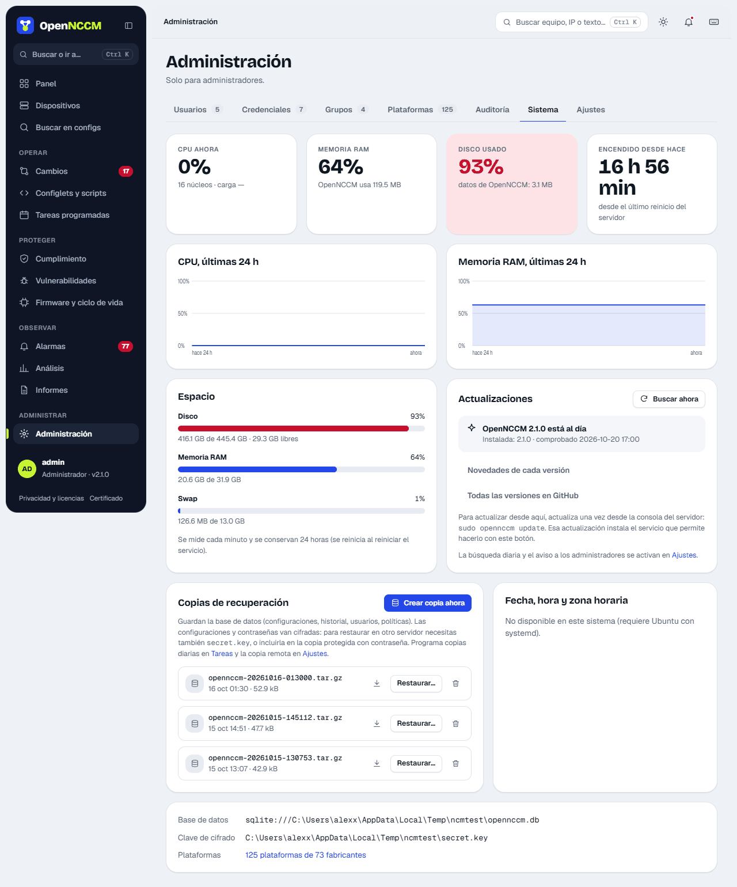
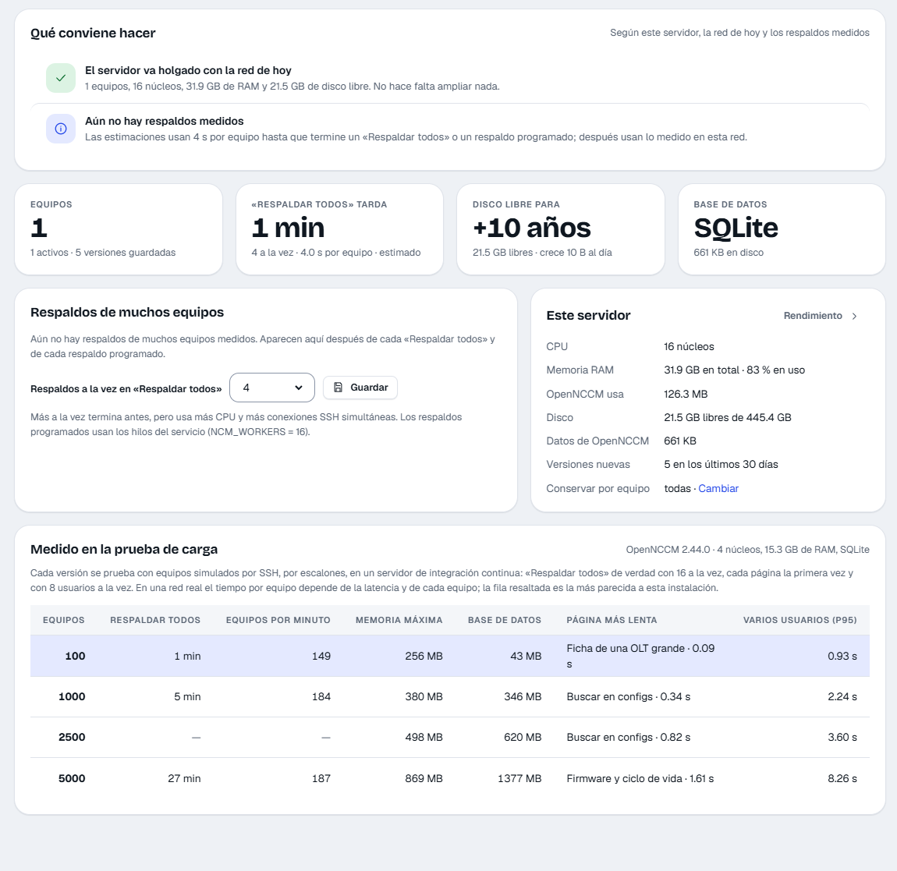

## Updates

The **Updates** card shows the installed version and the latest published one. **Check now** queries GitHub; OpenNCCM also does it once a day (can be turned off in Settings) and, if there is a new version, shows administrators a notice with what is new (**See and update** or **Later**, which does not repeat it in that session).

**What's new in each version** opens a window with what each version added or fixed (the installed one is marked) and, if there is a new one, what it brings before upgrading. **All versions on GitHub** opens the project's releases page.

**Update now** (asks for confirmation) does the same as `sudo opennccm update` on the console: a prior backup of the code and database, installation, verification and automatic return to the previous version if the new one does not start. A page shows the progress; OpenNCCM stops for 1-2 minutes. For security the application has no system administrator permissions: it only leaves a request handled by a systemd service (`opennccm-webupdate`) installed since 1.6.0.

## Recovery backups with the key

If you tick "Include the encryption key", the whole file is encrypted (AES-256-GCM) with a password of at least 12 characters that you choose, and ends in `.enc`. Without that password it cannot be restored: keep it separately. When restoring with `sudo opennccm restore FILE.enc` you are asked for it.

The **System** tab also shows the server's performance, **disk space**, the **server date and time**, the database and key in use, and the **recovery backups**: **Create backup now** (with or without the encryption key), download, delete and **Restore…** (explains the console command that restores it). 4 are shown at a time; the rest with the scroll bar on the edge.

## Usage statistics

Once a day, at a random time, OpenNCCM tells comunidad.opennccm.com that it is in use. It sends only this:

```json
{ "instalacion": "u_…", "version": "2.45.4" }
```

-   `instalacion` is a random number used only for the statistics, different from the license ID. It is generated once and stored in the database.
-   Configurations, devices, addresses of your network, users and names are never sent. The website does not store the IP the notice comes from.
-   It is on by default and cannot be turned off. That information helps us keep improving the system.
-   If the server has no internet access, nothing happens: no error is shown, it does not affect how OpenNCCM works and it tries again the next day.

The **Usage statistics** card in the **System** tab shows the **Last notice** and **See exactly what is sent**, with the real text.



## License and Pro modules

**Administration › License and modules** activates the optional paid modules. See [License and modules](/en/pro/licencia/).

## Date, time and time zone

-   **Time zone:** choose it from the list (grouped by region) and click **Change zone**. OpenNCCM restarts for a few seconds so the history and scheduled tasks use the new time.
-   **Synchronize with NTP:** a switch that keeps the time accurate automatically (recommended).
-   **Set date and time by hand:** turning NTP off shows the date and time fields and the **Set** button.

The service has no administrator privileges: through a polkit rule, the installer grants it permission **only** for these three actions. Every change is recorded in the Audit log.



## Git copy

With **Push each new version to Git**, every backup with changes is pushed as a commit to a Git repository (GitHub, GitLab, Gitea…), with a message such as "R1: +3/-1 lines \[scheduled\]". Each device is a file `<group>/<device>.cfg` with its latest configuration. The repository is given over HTTPS with a user and **token** (stored encrypted and never written in the URL or to disk) or over SSH with the service user's key. **Mask passwords and keys** (on by default) replaces the secrets, passwords, SNMP communities and keys it recognizes with `<oculto>`; even so, use a private repository. **Test and push everything now** exports every device at once. If the push fails, a "Git copy failed" alarm is recorded and the backup is not affected.

## Capacity

The **Capacity** tab (Administration) says how much this server can handle with today's network and what is worth expanding:

-   **What to do:** specific recommendations, from most to least urgent. For example, that the scheduled backup does not finish before the next one, that "Back up all" takes too long (with a button to run more backups at once), that the disk will fill up in N days at the current pace, that PostgreSQL is advisable for the number of devices, or that memory or CPU is short. If all is well, it says so.
-   **Indicators:** devices and stored versions, how long "Back up all" takes, how many days the disk will last, and the database with its size.
-   **Backups of many devices:** the latest "Back up all" runs and scheduled backups, with their duration, time per device and failures. Estimates use what was measured on this network. This is where you choose how many backups "Back up all" runs at once (1 to 16; 4 by default).
-   **This server:** cores, RAM, disk, the space OpenNCCM uses and how many new versions there were in 30 days.
-   **Measured in the load test:** each OpenNCCM version is tested on GitHub with devices simulated over SSH, from 100 to 5,000, with a real "Back up all", every page and several users at once. The table shows what was measured; the highlighted row is the closest to this installation.



## Support OpenNCCM

OpenNCCM is free and open-source software. Every user sees the **Professional support** and **Support OpenNCCM** buttons in the top bar (they cannot be hidden), and the System and About pages show a card with the ways to donate (GitHub Sponsors and Ko-fi). After upgrading to a new version, the first administrator who signs in sees a notice once with **Donate** and **Not now**. The links only open if clicked, in a new tab, and no server data is sent.

The full procedure for backing up, restoring on another server, upgrading and rolling back is in [Backups and moving servers](/en/instalacion/migrar/) and [Upgrade and roll back](/en/instalacion/actualizar/).
