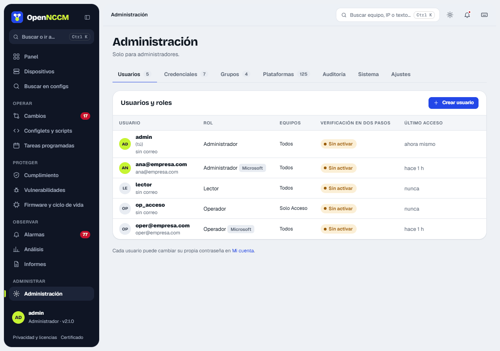
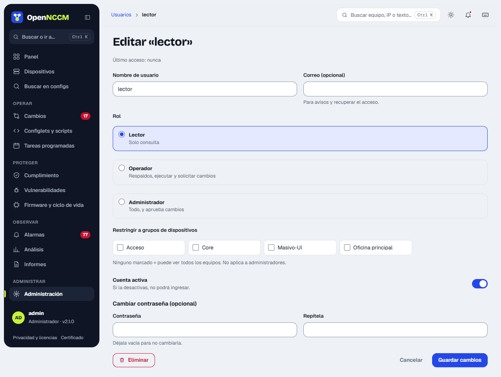
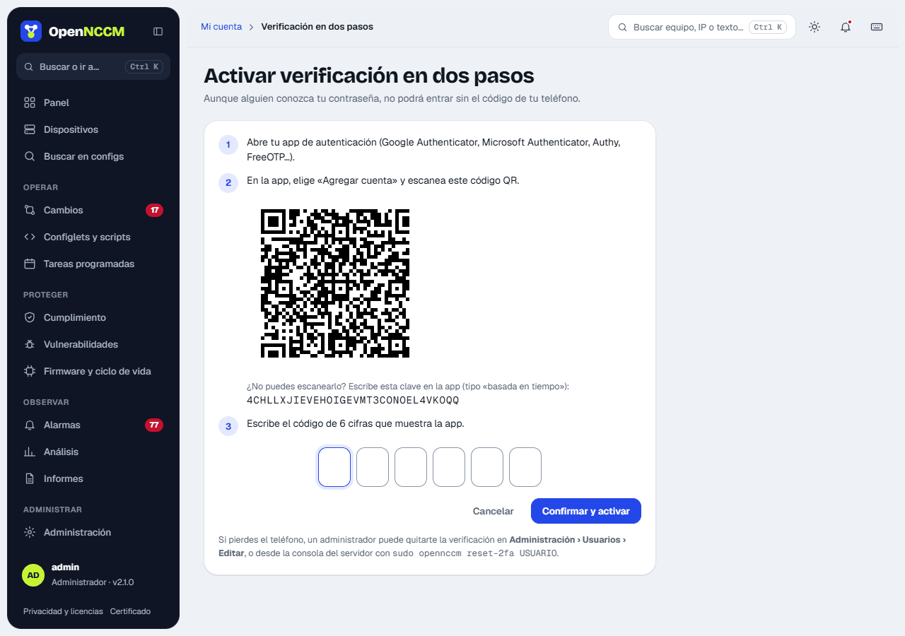
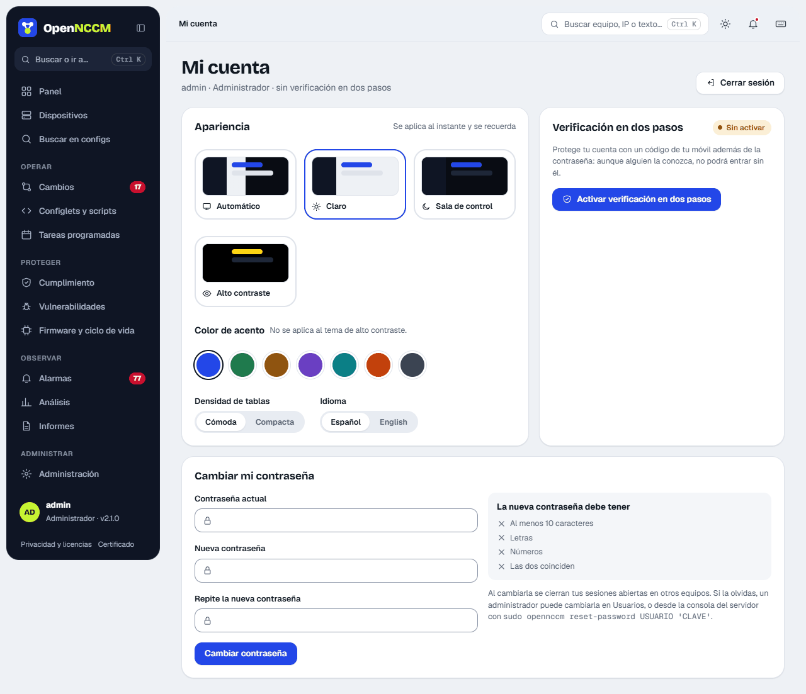
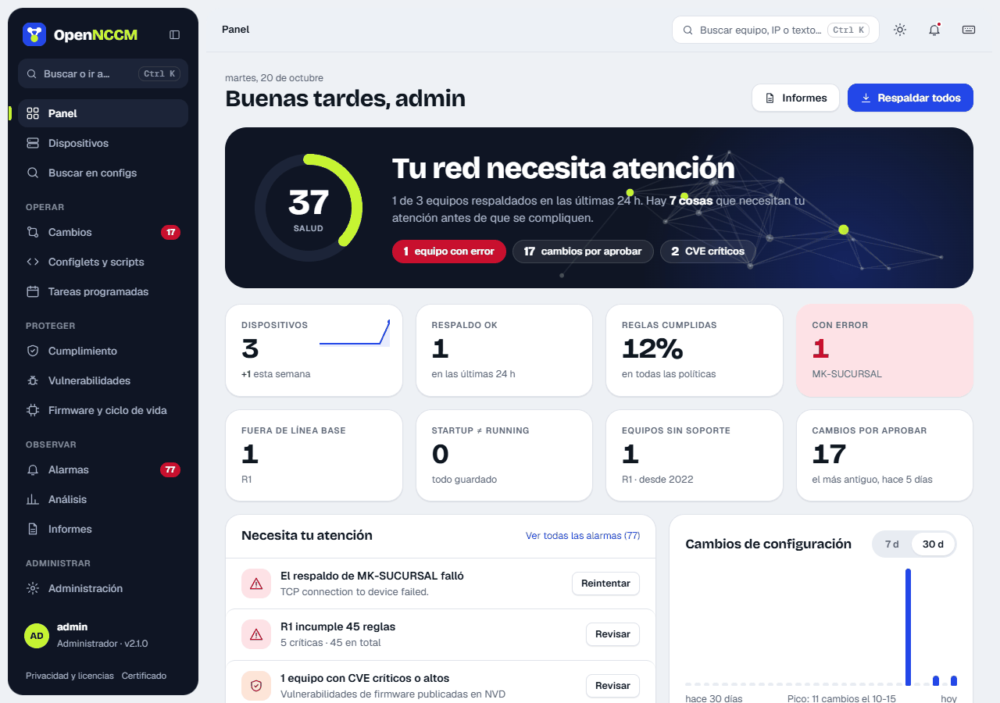
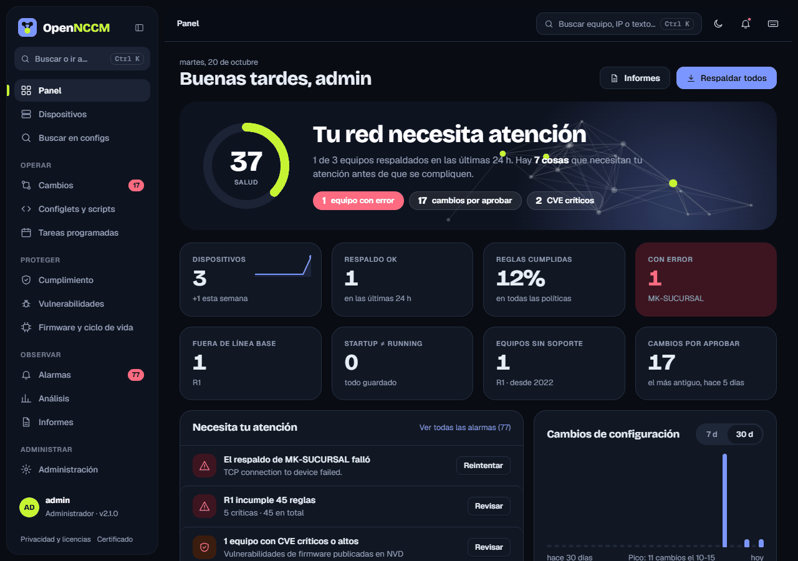
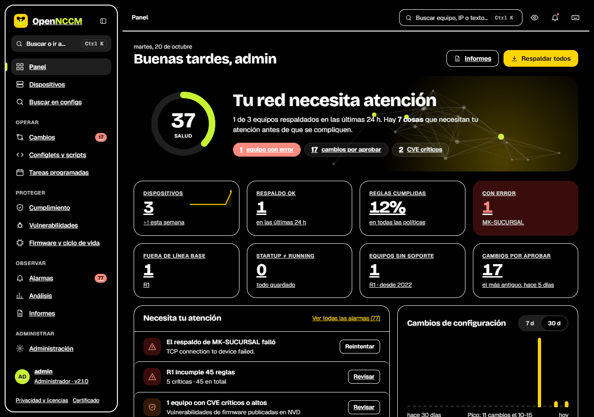
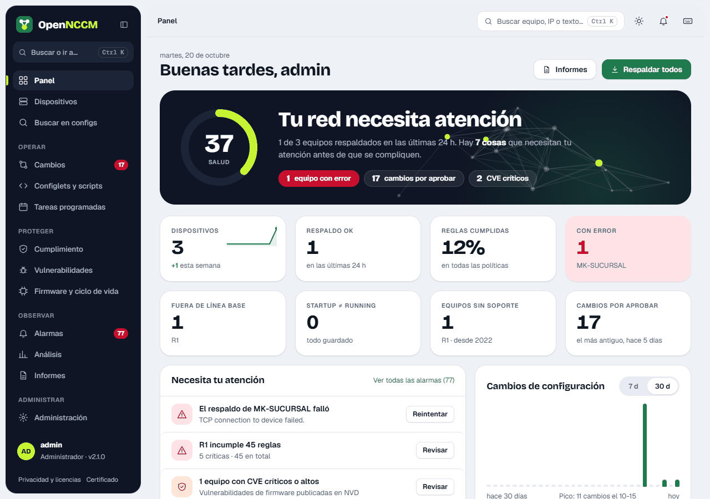
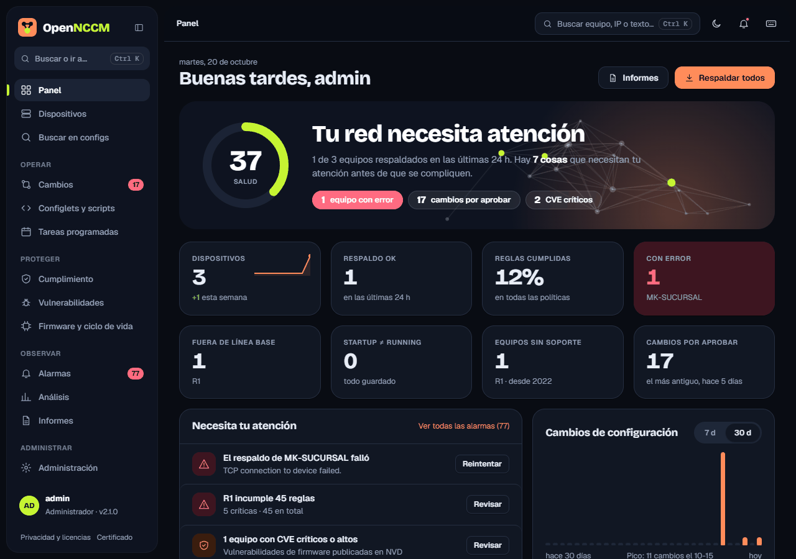

Every user has a role. In addition, operators and viewers can be restricted to one or more **device groups**: they only see and act on those devices.

| Action | viewer | operator | admin |
| --- | --- | --- | --- |
| View dashboard, devices, versions, diffs, search, alarms, reports, analytics | ✓ | ✓ | ✓ |
| Back up, run compliance audits, look up CVEs, acknowledge alarms |  | ✓ | ✓ |
| Run diagnostic configlets (exec) |  | ✓ | ✓ |
| Request changes, rollbacks, fixes and firmware upgrades |  | ✓ | ✓ |
| Tag versions and mark the baseline; run existing tasks |  | ✓ | ✓ |
| Approve or reject change requests |  |  | ✓ |
| Add/remove devices, credentials, groups, configlets, policies, tasks |  |  | ✓ |
| Users, audit log, settings, system, firmware images, EOL database |  |  | ✓ |

:::note[Group restrictions]
An administrator always sees everything. A user with no groups assigned also sees everything. If groups are assigned, the restriction applies on every page, in search, reports, the API and actions (an attempt on someone else's device answers "403 — You do not have permission").
:::

## Permissions of each user

Since 2.39, the role is a **template**: choosing it ticks its functions in the **Permissions** list, and you can then remove or add any you like (for example, a viewer who can also back up, or an operator who does not send configurations). Every page and every button follows the function, not the role. Upgrading changes nothing: each user keeps their role's functions.

Functions are grouped in sections:

-   **Operations:** back up, audit, tag versions, acknowledge alarms.
-   **Changes to devices:** send configurations, go back to a version, restore, console, firmware, approve.
-   **Administration:** devices, credentials, configlets and policies, tasks, firmware images, knowledge base, users, settings.

Every user can view devices, configurations and reports. If the list matches the role's, it says "the role's"; otherwise, "custom". **Critical** functions (those that change devices or grant access: send configurations, roll back, restore, console with changes, firmware, approve, credentials, users and settings) can only be granted or removed by the master administrator.

## Master administrator

-   It is the installation's first administrator (on upgrade, the oldest active administrator). In the list it carries the **Master** tag.
-   It has every function, and nobody can delete, lock or edit it or remove its two-step verification.
-   It is the only one who creates administrators, grants or removes the administrator role and the critical functions. Other administrators with the "users" function manage everyone else.
-   It can hand the role to another user with **Make master administrator** when editing them; it then becomes a regular administrator.
-   In the user list, the **Send configurations** column has a switch to instantly allow or cut off sending configurations to devices (requests, recipes, configlets, multi-device and fixes).
-   If the master's access is lost, on the server: `sudo opennccm set-master USER`.

## Create a user (administrators)

1.  **Administration → Users → Create user** (a side panel opens).
2.  Type the name (letters, numbers, dot, hyphen or @; no spaces), choose the role from its cards (Viewer, Operator or Administrator) and type the password twice (at least 10 characters, with letters and numbers, not containing the user name). Email is optional.
3.  To limit them to certain devices, tick their groups. With no groups ticked they will see every device.
4.  Click **Create user**. The message confirms the name and role; they can sign in now.

Two users with the same name are not allowed (case-insensitive). Creating a user **never** modifies another one.

## Edit a user

Click the row or **Edit** to change the role, email, groups, whether the **account is active** or the password (leave the password empty to keep it). When you save, the message says exactly what changed (for example "password changed, role viewer"). Deactivating the account prevents sign-in without deleting the user or their history. **Delete** is in the same panel.

:::note[Safeguards]
An administrator cannot remove their own role, lock themselves out or delete themselves, and there must always be at least one active administrator. If access is lost, on the server console: `sudo opennccm users` lists the users and `sudo opennccm reset-password USER 'PASSWORD'` sets a password (and makes them an administrator).
:::

## Two-step verification

With two-step verification, signing in requires, in addition to the password, a 6-digit code that changes every 30 seconds on the phone. Even if someone knows the password, they cannot get in without the phone.

1.  Install an authenticator app on the phone (Google Authenticator, Microsoft Authenticator, Authy, FreeOTP…).
2.  In OpenNCCM: **My account → Two-step verification → Turn on**.
3.  In the app, "Add account" and scan the QR code (or type the key shown below it).
4.  Type the 6-digit code shown by the app in the six boxes (you can paste it) and click **Confirm and turn on**.

From then on, the code is asked for after the password. The same code cannot be used twice. To turn it off, the password and a code are required (**My account → Turn off…**). If someone loses their phone, an administrator removes it in **Users → Edit → Remove it (lost their phone)**, or on the server console: `sudo opennccm reset-2fa USER`. In **Settings** it can be required for all administrators (to turn this on, the administrator doing it must already have it).

## Lockouts and sessions

-   After **5 wrong passwords in a row**, the account is locked for 15 minutes (even if the right one is typed afterwards) and the "Account locked" alarm is raised. An administrator unlocks it by setting a new password. In addition, 10 failed attempts from the same IP address block that address for 15 minutes.
-   The session closes by itself after the idle time set in Settings (30 minutes by default) and, at most, after 12 hours.
-   Changing the password (yourself or an administrator) closes that user's open sessions on other computers.

## My account: change my password

Any user can change their own password in **My account → Change my password** (also from Ctrl K): type the current one and the new one twice. On the right, the list **The new password must have** marks in green each requirement met (10 characters, letters, numbers and both matching). Upper and lower case matter.

## Language

The interface is in **Spanish** and **English**. Each user chooses theirs in **My account → Language** or on the sign-in screen (selector below the form); the choice is saved on their user and applies on any computer they sign in from. If a user has not chosen, the browser's language is used and, if it is not available, the **default language** set by the administrator in **Settings → Security and access → Language**.

Menus, pages, notices, charts and the SSH console are translated. Data stays in the language it was created in: names of policies and rules, events already recorded, CVE descriptions, the audit log and the PDF documents. CSV reports keep their headers in Spanish so as not to break integrations.

## Themes

In **My account → Appearance** (or the theme button in the top bar) each user chooses, and it applies instantly: **Automatic** (light or dark following the computer's system), **Light**, **Control room** (dark) or **High contrast** (for screens with a lot of glare or for low vision), and an **accent color** for buttons and links: cobalt, forest, sand, lavender, ocean, sunset or graphite. All meet the WCAG 2.1 AA minimum reading contrast. The choice is saved on the user and applies on any computer they sign in from; anyone who used one of the old color themes keeps their color as the accent. **Table density** (comfortable or compact) adjusts the row height; "Compact" also shortens the Devices table and the Changes and Alarms lists. A preview shows the change instantly.

**Pagination**: the Compliance, Vulnerabilities, Alarms, Users, Credentials, Groups and Audit log lists show 15 items per page, with the option to show 25, 50 or 100 below the list. The choice lasts while you stay on the page: when you come back it is 15 again.

**Remember me on this computer**: the checkbox on the sign-in screen remembers the user in that browser and keeps the session open for the number of days an administrator sets in Settings (14 by default), without closing it for inactivity. It also asks the browser's password manager to save the password; OpenNCCM does not store it. Browsers only save it if they trust the server's certificate: if they show "Not secure", install the certificate with the link on the sign-in screen. Do not tick it on shared computers. Changing the password also closes remembered sessions.

