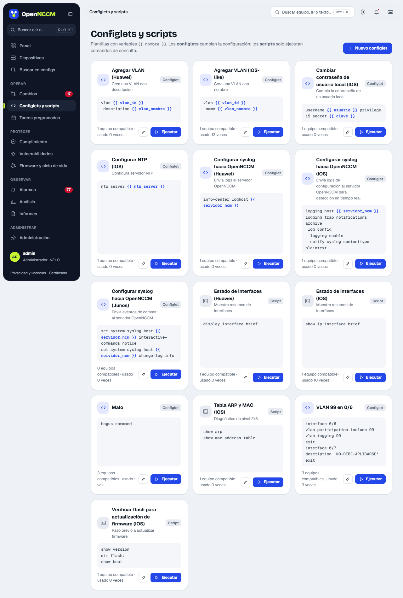
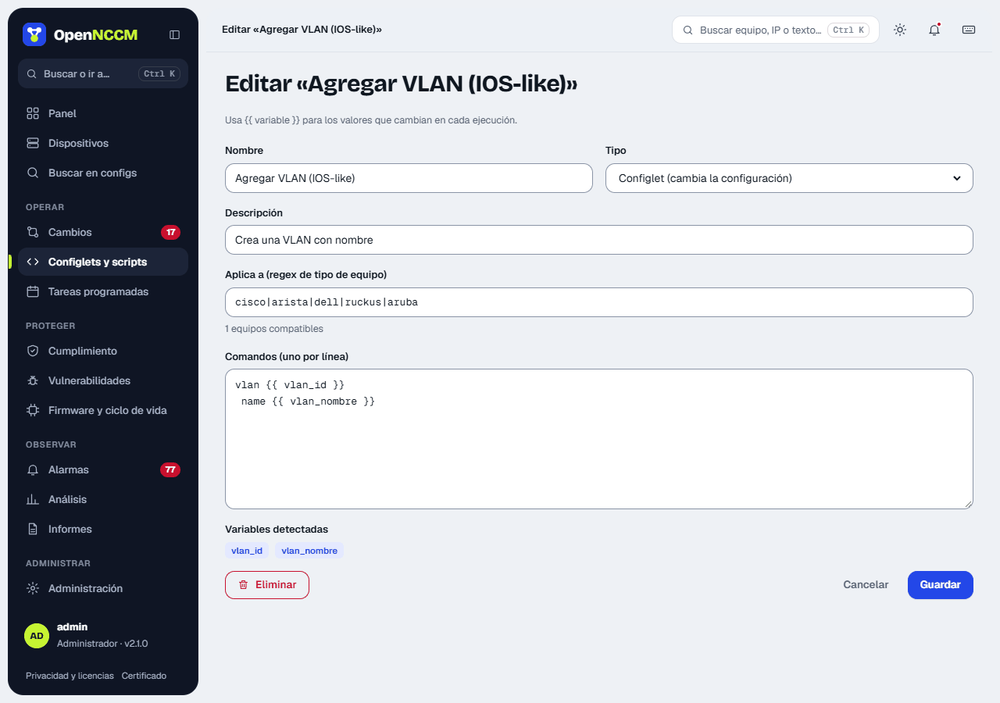
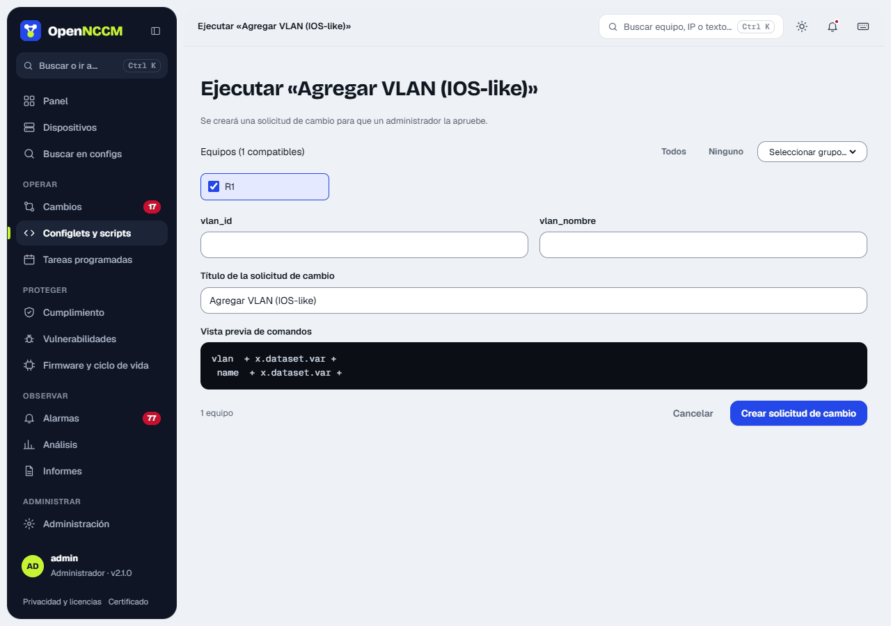
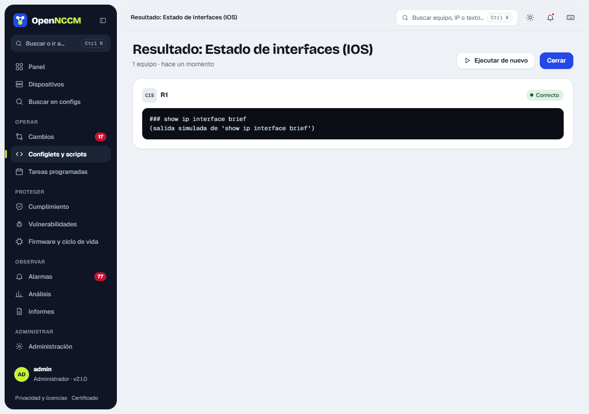

| Type | What it does | Approval |
| --- | --- | --- |
| **config** | Enters configuration mode, applies the commands and saves the configuration (or *commits* on Junos, IOS-XR, PAN-OS, VyOS…). | Yes: it creates a change request. |
| **exec** | Runs query commands (`show`, `display`…) and shows each device's output. | No: it is immediate. |

The page has three columns, like [Recipes](/en/consola/consola/). On the left, **For your devices** (what opens: only what you can run) and the platforms in your inventory; those without configlets go at the end and, when chosen, offer **New configlet for…** and **See its recipes**. Below, under **Not for your devices**, the platforms that are not in your inventory, with the note "There are no devices in your inventory to run them on."; they look the same as in Recipes, not dimmed. In the middle, the **configlets** (they change the configuration) and the **scripts** (queries only), each with its platform in words and how many of your devices can run it; those that do not apply to your devices are folded at the end. On the right, the chosen one: **Used for**, **Badge**, **Used**, the notice with the [forum](https://comunidad.opennccm.com/foro) and GitHub, the commands with the variables highlighted and **Run**, **Edit** and **Duplicate**. The search looks at the name and the commands.

:::caution[Review configlets before using them in production]
Like recipes, a configlet tested end to end on a device carries the **Verified** badge with the system version; only an administrator adds or removes it, and it is logged in Audit. The examples come out as "Not verified". Since 2.34, ten configlets and scripts are included for each of these platforms: MikroTik RouterOS, Extreme EXOS, Extreme VOSS / Fabric Engine, Ubiquiti EdgeSwitch and WatchGuard Fireware, and since 2.35 also for ArubaOS (controllers and S2500/S3500 switches). They arrive only once, and if you delete one it does not come back.
:::



## Variables

Commands are Jinja2 templates. You can use device data and your own variables, which are asked for when it runs:

```bash
vlan {{ vlan_id }}
 name {{ vlan_name }}

spanning-tree vlan {{ vlan_id }} priority 4096

! applied on {{ device.name }} ({{ device.host }})
```

Device variables: `device.name`, `device.host`, `device.model`, `device.os_version`, `device.serial`, `device.location`, `device.device_type`, `device.group`.



## Run

1.  Click **Run** on the configlet's card: a side panel opens.
2.  Fill in the detected variables: there is one field for each, and the **command preview** shows the commands with their values as you type. A variable without a value shows in amber and cannot be sent.
3.  Choose the compatible devices (all come ticked, with their system version): one by one, all, none or a group.
4.  For **config**: tick "I reviewed the commands and understand that OpenNCCM did not test them on every platform…" (if the configlet is verified and a device runs another version, you are warned), click **Create change request** and wait for approval. For **exec**: you see the output right away.




