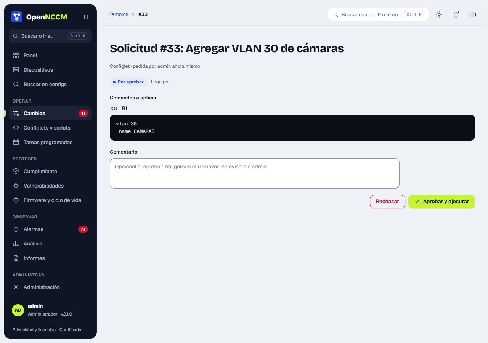
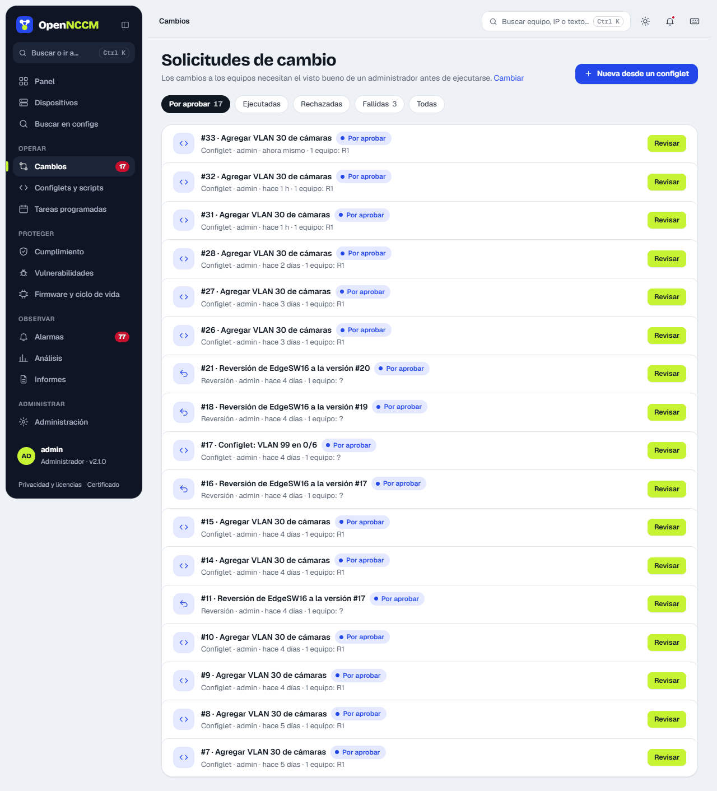

## How to use it

1.  Requests are created from configlets, compliance fixes, rollbacks and firmware upgrades.
2.  The administrator opens the request (**Changes** menu, which opens on "To approve" if any are pending), reviews the **per-device command preview** in the side panel and clicks **Approve and run** or **Reject**. The comment is optional when approving and required when rejecting, so whoever asked knows what to change.
3.  When it runs, the **Result** section shows each device's output. Commands are sent **one at a time**: if the device rejects one, OpenNCCM stops there, **does not save** the configuration (nor commit; on Junos, IOS-XR, VyOS and similar it discards the pending changes), says which command failed and which had already been applied, and backs up the device to record its real state. The request is marked as failed for that device.

:::note[Error messages that are recognized]
"% Invalid input" and similar (Cisco, Arista, Dell, Allied, Extreme), "% Unrecognized command" (HP Comware, Mellanox, A10), "Error:" (Huawei), "syntax error" and "unknown command" (Juniper), "bad command name", "expected end of command" and "failure:" (MikroTik), "Command fail" and "Unknown action" (FortiGate), "Invalid syntax" (Palo Alto), "MINOR:/MAJOR:" (Nokia), "!!%" (IOS-XR), "Set failed" (VyOS), "CLINFR" (Check Point) and "Failed to…" (EdgeSwitch, Netgear, Dell N-series). If a command asks for confirmation ("\[confirm\]", "(y/n)"), OpenNCCM does not answer it: it stops and reports it.
:::

## Impact analysis: "What goes down if I touch this device?"

When a request reboots devices (commands such as `reload`, `reboot`, `/system reboot` or a firmware upgrade with "Reboot when done") or shuts ports, OpenNCCM uses the [network map](/en/observar/analisis/#network-map) (LLDP/CDP neighbors from the latest backup) to work out what loses service while the outage lasts, and shows it in the request:

-   A **High / medium / no impact** card with a sentence ("If you reboot CORE-01, 3 devices are isolated and 2 links to routers or branches are cut") and a mini-map: in **red** what is isolated (no alternative path), in **amber** the routers, firewalls and devices at another location that are cut off, in **green** the neighbors that keep going through another path. Beside it, the lists of what each one hangs from.
-   What is not known is stated: devices that do not report neighbors "could not be evaluated", the calculation carries the time of the backup the data comes from, and the length of the outage is not estimated (it depends on the device).
-   With high or medium impact, **Approve** stays disabled until **I read the impact** is ticked. On approval, the impact that was shown is recorded in the Audit log with the approval.
-   **Run at this time:** the approved request can be scheduled for the maintenance window (by default, today at 23:00); it runs on its own at that time.
-   If "Require approval" was turned off in Settings, a request that isolates devices (or whose impact cannot be calculated) still waits for approval.

The same calculation appears when ticking **Reboot when done** in the device page's "Upgrade firmware", in scheduled tasks with a configlet that reboots, and on the network map: the **What goes down?** button in each device's panel paints the map with the same colors.

:::tip[To make it accurate]
Turn on LLDP or CDP on the devices (and their neighbors) and back them up: the calculation uses the neighbors read on each backup. A device with two uplinks shows in green; with only one, in red.
:::

:::note[Options in Settings]
"Require approval" (on by default) and "Allow an administrator to approve their own requests" (on by default since version 1.4.0; turn it off if you always want another administrator to review). Firmware upgrades always require approval.
:::
