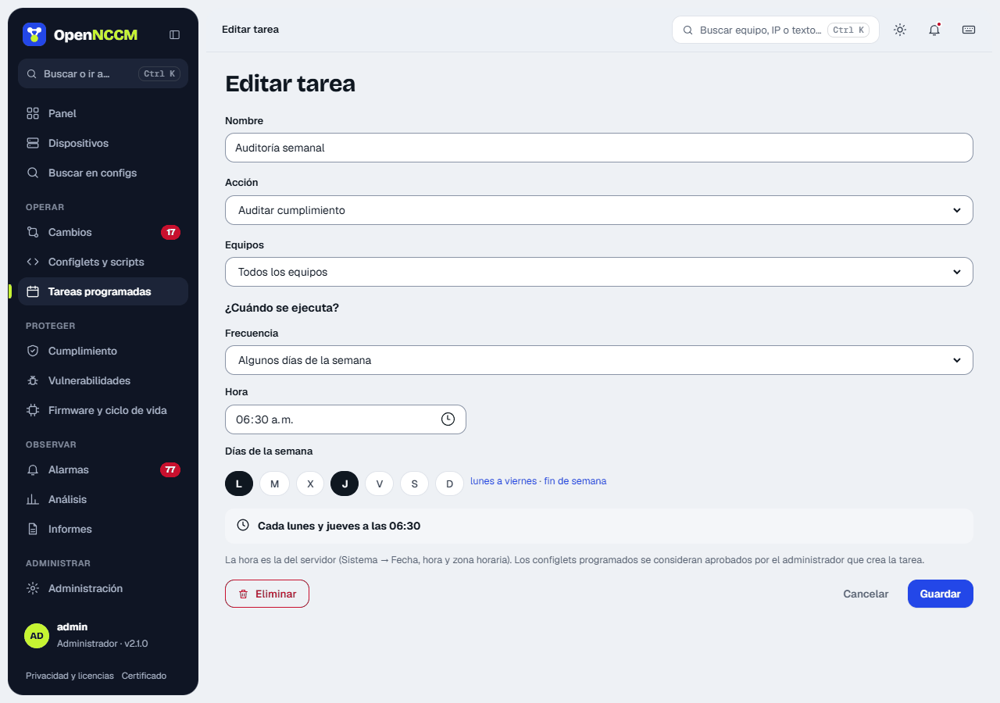
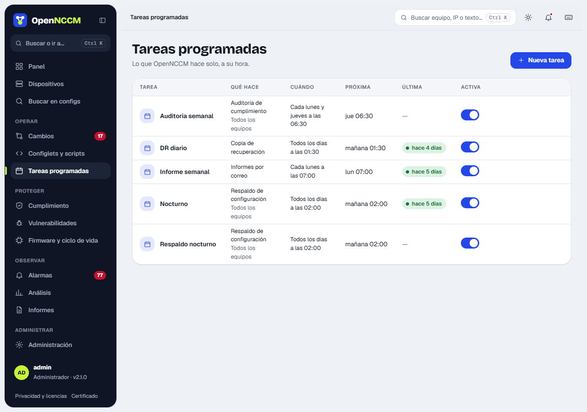

| Action | What it does |
| --- | --- |
| Configuration backup | Backs up the enabled devices (in parallel). |
| Compliance audit | Re-evaluates every policy. |
| Vulnerability scan | Queries NVD for each device. |
| Run configlet | Applies a configlet (it counts as approved by the administrator who creates the task). |
| Send reports by email | Sends inventory, changes, compliance, conflicts, baseline and EOL as CSV. |
| Recovery backup | Creates a backup of the OpenNCCM database (and sends it over SFTP if configured). |

**When does it run?** Choose the frequency and fill in only what it asks for; below it is shown in words, for example "Will run: Every Monday and Thursday at 02:30".

| Frequency | What you choose |
| --- | --- |
| Every day | The time. |
| Some days of the week | The days (shortcuts "Monday to Friday" and "weekend") and the time. |
| Once a month | The day of the month (1 to 28) and the time. |
| Every hour | The minute. |
| Every few minutes | 5, 10, 15, 20 or 30 minutes. |
| Advanced (cron expression) | For special cases: `minute hour day month weekday`; 0 or 7 is Sunday and 1 is Monday. |

The time is the server's (System → Date, time and time zone). The table shows each task in words, its next run ("today 06:00", "Mon 07:00"…) and a switch to pause or resume it. **New task** and each row's pencil open the wizard in a side panel; **Run now** starts it right away and **Delete** is inside the edit panel.

