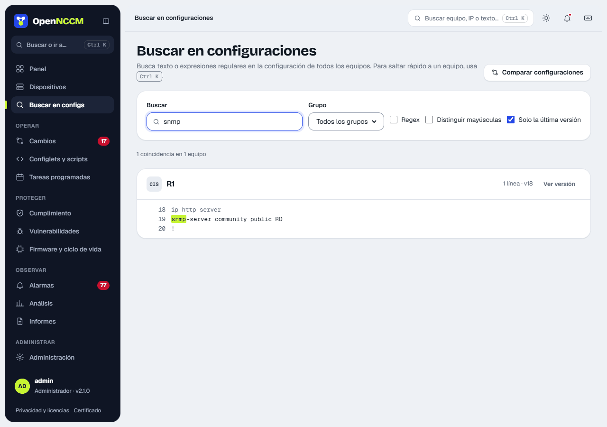

Type the text (or a regular expression by ticking the box) and click **Search**. It searches the latest running configuration of each device and shows the matching lines with their number. If more than 100 devices match, the first 100 (by name) are shown along with the total: narrow the search or choose a group to see the rest.

