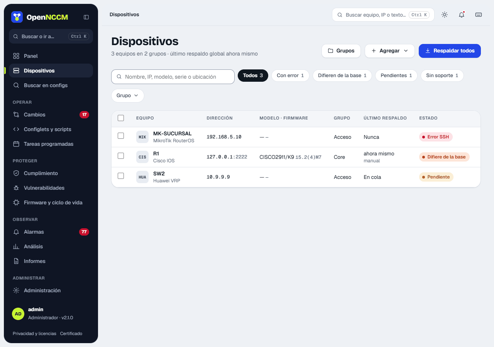
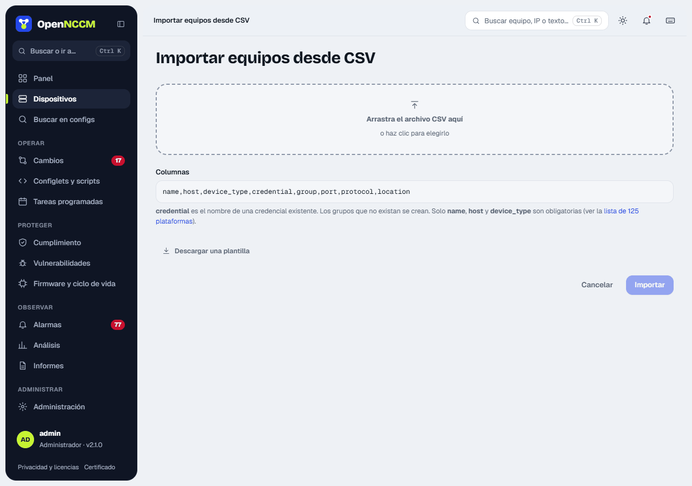
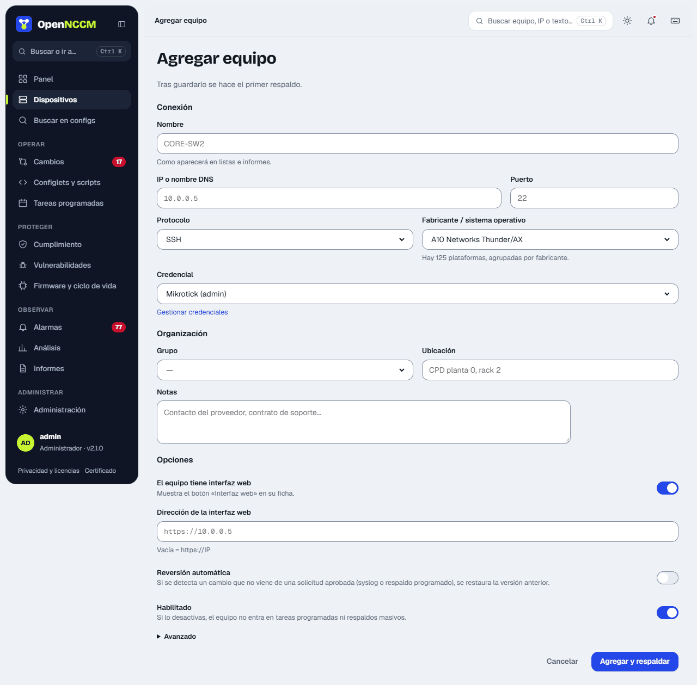
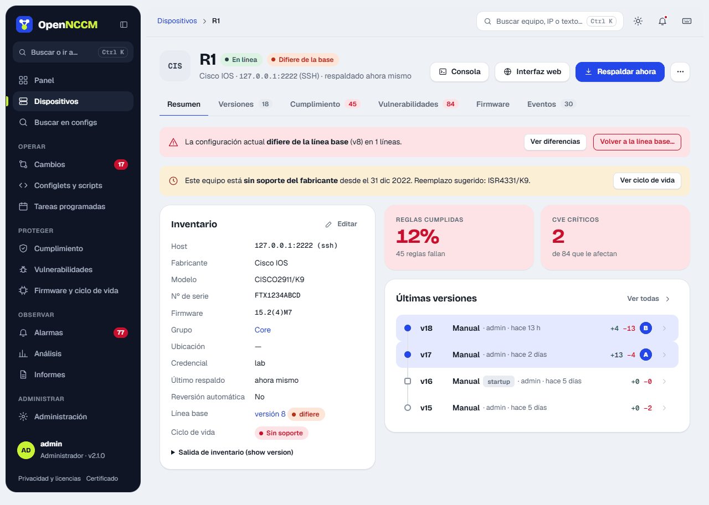
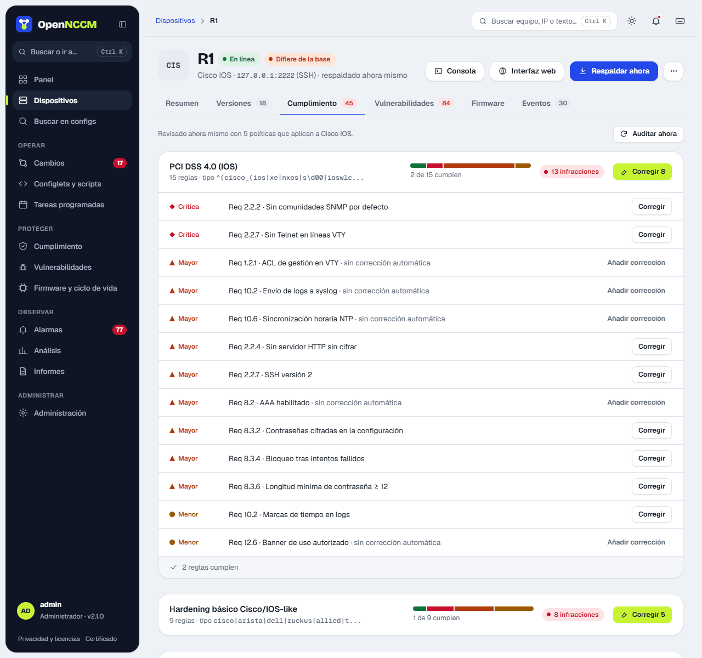

## How to use it

-   **Search and filter:** by name, IP, model, serial, version or location; by group; and by status (ok, error, pending, startup ≠ running, off baseline).
-   **Back up all:** starts a background backup of every device (or of the filtered group).
-   **Row actions:** hovering a row shows back up, console and the device's web interface.
-   **Bulk actions:** select several rows and use the bottom bar to back them up, audit them or move them to a group.
-   **\+ Add** (admin): **Add a device** opens the form in a side panel; **Import CSV** opens the bulk import; **Import from Zabbix** brings in the Zabbix hosts.

## Import from CSV

The panel explains the columns (`name,host,device_type,credential,group,port,protocol,location`; only the first three are required) and offers a template to download. When you choose the file it shows a **preview** with each valid row or its error (unknown platform, missing credential, invalid port or protocol, duplicate name). Rows with errors are skipped and the valid ones are imported; groups that do not exist are created.

## Import from Zabbix

If the devices are already in Zabbix (6.0 or later), **\+ Add › Import from Zabbix** creates them without typing them one by one:

1.  **Connect:** the address of the Zabbix web interface and an **API token** (in Zabbix 7: Users › API tokens; in 6.0: Administration › General › API tokens), or a user and password. A read-only user that can see the hosts is enough. The token and password are not stored; the address is. If Zabbix uses a self-signed certificate, untick *Verify the certificate*.
2.  **Choose the groups:** the Zabbix groups appear with how many hosts each one has and how many are new. Tick the ones you want to migrate (or *Select all*); only devices in those groups are imported.
3.  **Remove devices:** the list shows the hosts in the ticked groups with their name, address (IP of the main interface, or its DNS name), description, Zabbix groups and the **platform** deduced from the Zabbix templates and inventory (for example "Mikrotik by SNMP" → MikroTik RouterOS). Those not recognized stay as "Generic" with a *review* mark; each one can be changed. Untick those you do not want to bring in; you can filter by text. Devices that already exist in OpenNCCM (same name or address), those without an address and those disabled in Zabbix are not ticked.
4.  **Import:** the name, address (SSH, port 22) and description (in *Notes*) are saved and, if Zabbix has inventory, the model, serial number and location. Optionally, one credential and one group for all of them.

SSH credentials are not in Zabbix. If you do not choose one for all, the devices are created **disabled** (they are not backed up and raise no errors) until you edit each one, assign its credential and group, and enable it. Importing again later only adds the new hosts.

## Adding a device

| Field | Description |
| --- | --- |
| Name | Unique identifier (for example the hostname). |
| IP / hostname | Management address. It must be the same one the device sends syslog from. |
| Vendor / operating system | Platform profile (131 options grouped by vendor). It defines the commands used. |
| Protocol and port | SSH (22) or Telnet (23). Telnet only on platforms that support it. |
| Credential and group | User/password profile and the device's group. You can create a new group right here with "…or create a new group". They are also managed in **Devices → Groups**. |
| Does it have a web interface? | **Yes** (default) shows the device's **Web interface** button; you can give its address if it is not `https://IP/`. **No** hides the button for devices without an admin page (many access switches, Linux servers…). It can be changed later in **Edit**. |
| Custom backup command | Optional: replaces the profile's command (useful with the "Generic SSH" profile or versions with a different syntax). |
| Enabled | If unticked, the device is left out of scheduled tasks and bulk backups. |
| Revert automatically | Undoes unauthorized changes when they are detected (see [Rollback](/en/cambios/reversion/)). |

## Device page

It brings together everything about a device in tabs: **Summary** (inventory, baseline, lifecycle and latest versions), **Versions**, **Compliance**, **Vulnerabilities**, **Firmware** and **Events**. At the top are **Console**, **Web interface** and **Back up now**; the **⋯** menu groups audit, look up CVEs, upgrade firmware, edit, compare with another device, see the differences with the baseline, go back to it (if the device has no baseline yet, it lets you mark the latest version) and delete. To delete a device you have to type its name, because it is removed with its whole history.

### Device ports

Between the header and the tabs, a **port strip** draws the front of the device with one icon per port in its physical order: RJ45 for copper and an SFP cage for fiber (empty if it has no module). On large devices they go in two rows, odd ones on top and even ones below. Tapping a port shows its status, type, description, speed, address and neighbor; "See all ports" opens the **Ports** tab, with the *Interfaces* table (filters All, Up, Down, Fiber and, on large devices, Disabled and Copper; **Export CSV**) and a port card with **What the backup says**: the configuration line and the status line that explain its color.

| Color | Meaning |
| --- | --- |
| Green | Up: it has link. |
| Gray | Enabled without link (or, if the platform does not report status, simply enabled). |
| Amber with a dashed border | Disabled in the configuration (`disabled=yes`, `shutdown`). |
| Empty cage | Fiber port without an SFP module. |

The front is drawn like the model's: one row on routers and small switches (hEX, RB4011 with its gap after port 5, US-8, desktop firewalls) and two rows on large ones, in blocks as on the device (CRS326 in groups of 4 with the SFP+ at the bottom right; 24/48-port UniFi and EdgeSwitch and Cisco in groups of 6 with the SFPs in pairs). Models OpenNCCM does not know are drawn according to how many ports they have.

The configuration only says whether a port is disabled; the link is read in the same connection as the backup ("read in the backup from … ago"), with each platform's command:

| Platform | Command |
| --- | --- |
| MikroTik RouterOS | `/interface ethernet print` and `monitor` (status, speed, SFP module) |
| Cisco IOS/IOS-XE, Arista, Dell, TP-Link, Ruckus and most switches with a Cisco-style CLI | `show interfaces status` (or `show interface status/brief`) |
| Ubiquiti EdgeSwitch and UniFi (FastPath) | `show interfaces status all` |
| Huawei, H3C, HPE Comware | `display interface brief` |
| HPE ProCurve / Aruba OS-Switch · Aruba AOS-CX | `show interfaces brief` · `show interface brief` |
| Cisco NX-OS · ASA/FTD · WLC | `show interface status` · `show interface ip brief` · `show port summary` |
| Juniper · Extreme EXOS · Nokia SR OS | `show interfaces terse` · `show ports no-refresh` · `show port` |
| EdgeRouter, USG, VyOS | `show interfaces` (S/L column) |
| FortiGate · Palo Alto · Check Point | `get system interface physical` · `show interface all` · `show interfaces all` |
| Linux, Ubuntu, airOS, airFiber, UniFi AP · pfSense, OPNsense | `/sys/class/net` · `ifconfig -a` |

If the device answers none of them, the ports come from the configuration in gray (disabled or enabled) with the notice "no link status".

### Back view: power supplies and fans

The strip's **Back** button shows the device's **power supplies** and **fans**: in green those working (supply with power, fan spinning) and in red those failing or without power; with a dashed border, those not installed. So you can see at a glance whether a device with two supplies has both connected. If one fails, the strip also warns from the front ("No power or failed: PSU 2", "Fan stopped: Fan 3") and the Back button gets a red dot. It is read in the backup with each vendor's command: MikroTik `/system health print`, Cisco `show environment all`, Juniper `show chassis environment`, Huawei `display power` and `display fan`, HPE `show system fans/power-supply`, Aruba AOS-CX and Arista `show environment …`, FastPath `show environment`, Extreme `show fans/power` and FortiGate `execute sensor list`. Devices that do not report it over SSH (for example small fanless routers) say so in the Back view.

## Device web interface

The globe icon (next to the console one) and the **Web interface** button on the device page open its admin page in a separate window. By default `https://device-IP/` is used; if the device uses another address or port (for example `http://10.0.0.1:8080`), enter it in **Edit → Does the device have a web interface? → Address**. If the device has no web interface, choose **No** in that same question and the button is no longer shown. OpenNCCM does not take part in that connection: the browser connects directly to the device.

:::note[Security]
The console uses the same session as the page (it does not work from other websites), closes after 15 minutes without typing (4 hours at most), and every opening, failed attempt, forbidden or dangerous command, shared link and closing is recorded in the **Audit log**. It only works with devices configured for SSH.
:::
