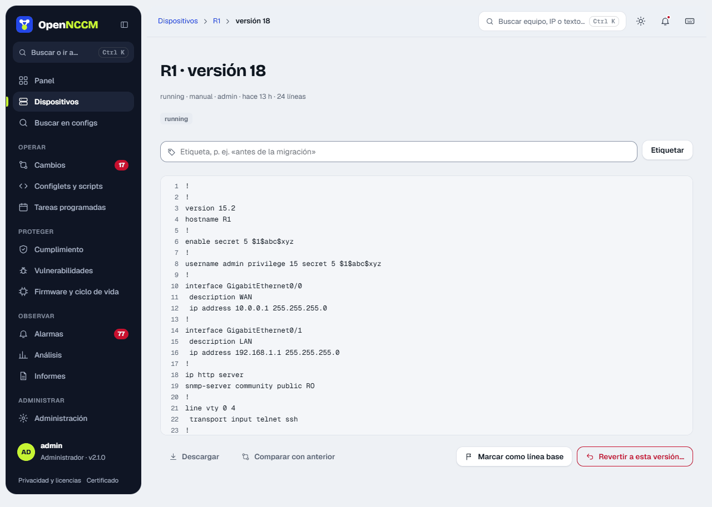
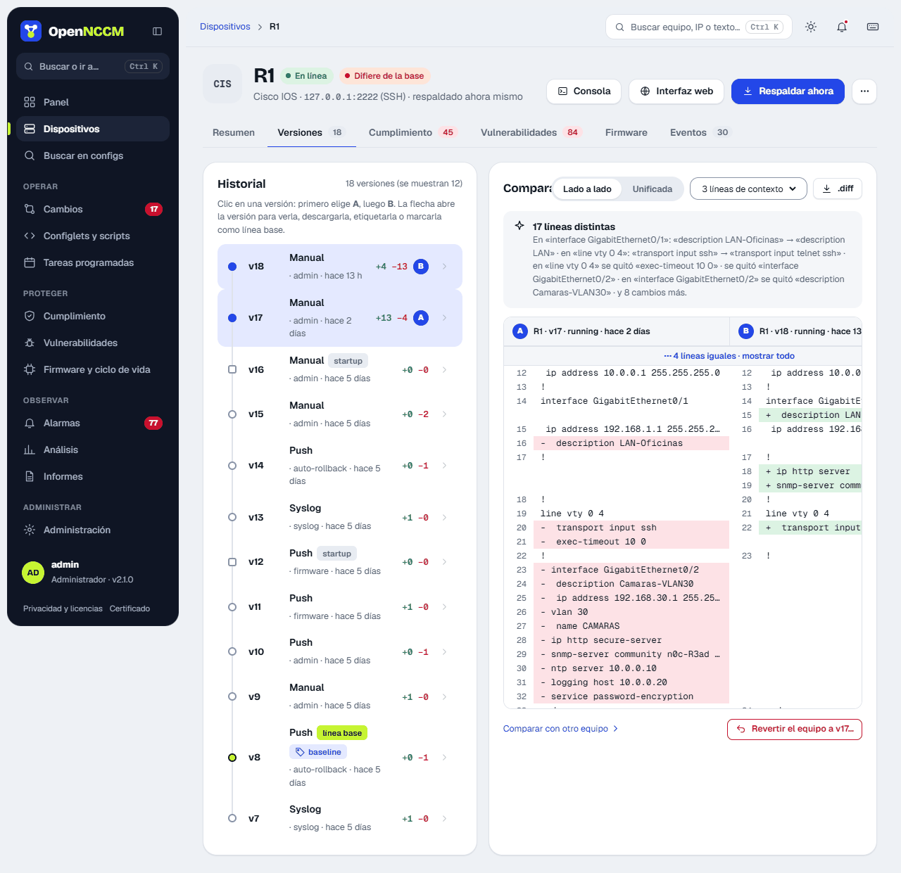
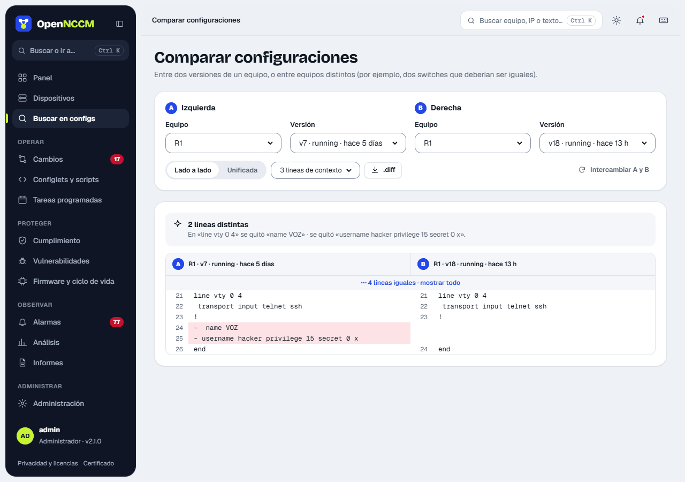
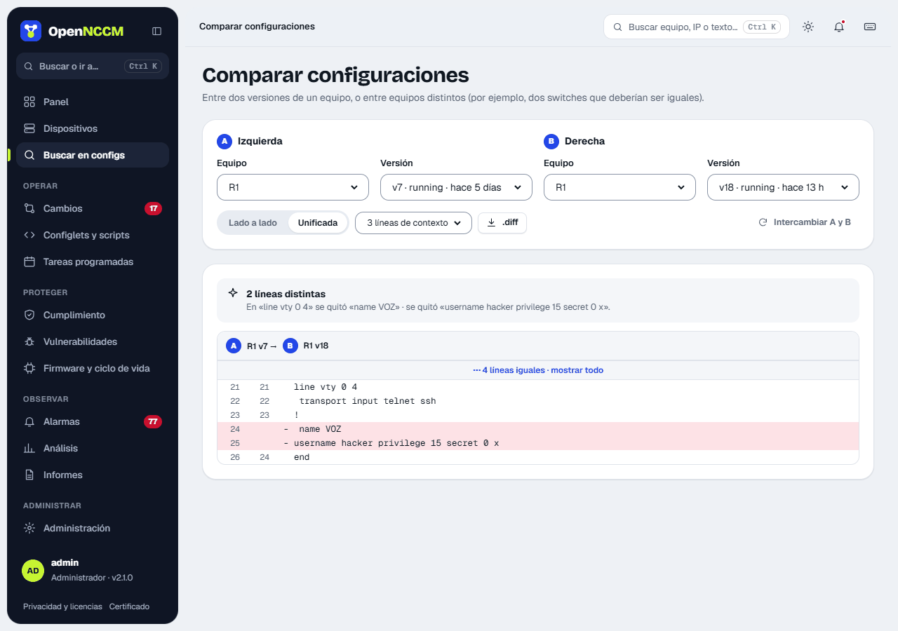

## How it works

1.  OpenNCCM connects to the device with its credential and runs the profile's backup command (e.g. `show running-config`, `display current-configuration`, `show configuration | display set`).
2.  It removes volatile lines (timestamps, checksums) so it does not record false changes.
3.  If the content changed since the last version, it saves a new encrypted version, with its SHA-256 fingerprint and the lines added and removed.
4.  If the profile supports it, it also backs up the startup configuration and compares both (startup/running conflict).
5.  It updates the inventory (model, serial, version), compares with the baseline and runs the compliance audit.

**Device replaced.** If the serial number the backup reads is not the stored one, it is another unit at the same address (an RMA or a device swap). OpenNCCM raises "Device replaced" with both serials, records it in Audit and takes the new serial. If the configuration changed, the new version is tagged "new device · serial …" and the change notice explains that the difference is against the previous unit. [Automatic rollback](/en/cambios/reversion/) is not applied to the new device on its own: check whether it needs the previous unit's configuration restored.

Each version records its **source**: `manual` (button), `scheduled` (task), `syslog` (detected in real time) or `push` (applied by OpenNCCM).

## View a version

On the device page, **Versions** tab, the **›** arrow on each version opens it in a side panel. From there you can **download**, **compare with the previous one**, **tag** it (for example "before migration"), **mark it as baseline** or **roll the device back to that version**.

**Firmware of each backup.** Every backup stores the software version the device had when it was made, read in the same backup (from the inventory, or from the configuration itself: "! System Version" on an EdgeSwitch, the RouterOS header, "version …" on Cisco and Junos). It shows as a tag on each version in the timeline, in the inventory (latest backup and baseline) and in the open version, where the line it comes from is highlighted: **blue** if it is the same one the device has today, **amber** if it is another and **"not recorded"** on backups from before 2.36.0. When the device changed firmware between two backups, the timeline marks it ("Firmware upgraded: v1.10.0 → v1.11.1 · between v2 and v3"). A version from another firmware warns before you roll back to it, and when comparing two backups from different firmware the differences the upgrade brought show in amber with "due to firmware". The downloaded file carries the version in its name ("SW-Miramar_v4_EdgeSwitch-1.11.1.txt"). Each backup's version does not change even if the device is upgraded later.

To find something inside the version, type in **Search in this version** (text or an IP): the lines that contain it are highlighted and **Enter** / **Shift+Enter** (or the arrows) jump between them. The **Tag** field does not search: it gives the version a name. To search the backups of every device, use **Search configs** in the menu.

On a **MikroTik RouterOS** device, the page's **…** menu also offers **Download .rsc (latest backup)**, the saved `/export` ready for `/import`, and **Download the device's .backup…**. The router creates the latter on the spot (`/system backup save`), OpenNCCM fetches it over SFTP and deletes it from the device. You can set a password to encrypt it. The .backup includes users and passwords and can only be restored on the same model; to move the configuration to another device, use the .rsc. The credential's user needs the *ftp* policy (SFTP).

:::tip[Retention]
In Settings you can limit how many versions are kept per device. Tagged versions (including the baseline) are never deleted.
:::

## Configuration comparison

### How to use it

1.  In the device's **Versions** tab, click two versions on the timeline (the older one becomes A and the other B): the comparison appears beside it, in **side-by-side** or **unified** view. With huge configurations it draws at most 2,000 rows and offers the full `.diff` for download.
2.  **Compare configurations** (from Search configs or the device's ⋯ menu) compares versions of different devices and lets you change the context (0, 3, 10 lines or the whole file) and swap A and B.

At the top, **What changed** sums up the differences in words (for example "in 'interface Gi0/1', 'shutdown' was added"). The **side-by-side** view shows version A on the left and B on the right, with line numbers: in red what was removed or modified, in green what was added or modified. The **unified** view shows the classic diff format. The **n** and **p** keys jump to the next or previous change, and the thin bar on the right marks where all of them are.

