OpenNCCM is installed straight from its GitHub repository. On the server console run:

```bash
curl -fsSL https://raw.githubusercontent.com/Gaaraalex/opennccm/main/install.sh -o install.sh
sudo bash install.sh
```

:::caution[Use these two steps for the wizard]
If you run `curl … | sudo bash`, `sudo` does not pass the keyboard to the installer and the menus would not respond. The installer detects this, changes nothing and shows you the right command. The piped form is only for the unattended installation (see [Unattended installation](/en/instalacion/instalar/#unattended-installation)).
:::

A **menu-driven wizard** opens. Move with the <kbd>arrow keys</kbd> and <kbd>Tab</kbd>, select options with the <kbd>space bar</kbd> and confirm with <kbd>Enter</kbd>. Pressing Enter on every screen gives you a secure installation with the recommended values.

### Welcome and server check

Before asking anything, the installer checks that the server runs 64-bit Ubuntu 22.04 or 24.04, that it can reach the internet and GitHub, that there is enough disk (3 GB free) and memory, and that port 443 is free. If anything prevents the installation, it explains why and stops without touching anything.

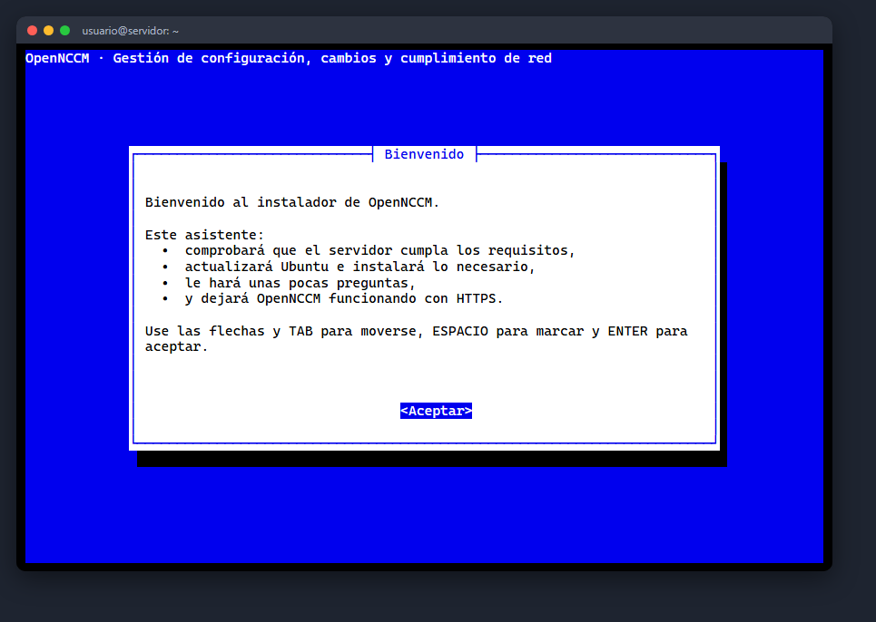

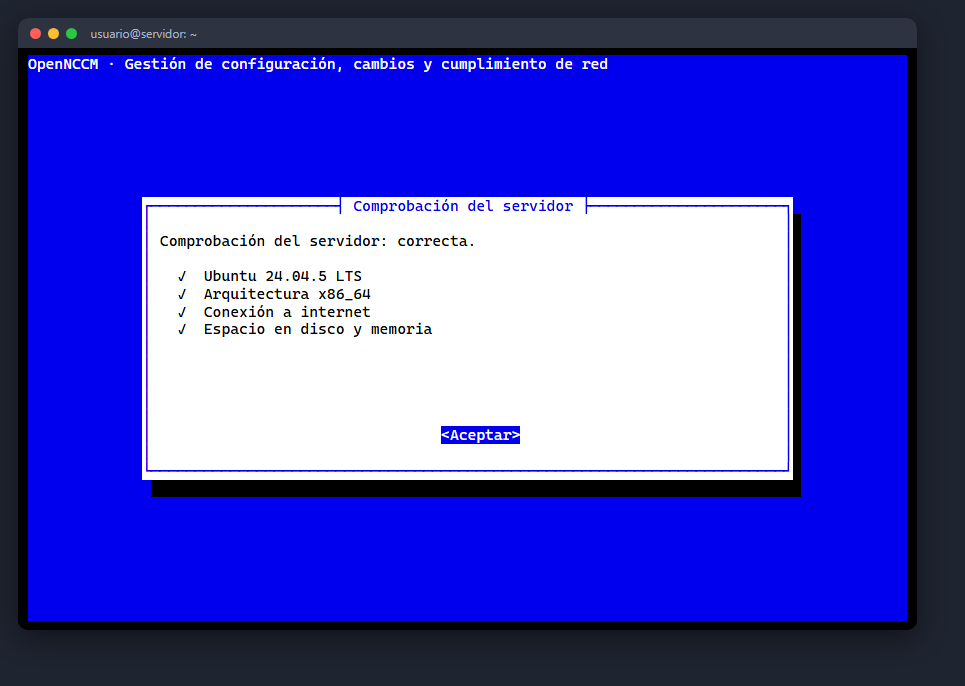

### Ubuntu updates

Recommended on new servers: it runs `apt update` and `apt full-upgrade`. Either way, the installer only installs the packages that are missing (git, Python 3, nginx, whiptail, openssl, etc.).

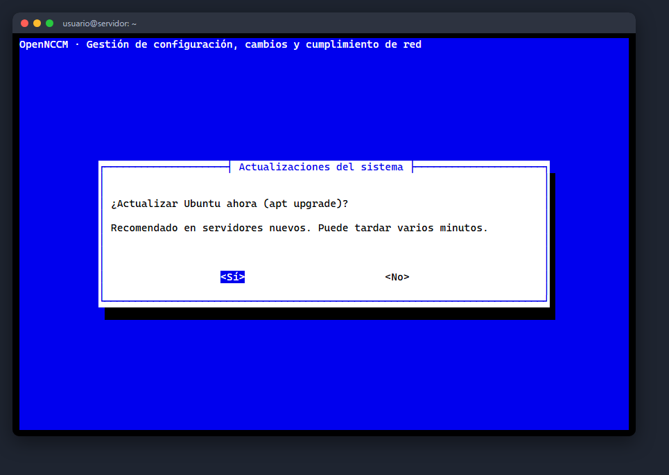

### Address, time zone and HTTPS access

The wizard detects the server's IP addresses; choose the one users will connect to or type a DNS name. Then confirm the time zone (if it is wrong, choose region and city in two menus) and the type of web access:

| Option | When to use it |
| --- | --- |
| Self-signed certificate | Internal networks (recommended). The browser shows a warning the first time. |
| Let's Encrypt | If the server has a public DNS name and port 80 reachable from the internet. |
| Your own certificate | If your company issues certificates: give the paths of the .crt and .key copied to the server. |
| No HTTPS | Lab use only: the application stays on port 8000, unencrypted. |

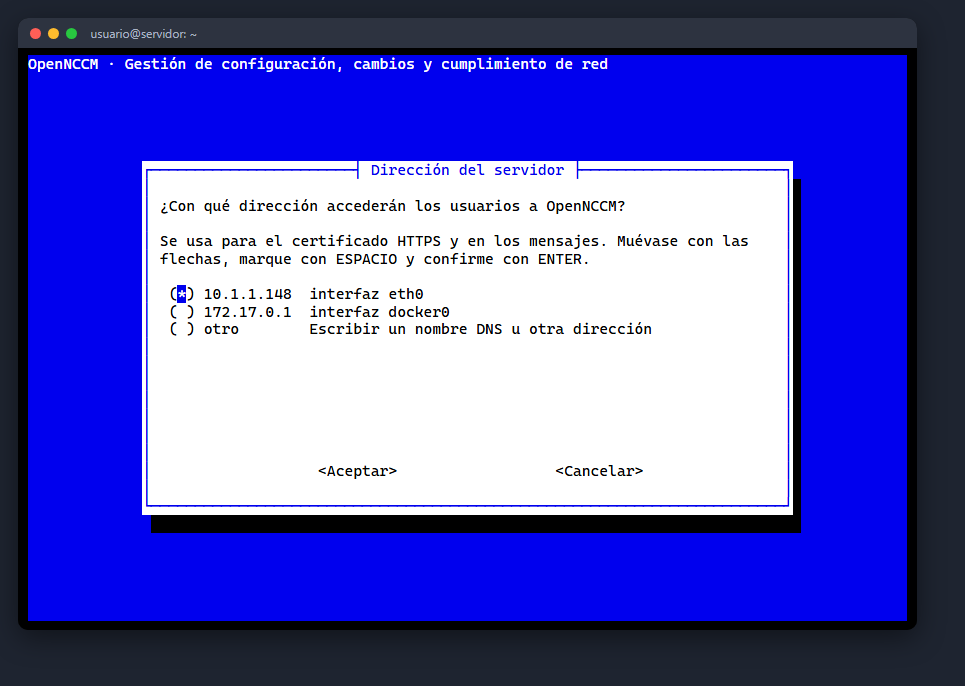

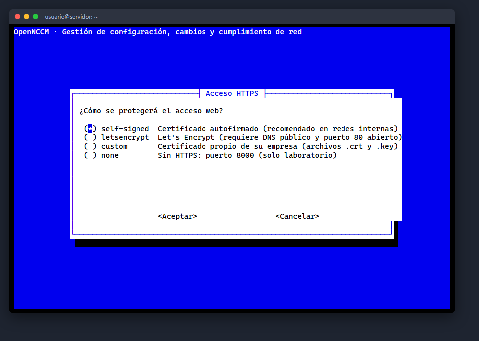

### Database and firewall

**SQLite** is built in and needs no maintenance (up to about 2,000 devices). If you choose **PostgreSQL**, the installer installs it, creates the database and a user with a random password, and configures it. The `ufw` firewall is enabled allowing SSH, HTTPS and syslog; choose "No" if the server already has another firewall.

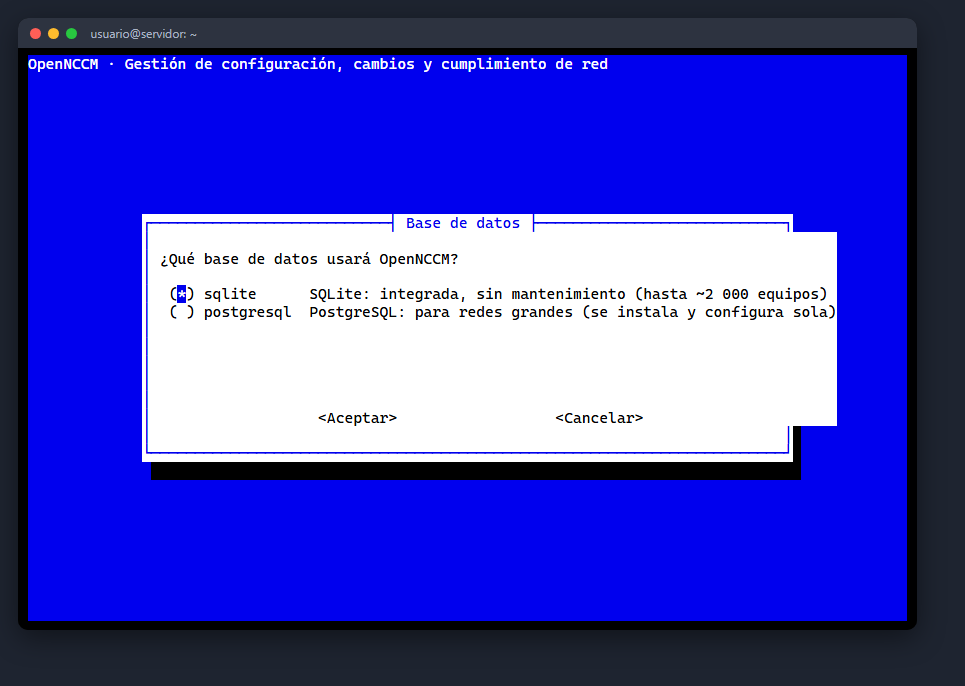

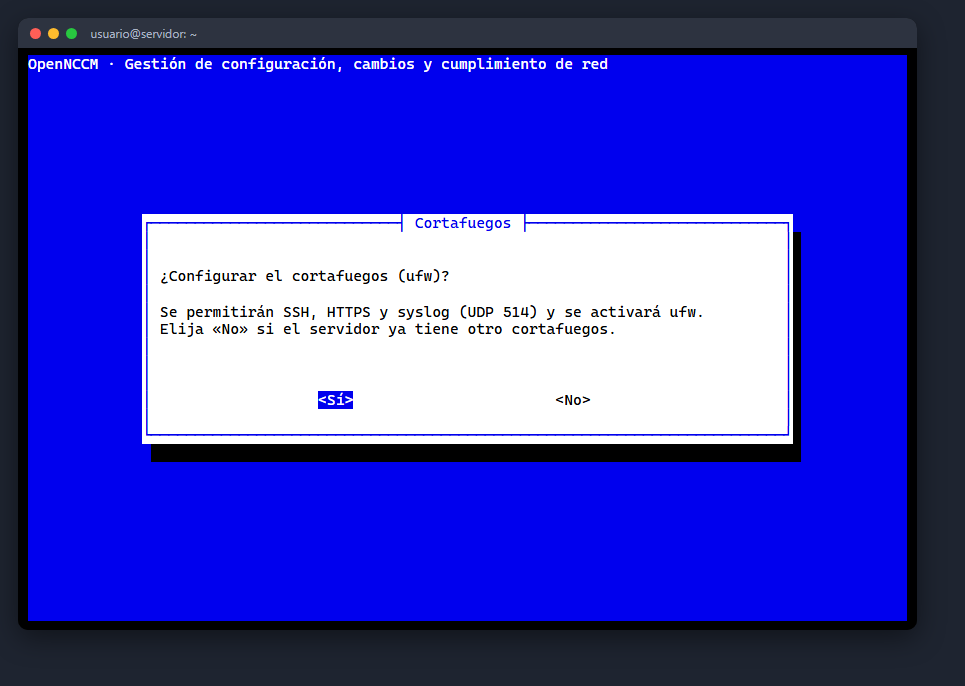

### Administrator and email

Set the administrator's user name and choose between **generating a strong password** (shown at the end) or typing it twice (at least 8 characters). Optionally set up email for alerts; you can also do it later in **Settings**.

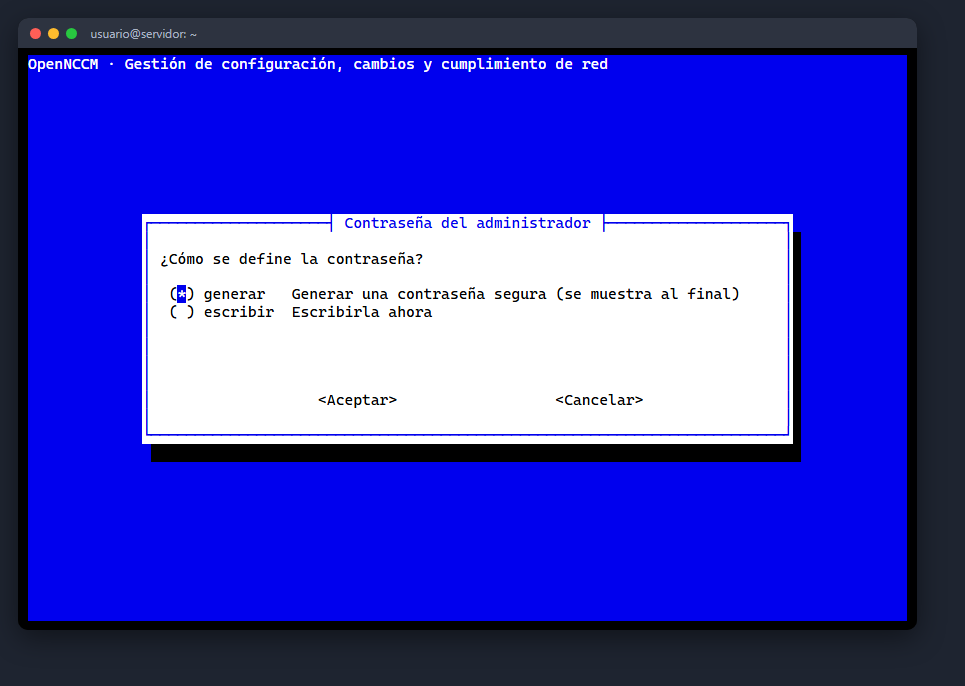

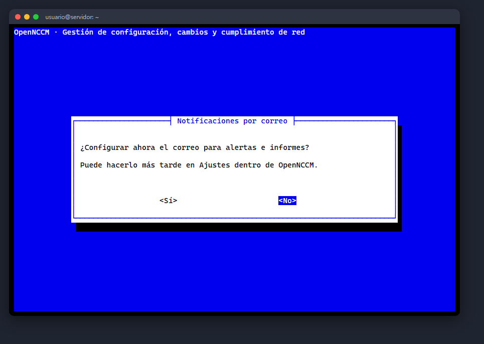

### Summary, installation and result

Review the summary and confirm. A progress bar shows each step; everything is logged to `/var/log/opennccm-install.log`. When it finishes it shows the access address and the credentials, which are also saved in `/root/opennccm-credenciales.txt` (delete it after changing the password).

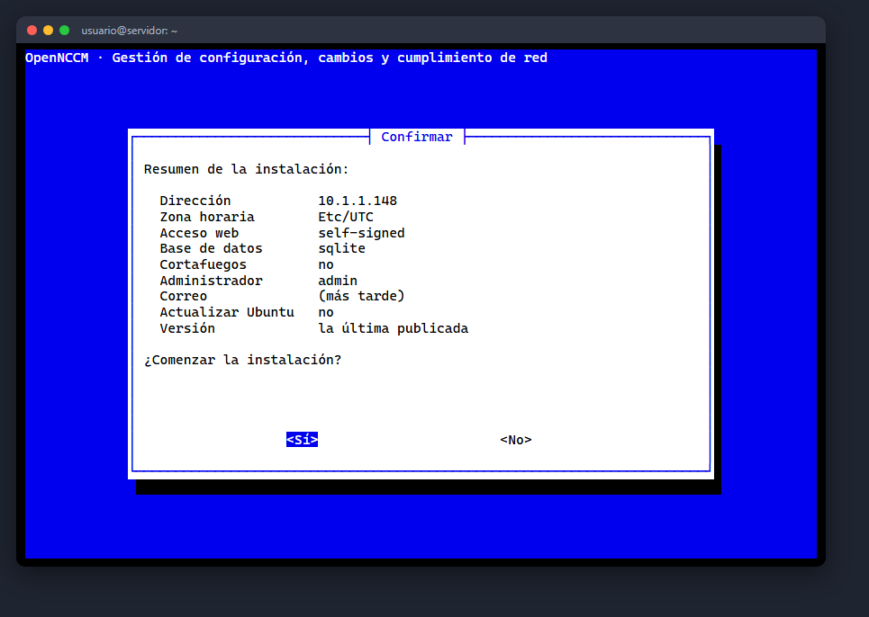

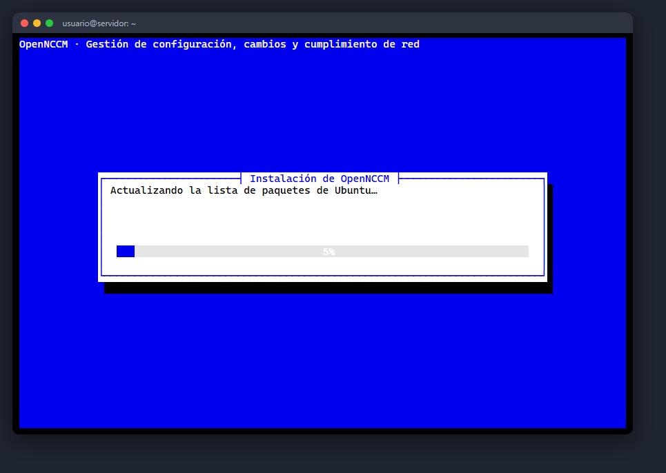

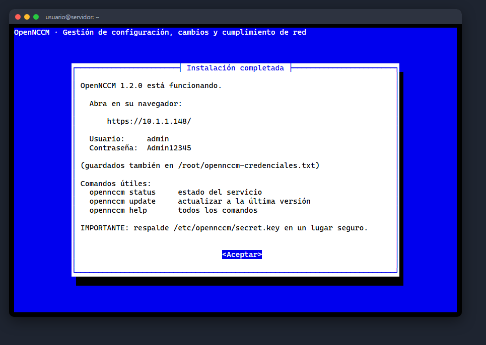

:::caution[If something fails]
The wizard shows the step where it stopped and the last lines of the log. Fix the cause and run the same command again.
:::

### Check that the service is running

```bash
opennccm status
OpenNCCM 1.2.0
✓ Servicio: activo
✓ Aplicación: responde
  Acceso:     https://IP_DEL_SERVIDOR/
```

## Unattended installation

To automate (scripts, Ansible, VM templates) add `--unattended` and the options you need. No questions are asked; anything you leave out takes its default value.

```bash
curl -fsSL https://raw.githubusercontent.com/Gaaraalex/opennccm/main/install.sh | \
    sudo bash -s -- --unattended --host 10.0.0.5 --timezone America/Mexico_City --admin-pass 'UnaClaveSegura123'
```

| Option | Use |
| --- | --- |
| `--host IP|NAME` | Access address (default: the main IP) |
| `--timezone ZONE` | Time zone (default: the current one) |
| `--tls self-signed|letsencrypt|custom|none` | Type of web access (default: self-signed) |
| `--domain NAME --email EMAIL` | Let's Encrypt details |
| `--cert FILE --key FILE` | Your own certificate |
| `--db sqlite|postgresql` | Database |
| `--firewall yes|no` | Configure ufw (default: only if it is already active) |
| `--admin-user`, `--admin-pass` | Initial administrator (without `--admin-pass` a password is generated) |
| `--smtp-host`, `--smtp-port`, `--smtp-user`, `--smtp-pass`, `--smtp-from`, `--alert-emails` | Email for alerts |
| `--syslog-port PORT` | UDP port of the syslog receiver (default 514) |
| `--no-upgrade` | Do not update Ubuntu |
| `--version vX.Y.Z` / `--channel main` | A specific version / the development branch |
| `--reinstall` | Repeat the installation over an existing one (keeps the data) |

Full help: `curl -fsSL …/install.sh | sudo bash -s -- --help`.

### Install without direct access to GitHub

If the server cannot reach the internet, download the `opennccm-X.Y.Z.tar.gz` file from the repository's **Releases** page on another machine, copy it to the server and run `sudo bash install.sh --source $(pwd)` inside the extracted folder. You still need access to the Ubuntu and Python repositories (or a proxy).

### What the installer does

If you run the command again on a server where OpenNCCM is already installed, the installer detects it and offers to upgrade instead (see [Upgrade and roll back](/en/instalacion/actualizar/)).

## First login

1.  On your PC open the browser and go to `https://SERVER_IP/`.
2.  The first time, the browser warns that the connection "is not private": OpenNCCM uses a certificate from its own certificate authority, which your PC does not know yet. Click **Advanced → Continue** and then install that authority (see [HTTPS and firewall](/en/instalacion/https-cortafuegos/)): the warning disappears and the browser offers to **save the user name and password**.
3.  Sign in with the user name and password shown by the installer (they are also in `/root/opennccm-credenciales.txt`).

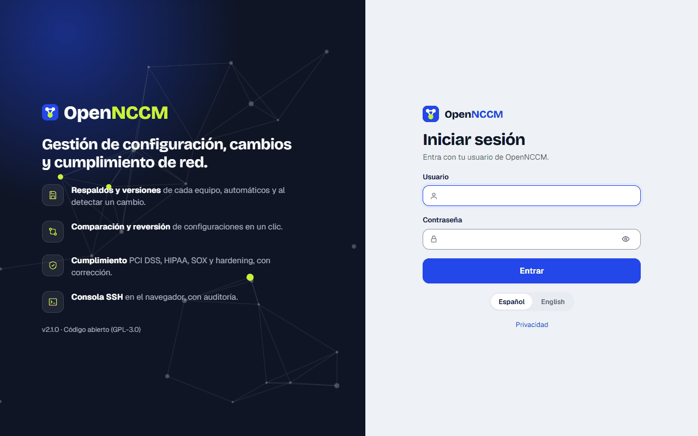

4.  Change the password right away: click your user name (top right) → **My account**.

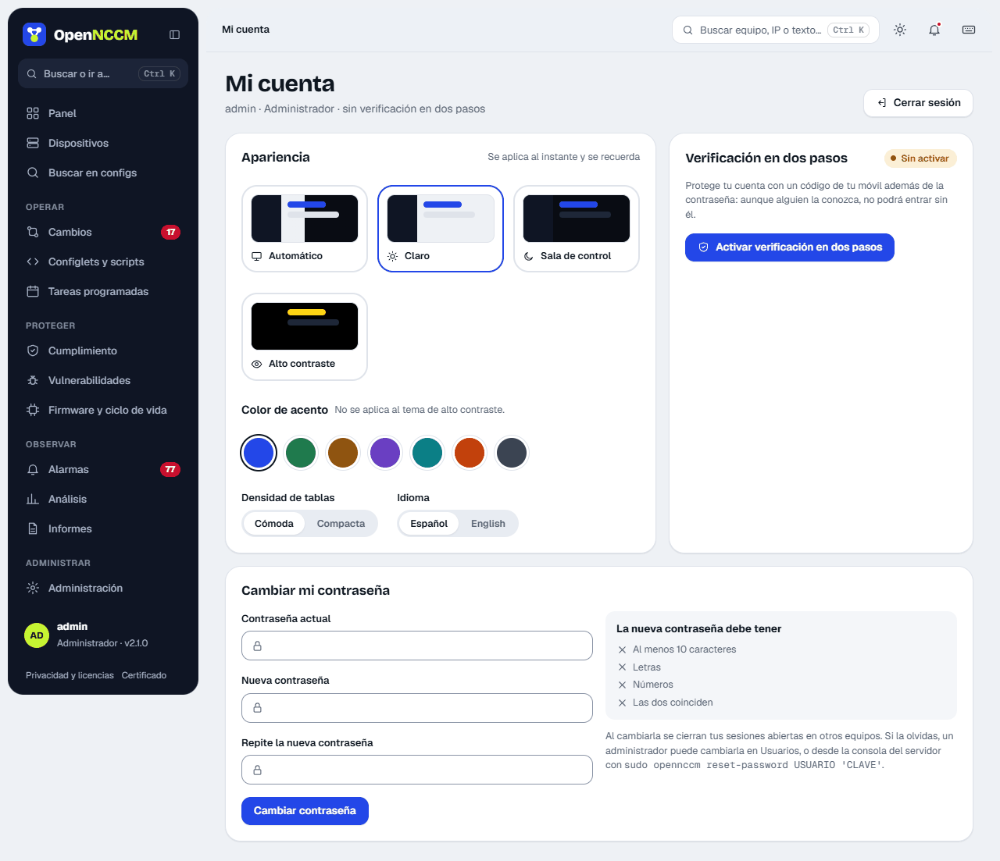

5.  Recommended: in **My account** turn on **two-step verification** with an authenticator app on your phone.

:::note[Brute-force protection]
After 5 wrong passwords in a row the account is locked for 15 minutes; after 10 failed attempts from the same IP, that address is blocked for 15 minutes. Every attempt is recorded in the **Audit log**.
:::
