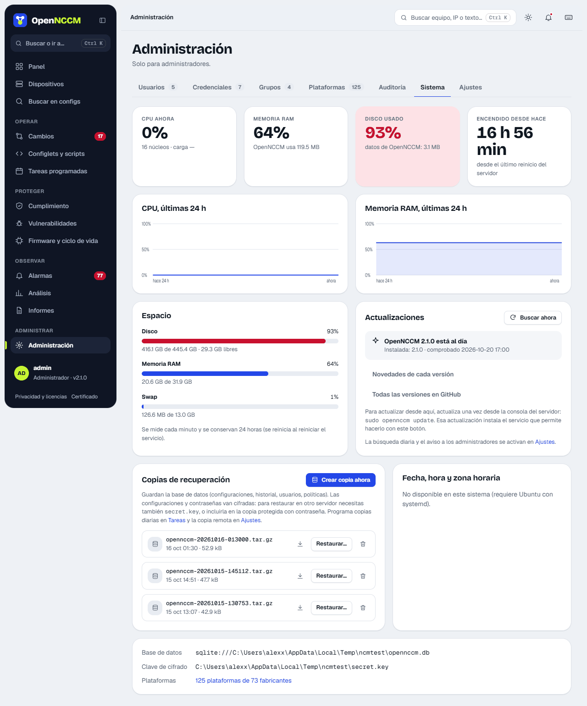

OpenNCCM keeps everything important in two places:

| Path | Contents |
| --- | --- |
| `/var/lib/opennccm` | Database (configurations, history, users, policies), firmware images and backups. |
| `/etc/opennccm` | **secret.key** (encryption key) and `opennccm.env` (service configuration). |

## From the interface

**System → Create backup now** menu. Schedule the daily backup in **Tasks** and, in **Settings → Disaster recovery**, set how many backups to keep and a remote SFTP server to send each backup to.



## From the console

```bash
sudo opennccm backup              # without the key
sudo opennccm backup --with-key   # includes secret.key: protect the file
```

## Restore (on the same server or a new one)

1.  On a new server, install OpenNCCM first (see [Install on Ubuntu](/en/instalacion/instalar/)).
2.  If the backup does not include the key, copy the original `secret.key` to `/etc/opennccm/secret.key`.
3.  Restore:

```bash
sudo opennccm restore /path/opennccm-YYYYMMDD-HHMMSS.tar.gz
```

The command stops the service, restores and starts it again.

:::caution[The key is essential]
Without the right `secret.key` the backed-up configurations and passwords cannot be decrypted. Keep it somewhere safe, separate from the backups (for example, in your team's password manager).
:::
