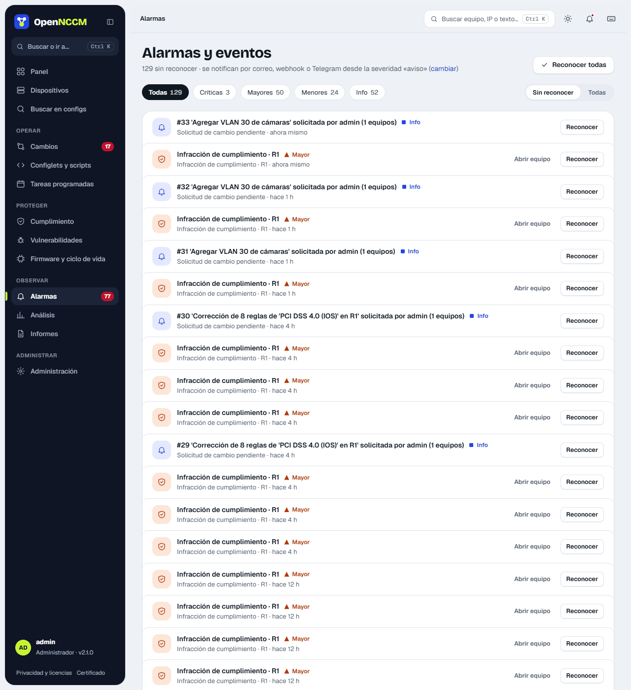
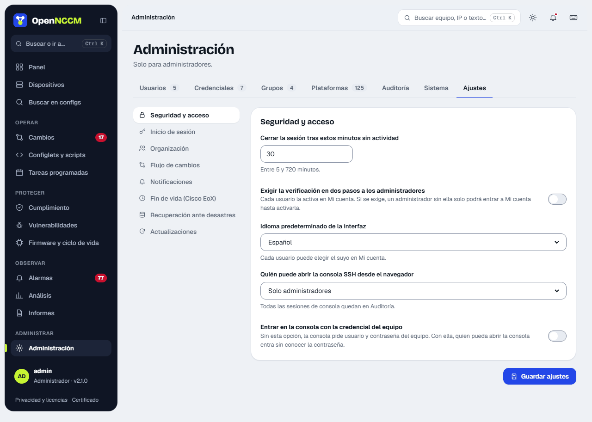

Everything relevant generates an **event** with a color-coded severity:

| Severity | Examples |
| --- | --- |
| **critical** | Automatic rollback, critical vulnerability, recovery backup failure |
| **major** | Failed backup, critical compliance violation, failed request |
| **warning** | Configuration change, startup/running conflict, baseline drift, violations |
| **info** | Syslog received, request pending or executed, backups created |

**Alarms** opens on **Unacknowledged** (or **All**), with chips per severity and their count. Each alarm shows the device and how long ago it happened (the full detail appears on hover), with **Open device** and **Acknowledge**; you can also acknowledge them all (with **Undo** in the notice). Those with a severity equal to or above the one set in Settings are sent by email, webhook (Teams, Slack…) and/or Telegram.

## Set up notifications

**Settings → Notifications** menu. Set up one or more channels and click **Send test notification**.

| Channel | What to fill in |
| --- | --- |
| Email | SMTP server, port (587 with STARTTLS or 465 with SSL), user, password, sender and comma-separated recipients. |
| Microsoft Teams / Slack / Mattermost / Google Chat | The channel's *incoming webhook* URL. |
| Telegram | Bot token (from @BotFather) and the chat or group ID. |

The "minimum severity" decides what is notified: `warning` sends configuration changes, violations and failures; `critical` only automatic rollbacks and critical vulnerabilities.

