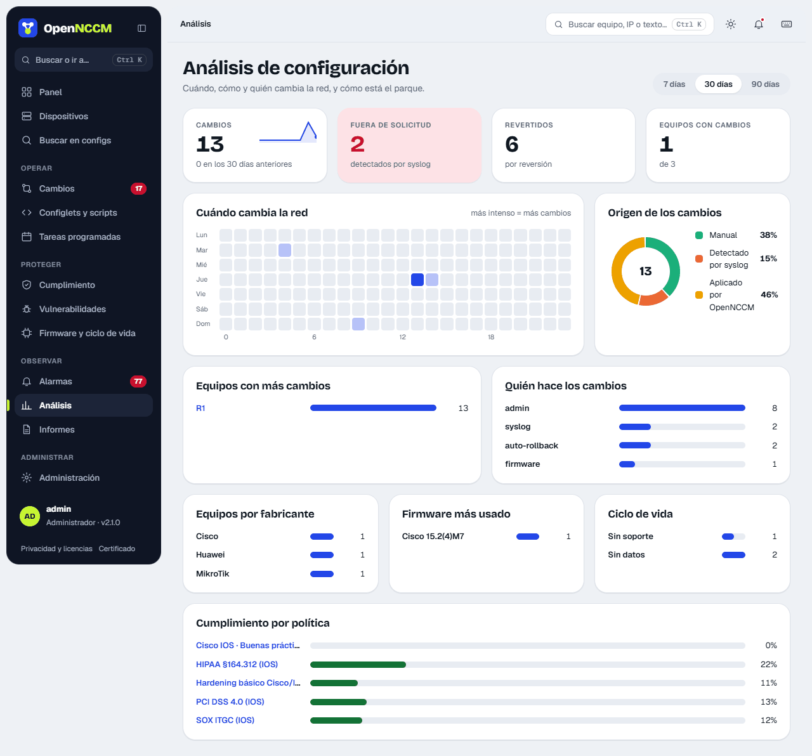

Choose the period (7, 30 or 90 days). The page shows:

-   **Indicators**: changes in the period with a sparkline and the comparison with the previous period, changes **outside a request** (detected by syslog), **reverted** changes and **devices with changes**.
-   **When the network changes**: heat map by day of week and hour (darker = more changes). Useful to spot changes outside working hours.
-   **Source of changes**: a ring with the total in the center and the percentage of each source (scheduled, syslog, manual or applied by OpenNCCM).
-   Bars for **devices with most changes**, **who makes the changes**, **devices by vendor**, **most used firmware**, **lifecycle** and **compliance by policy**.

Hovering over a bar or cell shows its exact value. Device and policy names are links.

## IP and VLAN

**IP and VLAN** (sidebar) brings together the IP addresses and VLANs configured on every device, read from their latest saved configuration (nothing is run on the devices). It recognizes Cisco and similar, Huawei, EdgeSwitch, VOSS, FortiGate, Junos, VyOS/EdgeRouter, MikroTik, EXOS and airOS; IPv4 only. It warns about **IPs configured in more than one place** (on two devices or two interfaces) and **VLANs with different names** depending on the device. You can filter by group or text and export to CSV.

## Network map

**Network map** (sidebar) draws the devices and the links between them, with the port at each end. Links come from the **LLDP or CDP** neighbors each device announces, read on every backup with a read-only command (for example `show cdp neighbors detail` on Cisco or `/ip neighbor print` on MikroTik). Supported on Cisco, Arista, Juniper, Huawei, HP/Aruba, Dell, Ruckus, Allied, MikroTik, EdgeSwitch, UniFi Switch, EXOS and VOSS / Fabric Engine (`show lldp neighbor`), if LLDP or CDP is enabled.

-   Each device has three layers: the **ring** gives its status, the **icon** in the center what it is (router, switch, antenna, firewall or unknown) and the **badge** in the corner its vendor (OpenNCCM's own marks, not the brands' logos). The type comes from the model or platform and, if they say nothing, from the capabilities it announces over LLDP or CDP. The **Vendor** chips at the top highlight those of one brand, and each device's panel explains **how it was recognized**. Ports are only shown on the links of the selected device.
-   Devices are colored by their latest backup. **Neighbors not in OpenNCCM** have a dashed border: clicking them, **Add to OpenNCCM** opens the add form with their name and IP.
-   A neighbor is recognized as an OpenNCCM device by its name (without domain) or, failing that, by its management IP.
-   Only **network devices** are shown. If **several devices are seen over the radio** on one port, they are an access point's customer CPEs: they are removed (the access point is shown) and a note says how many. If **only one** is seen, it is the other end of a PtP link or the station, and it is shown, unless it is a customer antenna model (LiteBeam, NanoStation, NanoBeam, SXT, LHG…), which is never shown: so customers each on their own VLAN do not appear. On MikroTik, on a port with several wired neighbors only the one seen over LLDP counts.
-   **Wireless links** (one end is a radio: ath0, wlan1…) are drawn with a dashed line.
-   In **Settings › Network map** you choose which **discovered device types** are shown: MikroTik, Ubiquiti, Juniper, Cisco, Huawei, HP/Aruba, Extreme and others. The type is recognized from what the neighbor announces (platform, model), from the vendor of its MAC (UniFi switches that do not give their model) or from the names of its ports. Devices already in OpenNCCM are always shown. Below the map, the neighbors hidden because of their type are listed.
-   Selecting a device shows the **ports** of its links next to each end; with more than 8 links, only the neighbor's (its own are in the panel's *Links* list). Hovering over a link shows both. The panel takes its own space on the right (at the bottom on narrow screens) and the map moves so the device and its neighbors are visible.
-   **Isolated networks** (devices with no known links between them) are placed together, in rows; the **Network** selector shows just one.
-   You can filter by group, search and drag devices. To move around: drag the background, use the wheel or the + and − buttons to zoom, "See the whole map" and "Full screen". Below, the list of links.
-   **RoMON (MikroTik, off by default):** with **Also find MikroTik devices through RoMON** in **Settings › Network map**, the backup of each MikroTik with RoMON enabled also runs `/tool romon discover duration=10 proplist=address,hops,path,identity,version,board` (RouterOS 7 and 6) and the map shows the MikroTik devices it reaches, even if they are several hops away or have no IP address. RoMON does not say which port they connect through: they are joined to the previous hop of the path with a **dotted line** ("Through RoMON (no port)"), unless there is already an LLDP/CDP link between the two. They do not count for the [impact analysis](/en/cambios/solicitudes/) or for [Unused ports](/en/observar/informes/#unused-ports). They take their IP from MNDP/LLDP neighbors or from the ARP tables, if any of them knows it. It adds about 10 seconds to each MikroTik backup.
-   It is turned off in **Settings › Network map** (then backups do not read neighbors).

### Layout: how to arrange the devices

The **Layout** menu on the map bar chooses how the devices are placed:

| Layout | How they end up |
| --- | --- |
| Free | They arrange themselves by their links (the usual one). |
| Stepped ↓ · Stepped → | From the central device downwards (or to the right), one hop per row. |
| Radial | The central one in the middle and one ring per hop. |
| By site | One box per site or network; each device's site is changed from its panel. |
| By role | Columns: core, routers, switches, wireless and others. |
| Circular | All in a circle. |
| Collapsible tree | Opens and closes each branch from the central one. |
| On a floor plan | Each device in its real place on a floor plan or map uploaded by an administrator ("Upload plan"). |
| My layout | The one saved by dragging devices: **Save** keeps it just for you or, for administrators, for the whole team; "Back to automatic" discards it. |

In those that start from a central device you choose which one (by default, the one with the most links). With "Remember this layout next time" the map opens the same way again. Each layout uses the whole frame and "Fit to screen" never leaves names below 11 px: if they do not fit, the map stays larger and you move it; no line crosses the names. **By site** puts the central device in the middle, **By role** splits long columns and the **collapsible tree** frames the branch that opens. Below the map, the strip says which layout is chosen and how it works; the legend folds away with **Legend**. "Below the name" shows the IP, the MAC, the brand or nothing. In "On a floor plan", the "No location" tray scrolls with the wheel or with "+N more".

### Nodes

A node groups the devices of one place (a branch, a tower, a building). They are created in **Administration › Nodes** or when creating or editing a device, with the **Node** field (like credentials: pick one from the list or "+ Create new node…"), or in bulk from [Devices](/en/equipos/dispositivos/) with **Assign to node**. On the map, the **Node** filter shows that node's devices and, dimmed, the neighbors in other nodes ("in another node: …"); "All" shows them all again. In the list of nodes, **Edit** and **Delete** are in view, "N devices" opens Devices filtered by that node and a node without devices says so.

## New or lost neighbor alert

With **Warn when neighbors change** (**Settings › Network map**, off by default) OpenNCCM creates an [alarm](/en/observar/alarmas/) when a device appears that was not there before or one that was there stops being seen. It uses the LLDP, CDP, MNDP and RoMON readings the map already takes on each backup: it adds no queries to the devices.

-   Each device's first reading, and everything seen when the alert is turned on, is taken as known: it creates no alarms.
-   **New neighbor:** it warns on the first reading where it appears (Warning level by default). **Lost neighbor:** it only warns if it is missing in 2 readings in a row (changed in Settings), so a few-second outage does not trigger it (High level by default). If it is seen again, the alarm closes on its own and stays in the history with the outage duration.
-   In **Alarms**, the **Neighbors** filter shows only these. **View detail** opens the neighbor's card: port (with its VLAN and description), the name it announces, what it says it is, MAC with its vendor, IP and what was on that port before. From there: **It is known, don't warn again**, **View on map** and **Prepare port "shutdown"**, which creates a [change request](/en/cambios/solicitudes/) (nothing is shut down without approval). For a lost neighbor you see when it was last seen, in how many readings it was missing, the port status and what depends on it.
-   On the map, **Highlight neighbor changes** (on) marks new ones with an amber border and the "NEW" label, and draws lost ones in dashed red, with an ✕ on their link. A device that is in OpenNCCM is not painted whole as new or lost: the lost link is drawn separately, on its port. The **Neighbor changes · last 24 h** panel lists the new, the lost and those that came back. The highlight goes away when the alarm is acknowledged or after 24 h.
-   **Don't warn for:** IP phones and access points (from what they announce over LLDP), ports with 802.1X and devices at the chosen locations. **Known neighbors** lists those that don't warn when they appear; removing one that is still connected makes it warn as new on the next reading.
-   The alarms go out through the same channels as the others (email, webhook and Telegram).
