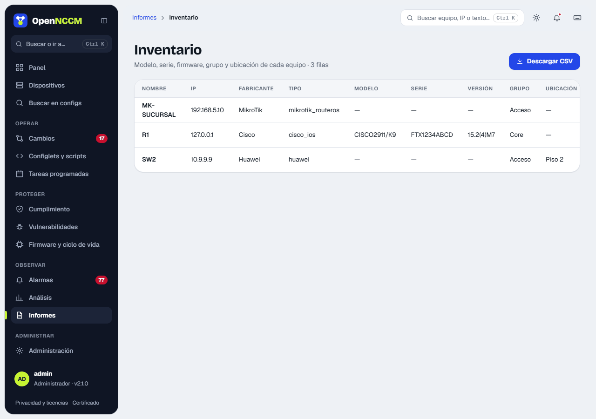

Each report is a card with **View** (on screen, with a period of 7, 30, 90 days or a year where it applies) and **CSV** (UTF-8, opens directly in Excel). Administrators can **email them now** or **schedule the sending**.

| Report | Contents |
| --- | --- |
| Inventory | Name, IP, vendor, model, serial, version, group, status, conflicts and baseline |
| Configuration changes | Each new version with date, source, user and lines |
| Compliance | Result per device, policy and rule |
| Startup ≠ running conflicts | Devices with unsaved changes |
| Off baseline | Devices with a baseline and whether they drifted |
| End of life (EOL/EOS) | Dates and status of each device |
| Vulnerabilities | CVEs per device |
| Licenses about to expire | Each device's license services (today, the WatchGuard feature key) that expire in the next 90 days or already expired, most urgent first |
| Unused ports | Switch access ports without link for more than 30, 60 or 90 days ([see below](#unused-ports)) |
| Network document | PDF or Word with what OpenNCCM knows about the network ([see below](#network-document)) |
| Map devices | The devices seen on the map (LLDP/CDP/MNDP and RoMON neighbors) checked against Devices: which ones are already added and backed up and which are not ([see below](#map-devices)) |
| Change requests | Who asked, who approved and the result |
| User audit | Sign-ins and actions (administrators only) |

CSV column headers stay in Spanish so integrations keep working.

## Map devices

**Reports → Map devices** tells you, for each device that appears on the [network map](/en/observar/analisis/), whether it is **not added**, **added and backed up**, **added with the last backup failed** or **added with no backup yet**, and from which device and port it is seen. It shows no IP or MAC: for the missing ones, type the IP on the page and use **Add** (it opens the new-device form with the name and IP), or download the **fillable PDF**, which has a field to type each one's IP on the PC (or print it and write it by hand).

## Unused ports

**Reports → Unused ports** shows, per switch, how many access ports are in use, without link for more than 30, 60 or 90 days, and free (shut down or marked "SIN-USO"), with the **nearly full switches** (less than 10% free). It can be filtered by site (each device's "Location") and VLAN, and exported to CSV.

-   It does not count uplinks (ports with an LLDP/CDP neighbor that is a switch, router or firewall), trunks, ports with 802.1X or those with an exception (**Mark as exception**).
-   On each backup OpenNCCM records the last time each port had link, starting with version 2.24.0. There is no earlier history: the report says since when there is data and, until the chosen period has passed, it does not show a port as "no link for 90 days" or more days than there is data for.
-   **Prepare "shutdown" as a change request** builds each vendor's configuration (description `SIN-USO-YYYY-MM` and shutdown), keeps the previous description to roll back, and sends it for approval with its [impact analysis](/en/cambios/solicitudes/#impact-analysis-what-goes-down-if-i-touch-this-device). It is available for Cisco IOS/IOS-XE/NX-OS, Arista, EdgeSwitch and similar, Aruba, HPE ProCurve, Huawei/Comware, Juniper, Extreme EXOS and MikroTik.

Shutting unused ports is also a security improvement: nobody can plug a device into a forgotten port.

## Network document

**Reports → Network document** generates a PDF or a Word file (.docx) for a site, a group or the whole network, with the sections you choose: inventory (model, serial and firmware), network map, VLANs and IP addresses, links between devices, compliance and vulnerabilities, and each device's latest backup. Optionally it has a cover with the customer's logo (PNG or JPEG, uploaded with its own button, shown in the preview and removable with **Remove**) and name, and it can hide public IPs. On the map, each group of linked devices is laid out by levels, the groups go side by side and devices without links go at the end, in a grid. Each heading stays on the same page as its table, tables have the same width, the "Site" column only appears when there is more than one and Compliance warns if it has not been audited yet. Passwords, SNMP communities and keys never appear: the document contains no configurations.

Generated documents stay in the list with **View** (the PDF in the browser), **Download** and, if the network changed since then ("The network changed: 3 new devices, 1 VLAN and 2 firmwares"), **Regenerate**. Every document generated and downloaded is recorded in the Audit log.
