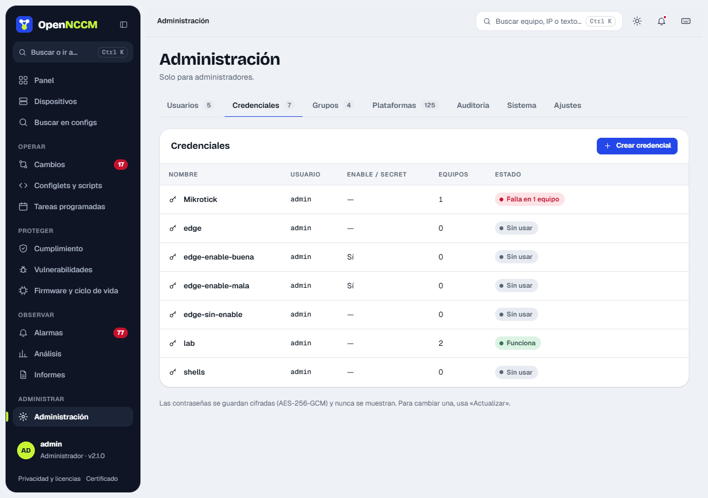
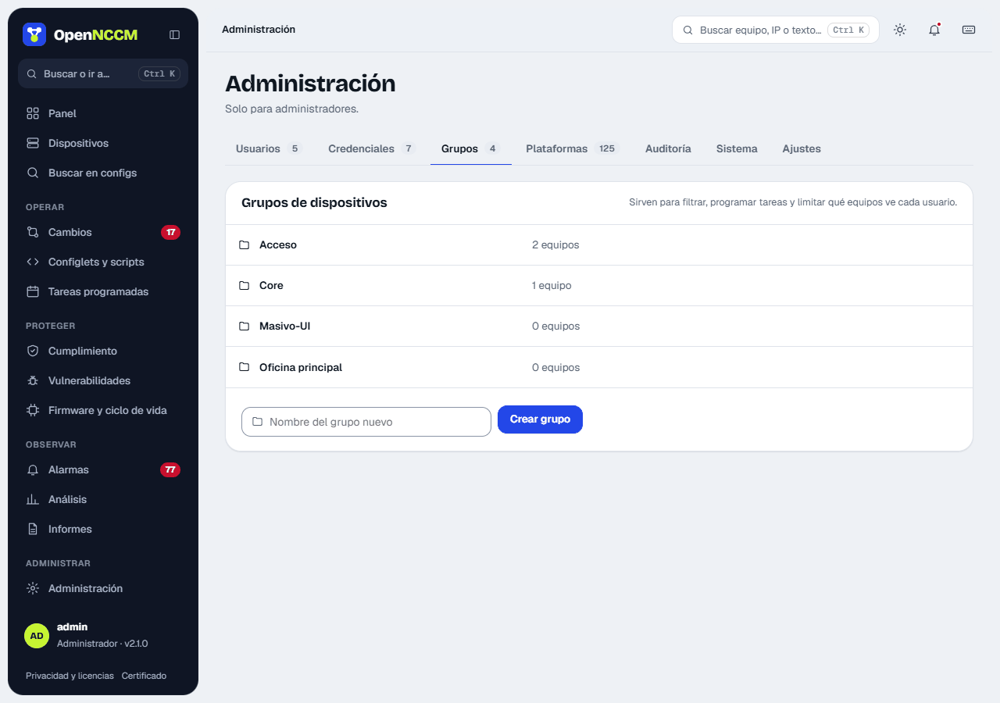

## Device credentials

**Credentials** menu. Create one profile for each user/password combination your devices use (for example "net-admin" and "firewalls"). If your Cisco devices require `enable`, also fill in "Enable / secret". Passwords are stored encrypted and are never shown again.

On the same page create the device **groups** (site, role or customer). Groups are used by tasks, policies and filters, and to limit which devices each user sees.

**Credentials:** profiles with the user, password and privileged password (*enable*) used to connect to devices. If the device logs in at user mode (">") and the credential has no *enable*, OpenNCCM tries the login password; if that does not work, the error says which credential to enter it in. They are stored encrypted with AES-256-GCM and, unless Settings allows it (see below), never shown. They are in **Administration → Credentials**: the table shows how many devices use each one and its status (works, fails on N devices or unused). **Create credential** and **Update** open a side panel; when updating, leave blank whatever you do not want to change.

**Viewing a credential.** In **Administration → Settings → Security and access → Who can view device credentials** an administrator chooses **Nobody** (the default), **Administrators only** or **Administrators and operators**. Anyone allowed sees **View** next to the credential on the device page (and administrators also in this list). To view it:

-   Their account must have two-step verification turned on. If it does not, they are told to turn it on first in **My account**.
-   Each time they click **View** they confirm with their OpenNCCM username and password (Active Directory accounts with the directory one; Microsoft accounts with the code from their authenticator app).
-   The username, password and *enable* are shown with a **Copy** button and hidden after 60 seconds.
-   Each view and each failed attempt is recorded in [Audit](/en/administracion/auditoria/). Failed attempts count toward account lockout just as at sign-in, and when the account locks its sessions are closed. An operator only sees those of the devices in their groups, and readers never do. They cannot be viewed with an API token.

**Groups** (**Administration → Groups** tab): group devices (site, role, customer) to filter, schedule tasks, apply policies and restrict users. The table shows how many devices each one has, with **See devices**; they are created with the field at the bottom. You also get here from the **Groups** button on the Devices page, and a group can be created while editing a device. To assign a device to a group: open it and click **assign group** (or **Edit**). When a group is deleted, its devices are left without a group.

