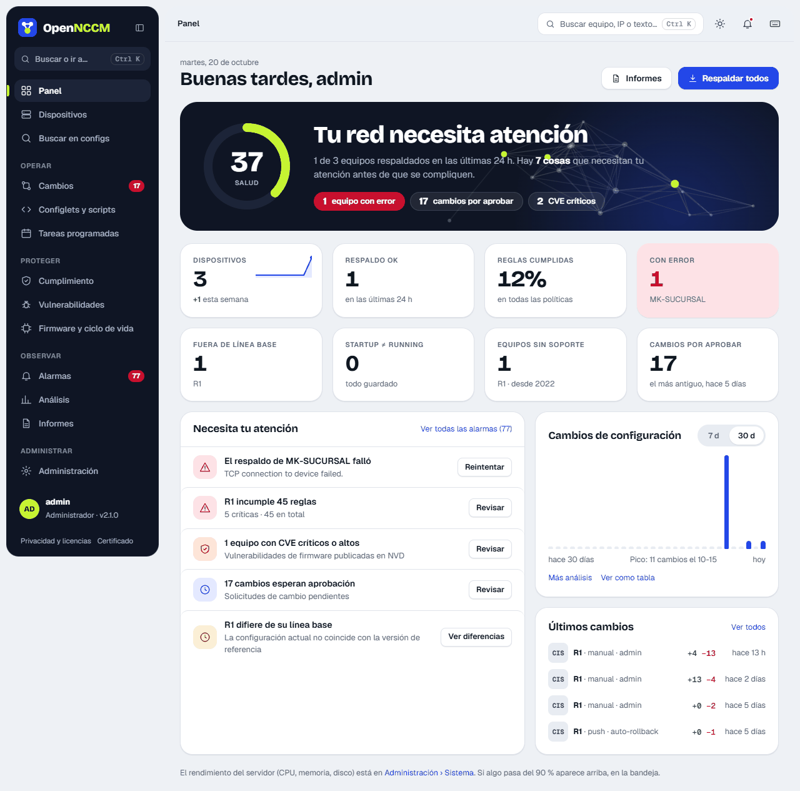
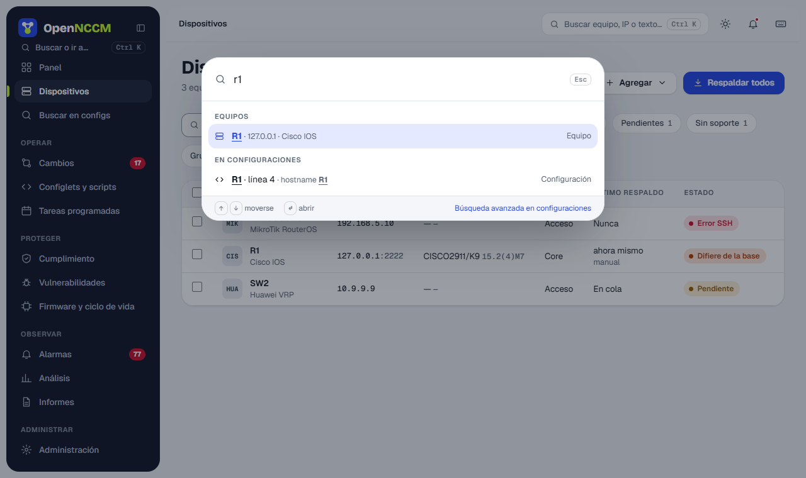

OpenNCCM keeps a complete, encrypted history of every network device's configuration, detects when and how it changes, controls who can change it and checks that it complies with your policies.

## Typical workflow

1.  An administrator loads credentials, groups and devices.
2.  OpenNCCM backs up each device (manually, on a schedule or when syslog arrives) and saves a new version only if something changed.
3.  Each backup triggers the compliance audit and the comparison with the baseline.
4.  Changes, violations and failures raise alarms and notifications.
5.  Operators propose changes (configlets, fixes, rollbacks, firmware); an administrator approves them.
6.  Reports and the Analytics page show the state of the whole network.

## Main menu

The sidebar groups the pages by task: **Operate** (Changes, Configlets, Tasks), **Protect** (Compliance, Vulnerabilities, Firmware and lifecycle), **Monitor** (Alarms, Analytics, Reports) and **Administer** (users, credentials, groups, platforms, audit log, system and settings, in tabs). The numbers next to Changes and Alarms show what is pending. The button at the top of the sidebar collapses it to icons only.

**Ctrl K** (or the search box in the top bar) opens a palette to go to any page, open a device by name, IP, model or serial, run actions or search for text in every configuration. Notices for each action appear at the bottom right; when the action can be undone (for example, acknowledging alarms) the notice has an **Undo** button.

## Dashboard

### Network health

A score from 0 to 100 sums up the state: 40% devices backed up in the last 24 hours, 30% compliance rules passing, 15% devices without critical or high CVEs and 15% devices still supported by the vendor. Below it, a sentence and some tags say what is pulling it down.

| Indicator | What it counts |
| --- | --- |
| Devices | Managed devices, with their trend and how many were added this week. |
| Backup OK | Devices backed up successfully in the last 24 hours. |
| Rules passed | Percentage of compliance checks (device × rule) that pass. |
| With errors | Devices whose last backup failed (in red if there are any). |
| Off baseline · Startup ≠ running | Devices that differ from their baseline or have unsaved changes. |
| Unsupported devices · Changes to approve | Devices without vendor support and pending requests (with the oldest one). |

Each indicator leads to the filtered list. **Needs your attention** lists the most important issues ordered by severity (failed backups, critical CVEs, violations, devices off baseline, changes to approve…), each with its action button. Next to it, the **Configuration changes** chart shows the changes per day over the last 7 or 30 days.

### Server performance (administrators only)

In **Administration → System** administrators see the state of the OpenNCCM server itself: current CPU use (and load), RAM, disk used and the space taken by OpenNCCM's data, and uptime. Two charts show CPU and memory use over the last 24 hours (5-minute averages; hover to see each value) and bars show disk, memory and swap used, free and total. If disk or memory goes above 90%, its indicator turns red.
