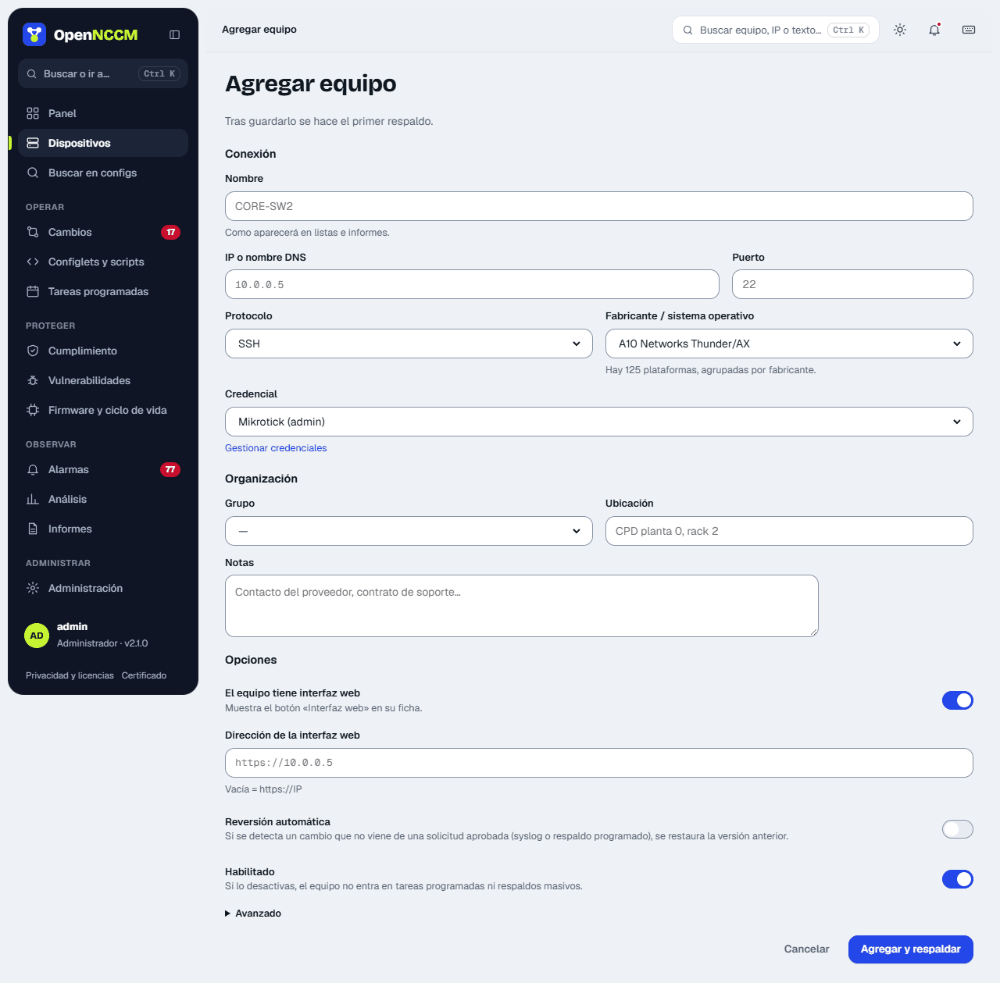
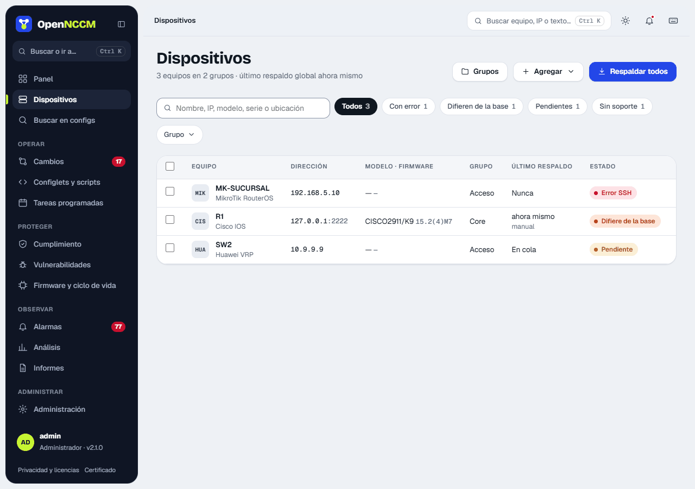

## Add devices

**Devices → + Add** menu. Fill in name, IP, vendor/operating system, protocol, credential and group. When you save, OpenNCCM takes the first backup automatically.



## Bulk import from CSV

For many devices, prepare a CSV in Excel (save as "CSV UTF-8") with these columns and upload it at the bottom of the **Devices** page:

```bash
name,host,device_type,credential,group,port,protocol,location
core-sw1,10.0.0.1,cisco_ios,net-admin,Core,22,ssh,Datacenter
fw-01,10.0.0.254,fortinet,firewalls,Security,22,ssh,Datacenter
edge-r1,10.0.1.1,juniper_junos,net-admin,WAN,22,ssh,North Branch
```

The `device_type` value of each platform is in **Administration → Platforms** (the `/vendors` page). Groups that do not exist are created automatically.

## Check the first backup

Open the device. If the status is **ok** you will see its model, serial number, firmware version and the first configuration version. If it is **error**, the red box gives the cause (see [Troubleshooting](/en/instalacion/problemas/)).


