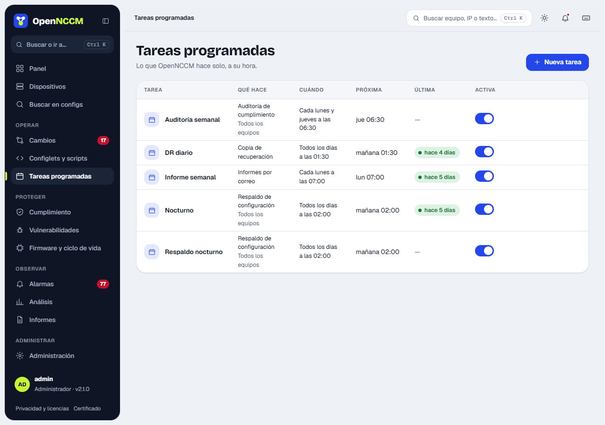

**Tasks** menu. Expressions use the 5-field cron format: minute, hour, day, month and day of week.

| Task | Action | Cron | Meaning |
| --- | --- | --- | --- |
| Nightly backup | Configuration backup | `0 2 * * *` | Every day at 02:00 |
| Recovery backup | OpenNCCM recovery backup | `30 3 * * *` | Every day at 03:30 |
| Weekly audit | Compliance audit | `0 6 * * 1` | Mondays at 06:00 |
| Vulnerabilities | Vulnerability scan (NVD) | `0 4 * * 0` | Sundays at 04:00 |
| Weekly report | Send reports by email | `0 7 * * 1` | Mondays at 07:00 |

