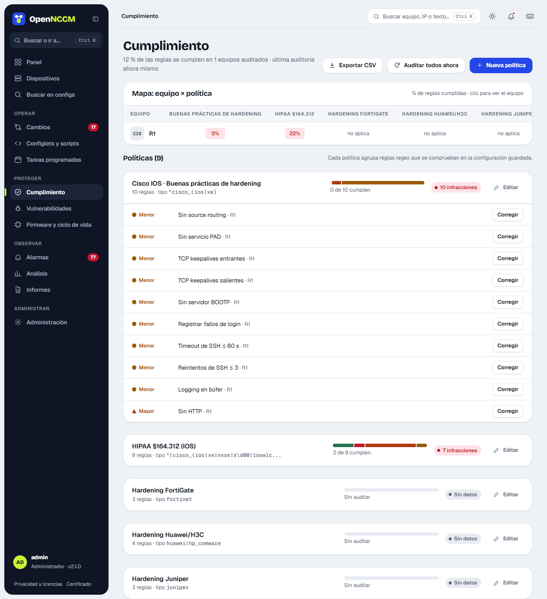
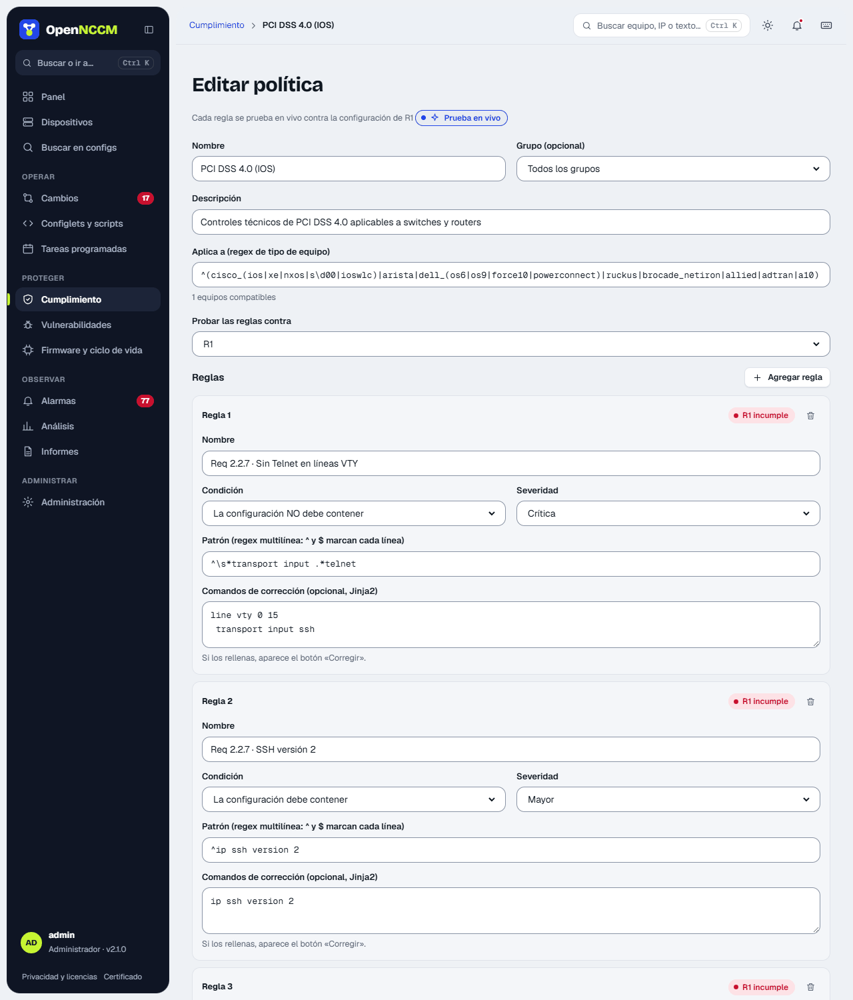

## How it works

-   A **policy** groups **rules** and applies to devices whose device\_type matches its filter (and optionally to a group).
-   Each rule is a regular expression that the configuration **must contain** or **must not contain**, with a severity (critical, major, minor) and, optionally, **fix** commands.
-   The audit runs by itself after each backup, and also on demand or on a schedule.

## Included packs

| Policy | Rules | Example controls |
| --- | --- | --- |
| PCI DSS 4.0 (IOS) | 15 | No Telnet (Req 2.2.7), no HTTP, no default SNMP communities, passwords ≥ 12, lockout after failed attempts, session ≤ 15 min, AAA, management ACL, syslog, NTP, banner |
| HIPAA §164.312 (IOS) | 9 | Access control, automatic logoff, command auditing, encrypted transmission, SNMPv3 |
| SOX ITGC (IOS) | 8 | Configuration archive, command logging and *accounting*, centralized authentication |
| Cisco IOS · Best practices | 10 | Source routing, PAD, keepalives, BOOTP, SSH timeouts |
| PCI DSS 4.0 (Junos) | 7 | Telnet, HTTP web, root over SSH, retries, idle-timeout, syslog, NTP |
| Extreme VOSS · Basic security | 12 | No Telnet, FTP, TFTP or rlogin; SSH; web over HTTPS only; SNMP without default communities; session timeout ≤ 15 min; RADIUS/TACACS+; syslog; NTP; banner |
| Ubiquiti EdgeSwitch/UniFi · Basic security | 7 | No "ubnt" account; SSH; no Telnet or unencrypted HTTP; SNMP without default communities; syslog; SNTP |
| MikroTik RouterOS · Basic security | 13 | Telnet, FTP, www and API disabled; Winbox and MAC-Telnet restricted; input firewall; SNMP; syslog; NTP |
| Juniper Junos · Basic security | 13 | No Telnet, FTP or J-Web HTTP; root without SSH; lockout after failed attempts; idle session; RADIUS/TACACS+; SNMP; syslog; NTP; banner |
| Ubuntu / Debian · Basic security | 8 | SSH without root password login or empty passwords; only root with UID 0; passwordless sudo only for specific commands; firewall active; automatic security updates; NTP; no Telnet, rsh or TFTP |
| WatchGuard Fireware · Basic security | 10 | Web UI and management (WSM and CLI) not open to the Internet; account lockout; idle session ≤ 15 min; SNMP without default communities, and v3; NTP; log forwarding; spoofed-packet blocking; pre-login notice. No automatic remediation: fix it in the Web UI or Policy Manager |
| Aruba ArubaOS · Basic security | 6 | No Telnet; SNMP without default communities; enable password; NTP; remote syslog; login banner (controllers and Mobility Access Switch) |
| FortiGate · Basic security | 11 | No Telnet or HTTP on interfaces; session ≤ 15 min; trusted hosts; password policy; strong crypto; SNMP; syslog/FortiAnalyzer; NTP |
| Basic hardening (Cisco, Huawei, Juniper, FortiGate) | 3 – 9 | Essential controls per vendor |

The rules are reference technical controls. Full regulatory compliance also requires processes and evidence that do not depend on the device. New packs in each version load by themselves on upgrade; if you delete one, it does not come back. Rules that depend on each network's addresses (syslog or NTP servers, management networks) come without fix commands: they say what is missing and the command is written with the real addresses. A change request with example addresses (192.0.2.x, 198.51.100.x, 203.0.113.x) cannot be approved.

## How to use it

1.  The **device × policy map** shows the percentage of rules each device passes in each policy (green, amber or red); a click takes you to the device. Below, each policy shows a bar per severity and, when expanded, the failing rules and on which devices. Severity is also shown by shape (diamond critical, triangle major, circle minor). Each rule with a fix shows its badge ("Not verified" or "Verified · version") and **Fix** (or **Fix on N devices…**), which opens a dialog with the commands, the devices to tick (one request per device), the notice with the forum and a pre-filled GitHub report, and the required "I reviewed the commands…" box. On the device page, **Fix N** ("Fixes are commands that change the configuration") opens "Fix N violations on DEVICE": each fix with its box, its badge and its commands, and **Create request (N fixes)** creates a single request with the ticked ones. **Fix** on a rule opens the same dialog with just that fix.
2.  To create or change a policy: **New policy** or **Edit** open the editor in a side panel. Each rule has a name, condition (must or must not contain), severity, pattern and optional fix, and is **tested live** against the chosen device's configuration as you type ("passes" / "fails"). **Save** saves the policy and all its rules at once.
3.  Use **Audit all now** after changing rules.

## Automatic remediation (optional)

A policy can fix on its own the devices that fail some of its rules, without anyone clicking **Fix**. It comes **off** in every policy: while it is not enabled, nothing changes. Open it with **Compliance → Automatic remediation**, which shows each policy's status, what would be applied right now and the history.

-   **Verified rules only.** Only rules with fix commands and the **Verified** badge can be chosen (their commands were tested in full on a real device). If someone later changes the pattern or the commands of a chosen rule, it stops being applied on its own until it is reviewed and ticked again ("changed: choose again").
-   **Window.** Days of the week and, optionally, hours (for example 22:00 to 06:00: a window that crosses midnight counts from the day it starts). Without hours, at any time on the ticked days.
-   **On each device and rule:** it backs up the device (the version to go back to) and checks the rule still fails; it runs the same checks as a change request (example addresses, not locking OpenNCCM out, reboots and ports that get shut down) and, if anything comes up, applies nothing and is left **Blocked**; it applies the commands, backs up again and audits. If the device rejects a command or the rule still fails, it goes back to the previous version (**Rolled back**).
-   **No insisting.** After an attempt, that rule is not tried again on that device for 24 hours, unless you click **Retry** in the history. It also leaves alone a device that is disabled, retired or having another change applied.
-   **History.** Each attempt is kept with its result (Applied, Rolled back, Blocked, Failed), the reason, the device output and links to the versions before and after; also in Events and Audit.
-   **Pause all** stops automatic remediation across the whole system instantly; **Check now** does not wait for the next check (every 5 minutes and after each audit).
-   Enabling, configuring or pausing it is the critical function **Automatic remediation** (for administrators; the master administrator grants or removes it). Every user can see the history of their devices.
-   **In the name of whoever enables it.** Each activation is recorded in the name of the user who saved it ("enabled by …") and only fixes the devices that user can see: if they are limited to some groups, only those groups. This is checked on every fix: if that user is deleted, disabled or loses the function, the policy stops fixing on its own until someone else saves it again (and the page says so). Policies enabled in 2.40.0 have no owner: they stop fixing until someone saves them again.
-   **Per device.** In **Edit device**, **Allow automatic remediation** (on by default): when off, no policy fixes that device on its own; it is still fixed by hand with **Fix**.

:::note[Approval]
Automatic remediations do not go through the change-request approval flow: enabling them on a policy is that approval, and it is logged in Audit with the chosen rules and the window.
:::

