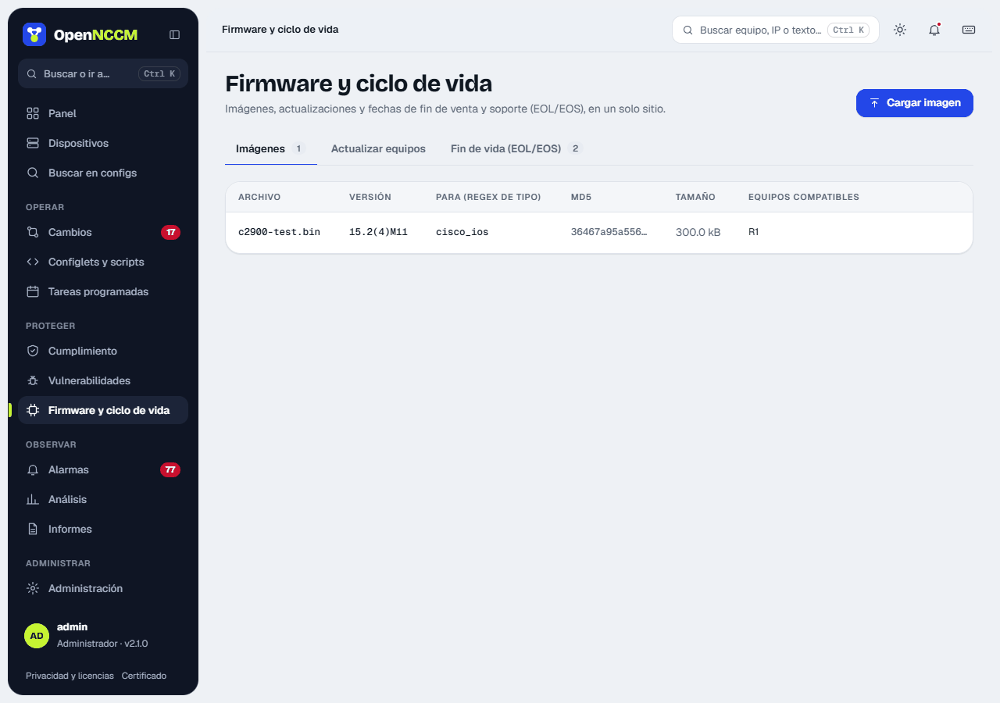
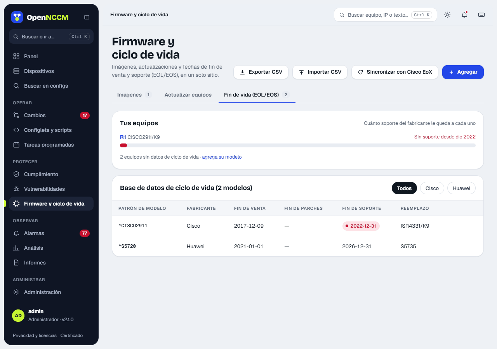

| Platform | Target | Boot configuration |
| --- | --- | --- |
| Cisco IOS | `flash:` | `no boot system` + `boot system flash:IMAGE` |
| Cisco IOS-XE (bundle mode) | `bootflash:` | `boot system bootflash:IMAGE` |
| Cisco NX-OS | `bootflash:` | `boot nxos bootflash:IMAGE` |
| Cisco ASA | `disk0:` | `boot system disk0:/IMAGE` |
| Arista EOS | `flash:` | `boot system flash:IMAGE` |
| Juniper Junos | `/var/tmp` | `request system software add … no-validate` |
| MikroTik RouterOS | router root (SFTP, size checked) | Installed on reboot (`/system reboot`) |
| Ubiquiti airMAX (airOS) and airFiber | `/tmp/fwupdate.bin` (SCP, size checked) | `fwupdate -m` writes it and reboots (Ubiquiti's method) |
| Ubiquiti EdgeRouter | `/tmp` (SCP) | `add system image …` and `reboot` |

On MikroTik, airOS, airFiber and EdgeRouter, OpenNCCM **backs up the device first** before touching the firmware and does not continue if the backup fails. MikroTik can also be upgraded **online**, without uploading the package: **MikroTik: update from MikroTik** chooses the channel (stable or long-term) and the router downloads it from MikroTik (`/system package update`); if it already has the latest version it does nothing, and without "Install and reboot" it only downloads it for the next reboot. Tested on real RouterOS in CI (7.23.8 → 7.25 with the package, and online). UniFi APs, switches and USGs upgrade their firmware from the UniFi Network controller.

## How to use it

1.  (admin) **Firmware and lifecycle → Images → Upload image**: drag the file, enter the version and which device\_type it is for. If you paste the vendor checksum (MD5 or SHA-256 from its download page, in **Vendor checksum**), OpenNCCM compares it with the file and does not save it if it does not match (nor does it replace any image with that name). The table shows the checksum, size and compatible devices.
2.  **Upgrade devices** tab (or **Use** on the image): choose the image; compatible devices with a different version are ticked automatically. If appropriate, tick **Reboot each device when done** and click **Create upgrade request**. With several devices, choose how many at a time (**Devices at a time**). You can also do it from each device's page.
3.  An administrator reviews the planned steps and approves. Before approving, **Check the devices** connects to each one without copying or changing anything and says whether it responds, which version it has and whether there is room for the image ("Ready" / "Not possible"). The result shows whether the file already existed, whether it was transferred and whether the checksum matched.
4.  Then OpenNCCM checks the version: it waits for the device to come back from the reboot (up to 20 minutes), asks it for its version, backs it up and looks for updates again. Events and the change request say "now on version X"; if it is still on the old one, it warns "the upgrade was not applied" with the end of the device's log, which usually gives the reason. If it does not respond again, it says so too.

### Many devices at once

-   **Free space:** before copying, it checks how much room there is where the image goes (`dir flash:` on Cisco and Arista, `free-hdd-space` on MikroTik, `df -k` on airOS and EdgeRouter). If it is not enough (the image plus a margin of 1 MB or 2 %), that device is left alone and it says how much is missing.
-   **Checksum on the device:** after copying, the device itself computes the file's checksum and it is compared with the image's: MD5 on Cisco, Arista and Junos; SHA-256 (or MD5 if it lacks it) on airOS and EdgeRouter. If it does not match, it is not installed. RouterOS does not compute file checksums: the size is compared.
-   **Batches:** **Devices at a time** (1, 2, 5, 10, 20 or all). With a reboot, each batch waits for the devices of the previous one to come back on the new version, and if one fails the next batches do not start (this can be unticked). The impact-analysis order is also followed: never two devices that together would leave others without service. Devices already on the image's version are left alone ("Unchanged").
-   **Progress per device:** the request shows live, per device, its batch and its step (backing up, checking space, copying with its percentage, verifying the checksum, installing, rebooting, checking the version) and how it ended.

**Several devices with reboot:** the request shows the suggested order (first those that isolate nobody, together; then, one at a time, those that do) and runs in that order, waiting for each step to finish. It never reboots at the same time two devices that together leave more without service than each one separately, and it says which ones. See the [impact analysis](/en/cambios/solicitudes/#impact-analysis-what-goes-down-if-i-touch-this-device).

## Available updates

Once a day OpenNCCM checks whether there is a newer firmware version for each device, and what it improves. The **Available updates** tab in **Firmware and lifecycle** lists all devices (those with a new version first); each device shows the tag **Firmware X available** and, in its Firmware tab, the **Firmware updates** section. When a new version appears a notice is recorded in Alarms, once per version. A new device is checked as soon as it makes its first backup, without waiting for the daily check, and the **Update firmware** card shows the available version also on devices that OpenNCCM cannot update.

| Devices | Where the version comes from | Download |
| --- | --- | --- |
| MikroTik RouterOS | MikroTik's official site (stable and long-term), with its release notes | Yes, the file for the device's architecture |
| Ubiquiti EdgeSwitch, EdgeRouter, UniFi Switch, airMAX (airOS), airFiber, UniFi APs and USG | Ubiquiti's official catalog, per model | Yes |
| Ubuntu Server and Debian | Official release table (distro-info-data): the newest LTS or stable release and the end-of-support date of the installed one | No: upgrade on the server itself (`do-release-upgrade`) |
| Cisco, Fortinet, Juniper, Palo Alto, Arista, WatchGuard and others with CPE | NVD's (NIST) version dictionary: the newest in its branch and the most recent overall | No: the vendor requires an account |

-   **What it improves**: how many CVEs of the installed version no longer affect the new one (with the critical and high ones), the vendor's release notes when published and the link to them.
-   **Download to the library** (administrators, MikroTik and Ubiquiti): downloads the file from the official site, checks the SHA-256 sum the vendor publishes and saves it in Images. If the sum does not match, the file is discarded. It is then installed like any image: request, approval and prior backup.
-   For vendors that require an account, OpenNCCM tells you about the new version and what it improves; the file is downloaded from the vendor's portal and uploaded with **Upload image**.
-   **Check now** (on the device page) first asks the device for its installed version (query commands only, no backup) and then looks for the new one; **Check all now** uses the version from the last backup. Both run in the background. An administrator can turn off the daily check with **Check daily**. Only the MikroTik, Ubiquiti and NVD sites are queried, without sending any device data.

The NVD version is the most recent one NVD knows about, not an official announcement: confirm it with the vendor. If NVD knows no version equal to or newer than the installed one, OpenNCCM says it cannot tell whether a newer one exists. When the vendor does not publish its versions (like ZTE), the notice also says that your model's end-of-sale and end-of-support dates can be entered by hand (**End of life (EOL/EOS)** tab).

:::caution[Before upgrading in production]
Read the vendor's notes (free space, upgrade paths, *install* mode on IOS-XE) and test on a lab device. On Cisco, enable `ip scp server enable`.
:::

## End of life (EOL/EOS)

**What it is for:** know which devices are no longer sold, no longer get patches or are about to lose support, to plan their replacement.

### How it works

The **lifecycle database** associates a model pattern (a regular expression on the inventory model) with its dates. Each device takes the first matching entry and gets a status:

| Status | Condition |
| --- | --- |
| **Unsupported** | The end-of-support date has passed. |
| **No software patches** | The end of software maintenance has passed. |
| **End of support < 12 months** | Support ends within a year. |
| **End of sale** | No longer sold, but still supported. |
| **Current** | None of the above. |
| **No data** | There is no entry for its model. |

### How to load the dates

-   **By hand:** the **Add** button in the **End of life (EOL/EOS)** tab; as you type the pattern it shows which devices it matches. Each model in the table can be edited or deleted.
-   **CSV:** the **Import CSV** button, columns `vendor,model_pattern,end_of_sale,end_of_sw_maintenance,end_of_support,replacement,url`.
-   **Cisco EoX API:** with apiconsole.cisco.com credentials in Settings, the **Sync with Cisco EoX** button fills in the dates of every Cisco model in the inventory.

