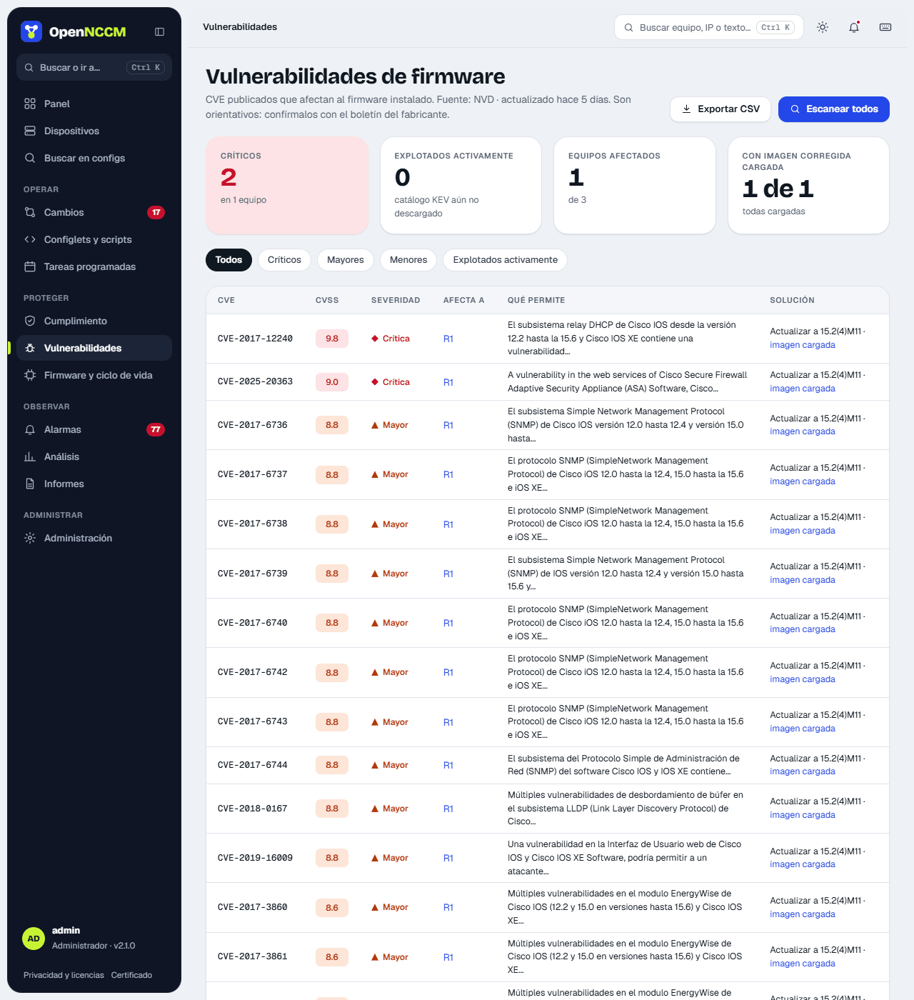

## How it works

With the firmware version read from the inventory, OpenNCCM queries NIST's public **NVD** database. It uses the vendor's CPE identifier when there is one (Cisco IOS/IOS-XE/NX-OS/IOS-XR/ASA, Junos, EOS, AOS-CX, FortiOS, PAN-OS, RouterOS, Ubiquiti EdgeSwitch, UniFi Switch and EdgeRouter, WatchGuard Fireware). On Junos it converts the version to NVD's format, which separates version and update ("21.4R3-S5" is looked up as "21.4:r3-s5"), and keyword search for the rest. It asks for CVEs in small pages and retries each one if NVD cuts the response, so it also works with versions that have many CVEs (for example, Cisco IOS 12.4). For Extreme VOSS / Fabric Engine, NVD records almost no vulnerabilities: the device page says so and links to Extreme's security advisories. It stores the CVE ID, CVSS score, severity and link, and raises a critical alarm if there are critical CVEs. It also downloads (at most once a day) CISA's **KEV** catalog and marks CVEs as **"actively exploited"**.

## How to use it

-   On a device: **⋯ → Look up firmware CVEs** menu. The lookup runs in the background: the Vulnerabilities tab shows "Searching NVD…" and updates by itself when done (with many CVEs it can take a few minutes). If NVD does not respond, the previous results are kept. For all devices: **Vulnerabilities → Scan all** or a scheduled task.
-   The page groups results by CVE (which devices it affects, what it allows and the fix: if a fixed image is already uploaded, it says so with a link). At the top, indicators for critical, actively exploited, affected devices and devices with a fixed image; the filters separate by severity or "Actively exploited".
-   Without an API key, NVD allows about 5 queries every 30 seconds and OpenNCCM waits as needed. A free key speeds it up (about 50 queries): set it in **Settings › Vulnerabilities (NVD)**, where it is stored encrypted, or in `NCM_NVD_API_KEY` in the `opennccm.env` file, which takes precedence.

Results depend on how NVD records each version: always confirm with the vendor's advisory.
