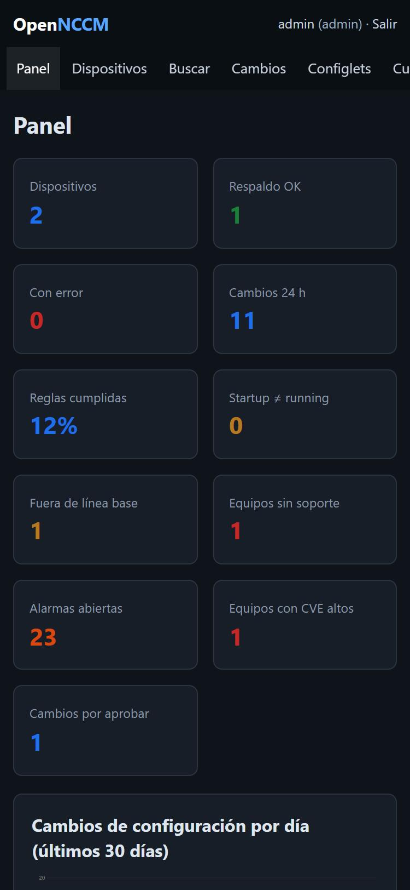

The interface adapts to small screens: a bar with Dashboard, Devices, Changes, Alarms and More (which opens the full sidebar) appears at the bottom and the indicators are shown in two columns. If the phone uses a dark theme, so does the application.

No app needs to be installed: just open the server's address in the phone's browser (inside the VPN or the management network).

## JSON API

For scripts and other tools, each user creates their **API tokens** in **My account › API tokens** (with a name and an optional expiry of 30, 90 or 365 days). The token is shown **only once**; OpenNCCM only keeps its fingerprint, so if it is lost you have to create another one. It is sent in the `Authorization: Bearer ncm_…` header, acts with its owner's permissions and groups, only works for `/api/…` (not for the web interface) and can be revoked at any time.

| Request | What it does | Role |
| --- | --- | --- |
| `GET /api/devices` | Inventory: name, IP, type, model, serial, version, status and last backup. | Viewer |
| `GET /api/devices/{id}` | Device details (group, location, notes, last error, baseline). | Viewer |
| `GET /api/devices/{id}/versions` | Saved versions (up to 500), with source and changed lines. | Viewer |
| `GET /api/devices/{id}/config[?version=N]` | Configuration as text: the latest or version N. | Viewer |
| `POST /api/devices/{id}/backup` | Backs up now; returns `first`, `changed`, `unchanged` or `error`. | Operator |
| `POST /api/devices` | Add with JSON: `name`, `host`, `device_type` and optional `port`, `protocol`, `credential`, `group`, `location`, `notes`. | Administrator |

Without a token or with an expired one the answer is 401; without permission, 403. Additions, backups and configuration reads through the API are recorded in the Audit log.

`GET /healthz` returns `{"status":"ok"}` for monitoring systems.

