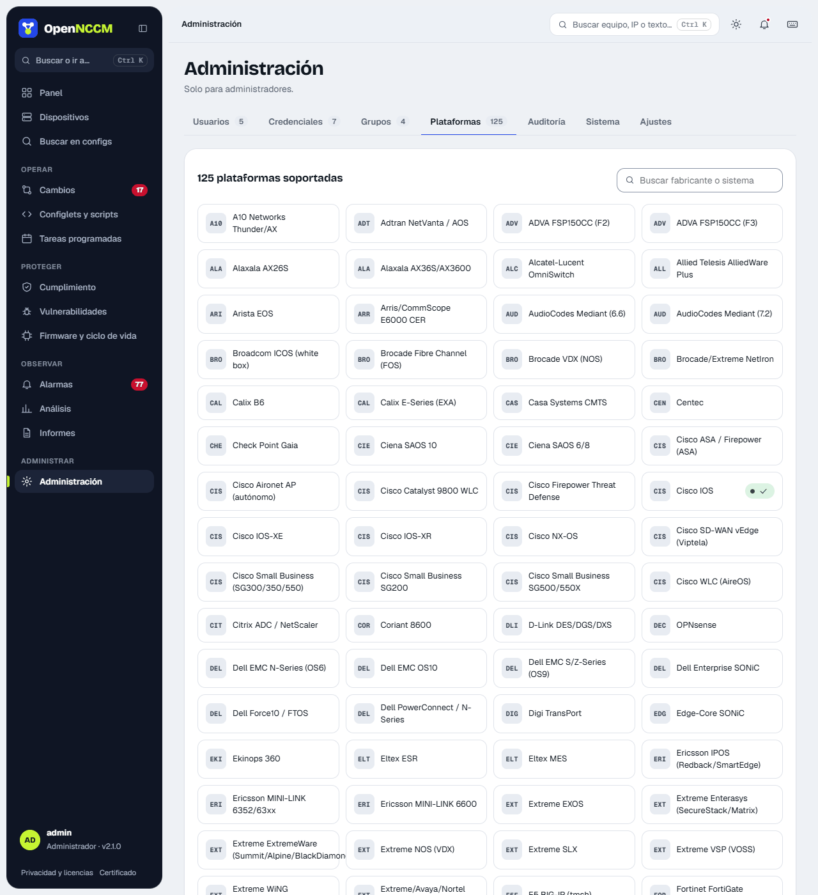

**Administration → Platforms**. It shows the 133 platforms as cards (those verified on your network carry a mark) and, in **Commands per platform**, their `device_type` and the commands run on each: **backup**, **startup** (to detect unsaved changes) and **inventory** (model, serial and version); also the rollback type and whether firmware upgrades are supported.

-   **Search** and **vendor filter**; the **Only those on my network** box shows only the platforms you use.
-   **Verified on your network**: marked only when a device of that platform completes its first successful backup, with the number of devices and the date (and whether it uses a custom command).
-   **to be verified**: command taken from the vendor's documentation, not yet tested on a real device.

The configuration is obtained by showing the command's output within the same SSH session: no files are created on the device and no FTP/TFTP is needed. **WatchGuard Fireware** is backed up with `export config to console` (the full configuration in XML) and, once, its *feature key* is stored, encrypted, exactly as it is pasted to restore it (Serial Number, License ID, Name, Model, Version, one Feature line per feature, Expiration and Signature), and can be downloaded from the device page. The detail comes from the CLI (`show feature-key` and `show feature-key ID`); the signature does not, so OpenNCCM briefly signs in to the Firebox Web UI (System › Feature Key, port 8080 or the device's "Web interface" port) with the same credential, reads it and signs out. If it cannot sign in, it stores the detail without the signature (the device page says "no signature: not usable for restore yet"), warns once per reason and retries: after an hour if the Web UI did not answer, and the next day if it rejected the login, so as not to keep trying the password. Under **Services**, the device page shows when each subscription expires (antivirus, IPS, LiveSecurity…), in amber with 60 days or less left and in red once expired; OpenNCCM warns at 60, 30 and 7 days and on expiry, once per date, and while something is about to expire it rereads the feature key once a day to catch the renewal. The [Licenses about to expire](/en/observar/informes/) report lists them for all devices. A read-only user (Device Monitor) is enough for all of it. To recover that same Firebox it can also store its [full encrypted image (.fxi)](/en/equipos/dispositivos/#watchguard-configuration-xml-and-full-image-fxi), with an administrator credential. If a command does not work for your version, set a **custom backup command** on the device. For devices without their own profile (SonicWall, Riverbed, Infoblox…) use **Generic SSH** with a custom command.

**pfSense and OPNsense** have their own profile: OpenNCCM goes through the console menu (option "8) Shell") and backs up the complete `config.xml` file, the same one the web interface exports. Use the `admin`/`root` user (only root can read the file); the inventory brings version, model and serial number. Changes are still made from the firewall's web interface. Since 2.34 each one is its own platform in the console, Recipes and Configlets, with its own recipes. **Alpine Linux** backs up network, DNS, installed packages (`apk world`), services, SSH and firewall rules.

**Ubuntu Server / Debian** (Ubuntu 26.04, 24.04 and 22.04 LTS; Debian 12 and 13) backs up text configuration only: name, network (netplan or `/etc/network/interfaces`), DNS, SSH, accounts and groups, sudo, repositories, manually installed packages (not each one's version, which changes daily), enabled services, cron jobs, time (chrony or timesyncd) and firewall (ufw, iptables and nftables, without packet counters). It **never** copies passwords (`/etc/shadow`), private keys, certificates or data, and netplan Wi-Fi passwords come out as `***`. A typical backup takes about 20–60 KB. Some files (netplan, root's crontab) and the firewall can only be read as root: give the OpenNCCM user passwordless `sudo`, ideally only for those read commands; without `sudo` the rest is backed up. The inventory reads the version from `/etc/os-release`, and **Available updates** reports the new LTS and the end-of-support date.

**Ubiquiti airMAX, airFiber and UniFi.** airMAX M (M2, M5 with airOS 6), airMAX AC (airOS 8), airFiber (AF5XHD, AF60, AF24HD, AF5X) and UniFi APs keep their whole configuration in `/tmp/system.cfg`, which is what gets backed up; version and model come from `/etc/version` and `/etc/board.info` (or from `info` on UniFi), and the serial number is the MAC, as Ubiquiti shows it. The USG is backed up with `show configuration commands`. UniFi switches, APs and USGs are configured by the UniFi Network controller: changes and their rollback are made there. On airMAX, airFiber and UniFi APs the backup downloads as `system.cfg`, ready to restore: on airOS, *System › Configuration Management › Upload Configuration*.

**ZTE.** **ZXA10** GPON/EPON OLTs of the C300 series (C300, C320, C350 and C220), **ZXA10 TITAN** OLTs (C600, C610, C620, C650 and C680) and **ZXR10** switches and routers (ZXROS: 2900E, 5900E, 5960, 8900E, 9900, M6000…) are backed up with `show running-config`, over SSH or Telnet. Version and model come from `show system-group` (C300), `show software` (TITAN) or `show version` (ZXR10), and the cards from `show card`; the serial number is read too. An OLT's configuration includes every ONU: with thousands of ONUs it takes a while to read (up to 15 minutes).

**MikroTik SwitchOS** (SwOS and SwOS Lite) has no SSH: OpenNCCM downloads over HTTP (port 80) the same `backup.swb` backup as its web interface, and reads the model, version and serial from it. It does not support command-based changes or the console; to restore, use *Restore Backup* in SwitchOS with the downloaded file.

