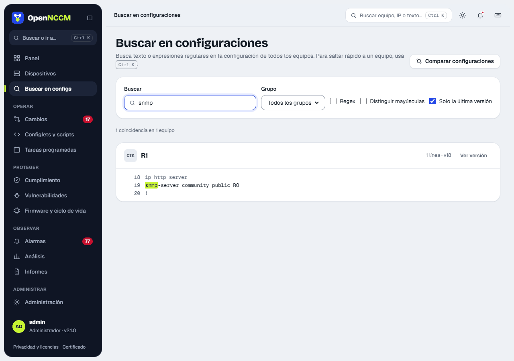

Escriba el texto (o una expresión regular marcando la casilla) y pulse **Buscar**. Se busca en la última configuración en ejecución de cada equipo y se muestran las líneas con su número. Si coinciden más de 100 equipos se muestran los 100 primeros (por nombre) y se dice cuántos hay en total: afine la búsqueda o elija un grupo para ver los demás.

