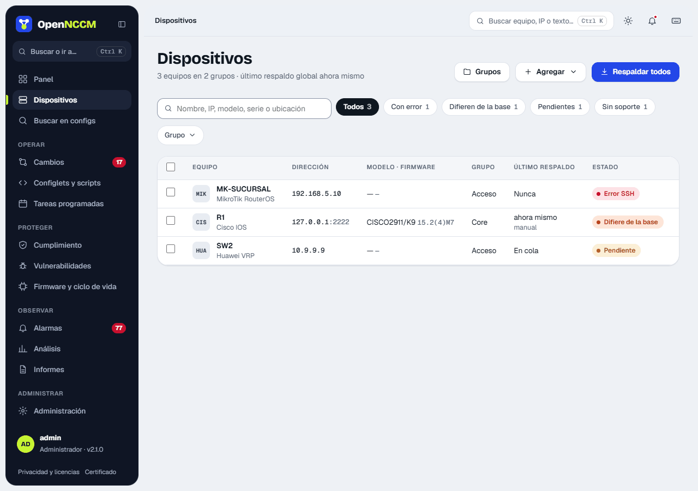
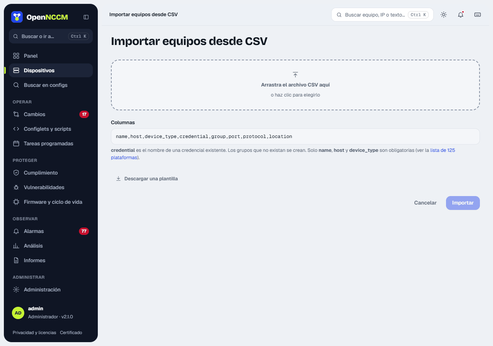
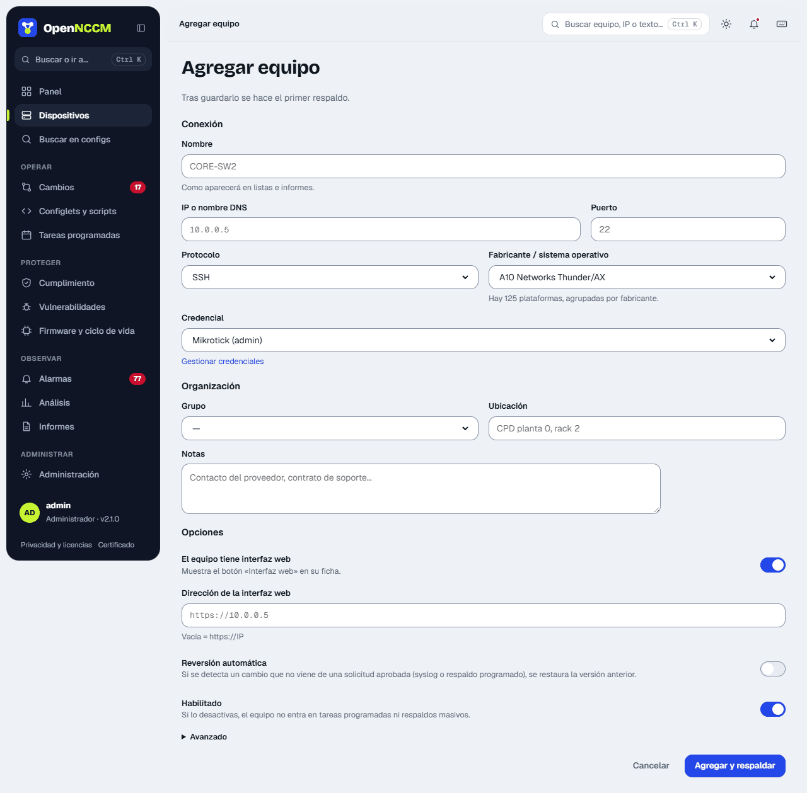
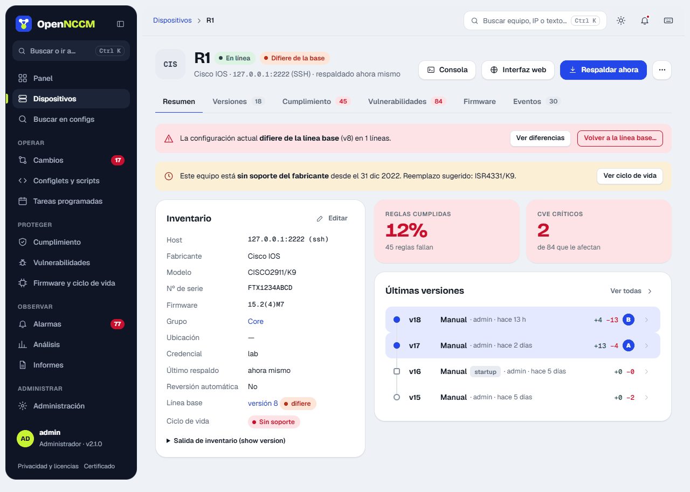
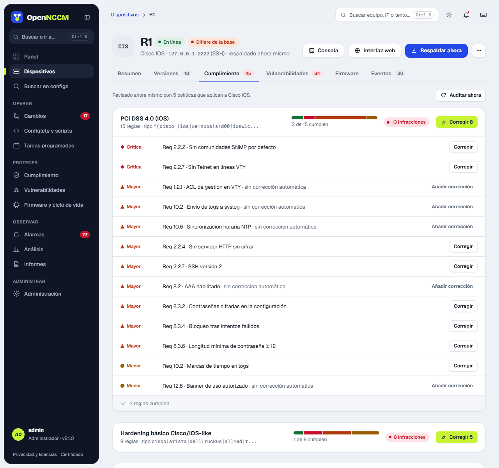

## Cómo usarlo

-   **Buscar y filtrar:** por nombre, IP, modelo, serie, versión o ubicación; por grupo; y por estado (ok, error, pendiente, startup ≠ running, fuera de línea base).
-   **Respaldar todos:** lanza en segundo plano el respaldo de todos los equipos (o del grupo filtrado).
-   **Acciones de la fila:** al pasar el ratón aparecen respaldar, consola e interfaz web del equipo.
-   **Acciones masivas:** marque varias filas y use la barra inferior para respaldarlas, auditarlas o moverlas a un grupo.
-   **\+ Agregar** (admin): **Agregar un equipo** abre el formulario de alta en un panel lateral; **Importar CSV** abre la importación masiva; **Importar desde Zabbix** trae los hosts de Zabbix.

## Importar desde CSV

El panel explica las columnas (`name,host,device_type,credential,group,port,protocol,location`; solo las tres primeras son obligatorias) y ofrece una plantilla para descargar. Al elegir el archivo muestra una **vista previa** con cada fila válida o su error (plataforma desconocida, credencial inexistente, puerto o protocolo no válidos, nombre repetido). Las filas con error se omiten y las válidas se importan; los grupos que no existen se crean.

## Importar desde Zabbix

Si los equipos ya están en Zabbix (6.0 o posterior), **\+ Agregar › Importar desde Zabbix** los crea sin escribirlos uno a uno:

1.  **Conectar:** la dirección de la interfaz web de Zabbix y un **token de API** (en Zabbix 7: Usuarios › Tokens de API; en 6.0: Administración › General › Tokens de API), o un usuario y su contraseña. Basta con un usuario de solo lectura que vea los hosts. El token y la contraseña no se guardan; la dirección sí. Si Zabbix usa un certificado autofirmado, desmarque *Verificar el certificado*.
2.  **Elegir los grupos:** salen los grupos de Zabbix con cuántos hosts tiene cada uno y cuántos son nuevos. Marque los que quiere migrar (o *Marcar todos*); solo se importan los equipos de esos grupos.
3.  **Quitar equipos:** la lista muestra los hosts de los grupos marcados con su nombre, dirección (IP de la interfaz principal, o su nombre DNS), descripción, grupos de Zabbix y la **plataforma** deducida de las plantillas y el inventario de Zabbix (por ejemplo «Mikrotik by SNMP» → MikroTik RouterOS). Las que no se reconocen quedan como «Genérico» con la marca *revisar*; cada una se puede cambiar. Desmarque los que no quiera traer; se puede filtrar por texto. No se marcan los que ya existen en OpenNCCM (mismo nombre o dirección), los que no tienen dirección ni los desactivados en Zabbix.
4.  **Importar:** se guardan el nombre, la dirección (SSH, puerto 22), la descripción en *Notas* y, si Zabbix tiene inventario, el modelo, el n.º de serie y la ubicación. Opcionalmente, una credencial y un grupo para todos.

Las credenciales SSH no están en Zabbix. Si no elige una para todos, los equipos se crean **desactivados** (no se respaldan ni generan errores) hasta que edite cada uno, le asigne su credencial y su grupo, y lo active. Volver a importar más adelante solo añade los hosts nuevos.

## Alta de un dispositivo

| Campo | Descripción |
| --- | --- |
| Nombre | Identificador único (por ejemplo el hostname). |
| IP / hostname | Dirección de gestión. Debe ser la misma desde la que el equipo envía syslog. |
| Fabricante / sistema operativo | Perfil de la plataforma (131 opciones agrupadas por fabricante). Define los comandos que se usan. |
| Protocolo y puerto | SSH (22) o Telnet (23). Telnet solo en plataformas que lo admiten. |
| Credencial y grupo | Perfil de usuario/contraseña y grupo del equipo. Puede crear un grupo nuevo desde aquí mismo con «…o crear un grupo nuevo». También se administran en **Dispositivos → Grupos**. |
| ¿Tiene interfaz web? | **Sí** (por omisión) muestra el botón **Interfaz web** del equipo; se puede indicar su dirección si no es `https://IP/`. **No** oculta el botón para los equipos sin página de administración (muchos switches de acceso, servidores Linux…). Se puede cambiar después en **Editar**. |
| Comando de respaldo personalizado | Opcional: sustituye al comando del perfil (útil con el perfil «Genérico SSH» o versiones con otra sintaxis). |
| Habilitado | Si se desmarca, el equipo no entra en tareas programadas ni respaldos masivos. |
| Revertir automáticamente | Deshace los cambios no autorizados que se detecten (ver [Reversión](/cambios/reversion/)). |

## Ficha del dispositivo

Reúne todo sobre un equipo en pestañas: **Resumen** (inventario, línea base, ciclo de vida y últimas versiones), **Versiones**, **Cumplimiento**, **Vulnerabilidades**, **Firmware** y **Eventos**. Arriba están **Consola**, **Interfaz web** y **Respaldar ahora**; el menú **⋯** agrupa auditar, buscar CVE, actualizar firmware, editar, comparar con otro equipo, ver las diferencias con la línea base, volver a ella (si el equipo aún no tiene línea base, permite marcar la última versión) y eliminar. Para eliminar un equipo hay que escribir su nombre, porque se borra con todo su historial.

### Puertos del equipo

Entre la cabecera y las pestañas, una **franja de puertos** dibuja el frente del equipo con un icono por puerto en su orden físico: RJ45 para cobre y jaula SFP para fibra (vacía si no tiene módulo). En los equipos grandes van en dos filas, los impares arriba y los pares abajo. Al tocar un puerto se ven su estado, tipo, descripción, velocidad, dirección y vecino; «Ver todos los puertos» abre la pestaña **Puertos**, con la tabla *Interfaces* (filtros Todos, Activos, Inactivos, Fibra y, en equipos grandes, Apagados y Cobre; **Exportar CSV**) y una tarjeta del puerto con **Lo que dice el respaldo**: la línea de la configuración y la línea de estado que explican su color.

| Color | Significa |
| --- | --- |
| Verde | Activo: tiene enlace. |
| Gris | Habilitado sin enlace (o, si la plataforma no da el estado, habilitado sin más). |
| Ámbar con borde discontinuo | Apagado en la configuración (`disabled=yes`, `shutdown`). |
| Jaula vacía | Puerto de fibra sin módulo SFP. |

El frente se dibuja como el del modelo: una fila en routers y switches pequeños (hEX, RB4011 con su separación tras el puerto 5, US-8, firewalls de escritorio) y dos filas en los grandes, en bloques como en el equipo (CRS326 de 4 en 4 con los SFP+ abajo a la derecha; UniFi y EdgeSwitch de 24/48 y Cisco de 6 en 6 con los SFP de dos en dos). Los modelos que OpenNCCM no conoce se dibujan según cuántos puertos tienen.

La configuración solo dice si un puerto está apagado; el enlace se lee en la misma conexión del respaldo («leído en el respaldo de hace…»), con la orden de cada plataforma:

| Plataforma | Orden |
| --- | --- |
| MikroTik RouterOS | `/interface ethernet print` y `monitor` (estado, velocidad, módulo SFP) |
| Cisco IOS/IOS-XE, Arista, Dell, TP-Link, Ruckus y la mayoría de switches con CLI tipo Cisco | `show interfaces status` (o `show interface status/brief`) |
| Ubiquiti EdgeSwitch y UniFi (FastPath) | `show interfaces status all` |
| Huawei, H3C, HPE Comware | `display interface brief` |
| HPE ProCurve / Aruba OS-Switch · Aruba AOS-CX | `show interfaces brief` · `show interface brief` |
| Cisco NX-OS · ASA/FTD · WLC | `show interface status` · `show interface ip brief` · `show port summary` |
| Juniper · Extreme EXOS · Nokia SR OS | `show interfaces terse` · `show ports no-refresh` · `show port` |
| Extreme VOSS / Fabric Engine (VSP) | `show interfaces gigabitEthernet` (columna OPERATE de STATUS) |
| EdgeRouter, USG, VyOS | `show interfaces` (columna S/L) |
| FortiGate · Palo Alto · Check Point | `get system interface physical` · `show interface all` · `show interfaces all` |
| WatchGuard Fireware | `show status-report` (solo la sección «Physical Interfaces Link Status»; basta Device Monitor) |
| Linux, Ubuntu, airOS, airFiber, UniFi AP · pfSense, OPNsense | `/sys/class/net` · `ifconfig -a` |

Si el equipo no responde a ninguna, los puertos salen de la configuración en gris (apagado o habilitado) con el aviso «sin estado de enlace».

### Parte de atrás: fuentes y ventiladores

El botón **Atrás** de la franja muestra las **fuentes de alimentación** y los **ventiladores** del equipo: en verde los que funcionan (fuente con corriente, ventilador girando) y en rojo los que fallan o están sin corriente; con borde discontinuo, los que no están instalados. Así se ve de un vistazo si un equipo con dos fuentes tiene las dos conectadas. Si alguna falla, la franja lo avisa también desde el frente («Sin corriente o con fallo: PSU 2», «Ventilador parado: Fan 3») y el botón Atrás lleva un punto rojo. Se lee en el respaldo con la orden de cada fabricante: MikroTik `/system health print`, Cisco `show environment all`, Juniper `show chassis environment`, Huawei `display power` y `display fan`, HPE `show system fans/power-supply`, Aruba AOS-CX y Arista `show environment …`, FastPath `show environment`, Extreme EXOS `show fans/power`, Extreme VOSS / Fabric Engine `show sys-info` (secciones «Power Supply Info» y «Fan Info») y FortiGate `execute sensor list`. Los equipos que no informan de ello por SSH (por ejemplo, los routers pequeños sin ventiladores) lo indican en la vista Atrás.

En los equipos que tienen los puertos detrás, como el **WatchGuard Firebox T40**, la ficha se abre por **Atrás** y muestra el equipo como es: consola serie, los dos USB, los puertos con su rótulo (0/WAN, 1/LAN, 2, 3, 4-PoE), Reset, el interruptor y la entrada de corriente. **Frente** muestra sus luces (Failover, las de cada puerto, Status, Mode, Attn y encendido); pulsar las luces de un puerto lo elige. En WatchGuard el nombre de la interfaz, si está habilitada y su IP o las VLAN que pasan por el puerto salen de la configuración; el enlace y la velocidad, de `show status-report`. Atrás, el puerto con enlace sale en verde; delante se enciende la luz de su velocidad: la de 1000 en amarillo y la de 10/100 en verde, como en el equipo. **Mode** se ve verde si alguna interfaz externa tiene enlace y parpadea si ninguna lo tiene; **Status** queda apagada, porque en el Firebox solo se enciende 30 segundos cuando alguien entra por la Web UI o la CLI. Cada luz explica su estado al pasar el ratón.

## WatchGuard: configuración (XML) e imagen completa (.fxi)

La ficha de un Firebox tiene la pestaña **Respaldos** con los dos tipos de respaldo de WatchGuard:

| | Configuración (XML) | Imagen completa (.fxi) |
| --- | --- | --- |
| **Qué guarda** | Políticas, interfaces, VLAN, NAT, VPN, alias, usuarios y ajustes | Todo lo anterior, más los certificados con sus claves privadas, la feature key, las contraseñas y la información propia de ese Firebox. No el sistema operativo: desde Fireware 12.2.1 la imagen no lo incluye, y por eso pesa alrededor de 1 MB; para restaurarla, el Firebox debe tener una versión de Fireware compatible |
| **Qué no guarda** | La feature key (OpenNCCM la guarda aparte), los certificados con sus claves, las contraseñas propias del equipo y el Fireware OS | — |
| **Cuándo** | En cada respaldo; no cambia nada en el Firebox | Semanal, diaria (a las 03:00) o solo a mano |
| **Credencial** | Basta una de solo lectura (Device Monitor) | De administrador (Device Administrator) |
| **Úsela para** | Ver qué cambió, auditar el cumplimiento y llevar la configuración a otro Firebox (de reemplazo o de otro modelo) con Policy Manager | Recuperar el mismo Firebox tras un fallo, un restablecimiento de fábrica o una actualización que salió mal. No sirve para otro equipo: WatchGuard la considera única de cada Firebox |

Al configurar la imagen se elige la credencial de administrador, la **clave de cifrado** (8 a 15 caracteres, el máximo que admite Fireware; **Generar** crea una de 15; sin ella no se puede restaurar), la dirección por la que el Firebox llega a OpenNCCM (se detecta sola) y cuántas imágenes guardar; se conservan las últimas. **Probar conexión** pide al Firebox que suba su configuración al receptor, sin crear ninguna imagen.

Fireware solo entrega la imagen subiéndola por FTP. Para eso OpenNCCM abre un **receptor FTP temporal** solo mientras dura el respaldo (puerto 2121 y pasivos 50000–50010, configurables): acepta únicamente la IP del Firebox, con usuario y contraseña de un solo uso, y se cierra al recibir el archivo o a los 5 minutos. Si el servidor usa `ufw`, abre esos puertos solo para el Firebox y los cierra al terminar (si el servicio se detuviera, la regla se quita sola a los 6 minutos). En el Firebox se ejecuta `backup image`, `export image … to ftp://…` y `delete backup`: no queda ninguna copia en el equipo.

:::caution[Otro cortafuegos en el camino]
Si hay un cortafuegos entre el Firebox y OpenNCCM, permita el puerto 2121 y los pasivos 50000–50010 (TCP) desde el Firebox hacia el servidor.
:::

Si la imagen falla, la pantalla muestra el mensaje exacto del Firebox y qué revisar (cortafuegos, dirección, política del Firebox o credencial sin permiso). Si falla dos veces seguidas se abre la alarma **«Imagen .fxi sin crear»**; el respaldo XML no se ve afectado.

Cada archivo se descarga en su formato (`EQUIPO_v48.xml`, `EQUIPO_img-12.fxi`), nunca en .zip; **Descargar .xml y .fxi** baja los dos. La clave no va dentro de ningún archivo: solo los administradores la ven, en **Cómo restaurar**, y queda en [Auditoría](/administracion/auditoria/) quién la vio. Para restaurar la imagen: Fireware Web UI › **Sistema › Backup and Restore Image**, importar el .fxi y escribir su clave.

## Interfaz web del equipo

El icono de globo (junto al de la consola) y el botón **Interfaz web** de la página del equipo abren su página de administración en una ventana aparte. Por omisión se usa `https://IP-del-equipo/`; si el equipo usa otra dirección o puerto (por ejemplo `http://10.0.0.1:8080`), escríbala en **Editar → ¿El equipo tiene interfaz web? → Dirección**. Si el equipo no tiene web, marque **No** en esa misma pregunta y el botón deja de mostrarse. OpenNCCM no interviene en esa conexión: el navegador se conecta directamente al equipo.

:::note[Seguridad]
La consola usa la misma sesión que la página (no funciona desde otros sitios web), se cierra tras 15 minutos sin escribir (máximo 4 horas), y cada apertura, intento fallido, comando prohibido o peligroso, enlace compartido y cierre queda en **Auditoría**. Solo funciona con equipos configurados por SSH.
:::
