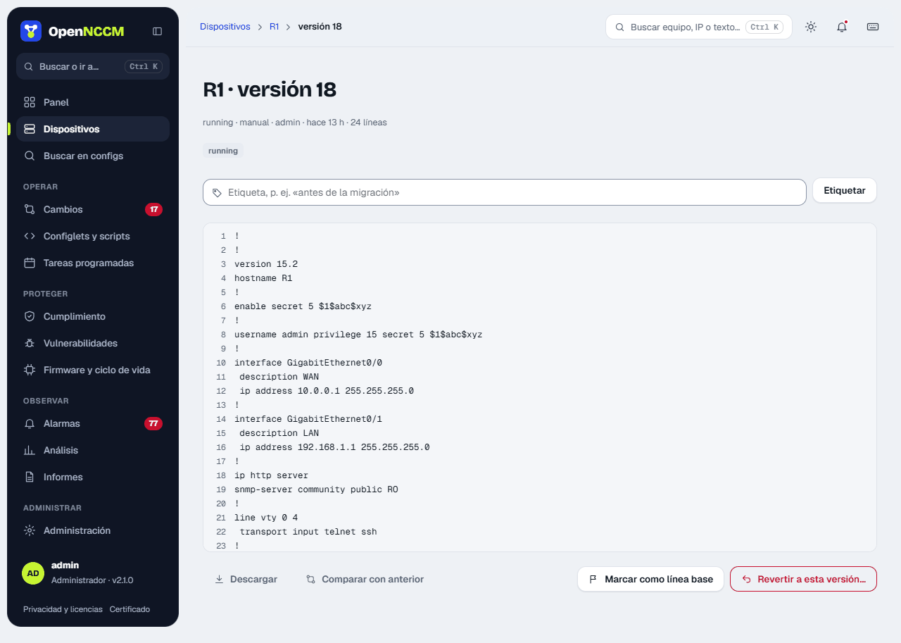
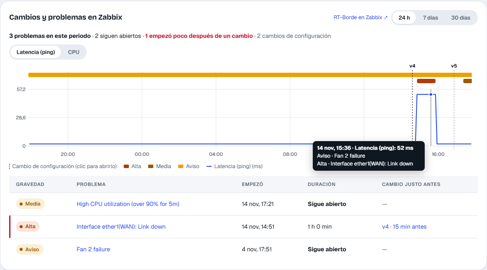
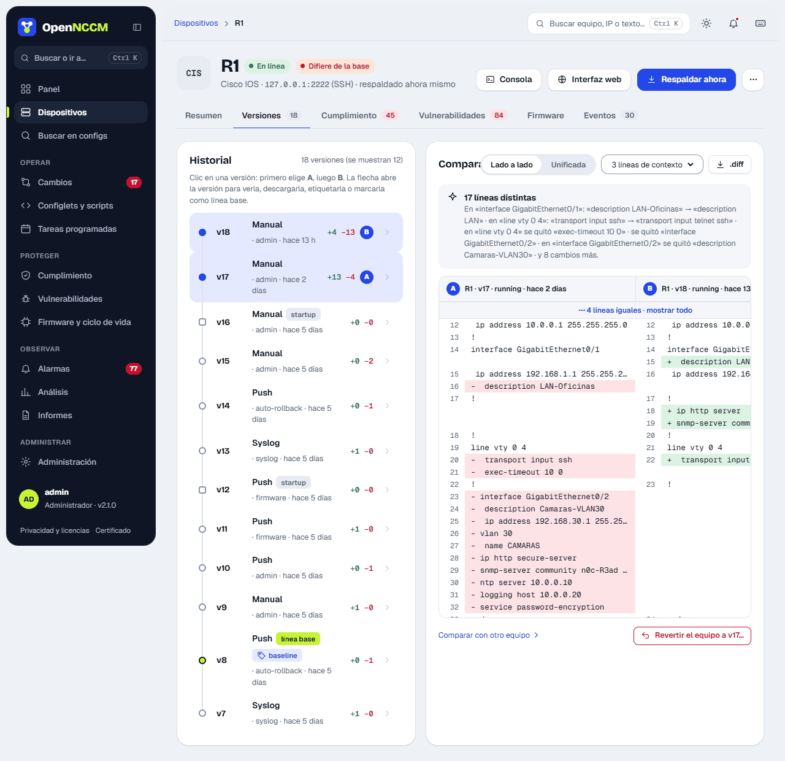
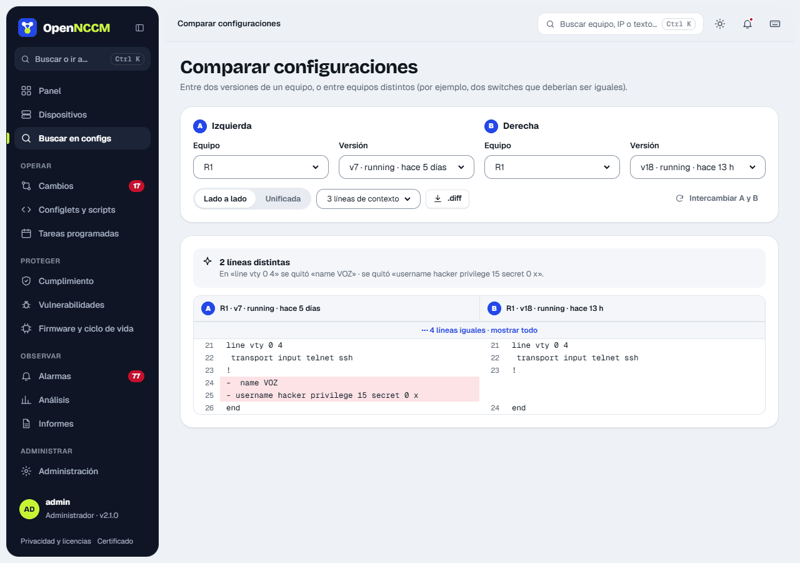
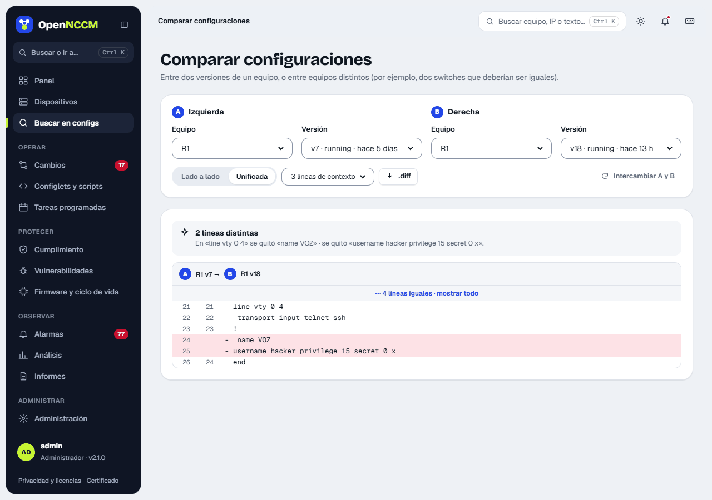

## Cómo funciona

1.  OpenNCCM se conecta al equipo con su credencial y ejecuta el comando de respaldo del perfil (p. ej. `show running-config`, `display current-configuration`, `show configuration | display set`).
2.  Quita las líneas volátiles (marcas de tiempo, checksums) para no registrar cambios falsos.
3.  Si el contenido cambió respecto a la última versión, guarda una versión nueva cifrada, con su huella SHA-256 y las líneas agregadas y quitadas.
4.  Si el perfil lo admite, respalda también la configuración de arranque y compara ambas (conflicto startup/running).
5.  Actualiza el inventario (modelo, serie, versión), compara con la línea base y ejecuta la auditoría de cumplimiento.

**Equipo reemplazado.** Si el número de serie que lee el respaldo no es el que estaba guardado, es otro aparato con la misma dirección (un RMA o un cambio de equipo). OpenNCCM avisa «Equipo reemplazado» con las dos series, lo deja en Auditoría y toma la serie nueva. Si la configuración cambió, la versión nueva queda etiquetada «equipo nuevo · serie …» y el aviso de cambio aclara que la diferencia es contra el aparato anterior. Al equipo nuevo no se le aplica sola la [reversión automática](/cambios/reversion/): revise usted si hay que restaurarle la configuración del anterior.

Cada versión registra su **origen**: `manual` (botón), `scheduled` (tarea), `syslog` (detectado en tiempo real) o `push` (aplicado por OpenNCCM).

## Ver una versión

En la ficha del equipo, pestaña **Versiones**, la flecha **›** de cada versión la abre en un panel lateral. Desde allí puede **descargar**, **comparar con la anterior**, **etiquetar** (por ejemplo «antes de migración»), **marcar como línea base** o **revertir el equipo a esa versión**.

**Firmware de cada copia.** Cada copia de seguridad guarda la versión de software que tenía el equipo cuando se hizo, leída en el mismo respaldo (del inventario, o de la propia configuración: «! System Version» en un EdgeSwitch, la cabecera de RouterOS, «version …» en Cisco y Junos). Se ve como una etiqueta en cada versión de la línea de tiempo, en el inventario (último respaldo y línea base) y en la versión abierta, donde se resalta la línea de la que sale: **azul** si es la misma que tiene hoy el equipo, **ámbar** si es otra y **«sin registrar»** en las copias de antes de la 2.36.0 (si un respaldo encuentra la configuración igual, la última copia «sin registrar» recibe la versión leída en ese respaldo). Cuando el equipo cambió de firmware entre dos copias, la línea de tiempo lo marca («Firmware actualizado: v1.10.0 → v1.11.1 · entre v2 y v3»). Una versión de otro firmware avisa antes de revertir a ella, y al comparar dos copias de firmware distinto las diferencias que trajo la actualización salen en ámbar con «por el firmware». El archivo descargado lleva la versión en el nombre («SW-Miramar_v4_EdgeSwitch-1.11.1.txt»). La versión de cada copia no cambia aunque después se actualice el equipo.

Para encontrar algo dentro de la versión, escriba en **Buscar en esta versión** (un texto o una IP): las líneas que lo tienen se resaltan y **Intro** / **Mayús+Intro** (o las flechas) saltan entre ellas. El campo **Etiqueta** no busca: le pone un nombre a la versión. Para buscar en las copias de todos los equipos use **Buscar en configs** del menú.

**Copiar todo** copia al portapapeles la versión entera, sin los números de línea. Las copias muy grandes (una OLT C300 pasa de 40.000 líneas) se abren al instante: la página solo dibuja la parte que se ve.

En un **MikroTik RouterOS**, el menú **…** de la ficha ofrece además **Descargar .rsc (último respaldo)**, el `/export` guardado listo para `/import`, y **Descargar .backup del equipo…**. Este último lo crea el router en el momento (`/system backup save`), OpenNCCM lo trae por SFTP y lo borra del equipo. Se le puede poner una contraseña para cifrarlo. El .backup incluye usuarios y contraseñas y solo se restaura en el mismo modelo; para pasar la configuración a otro equipo, use el .rsc. El usuario de la credencial necesita la política *ftp* (SFTP).

:::tip[Retención]
En Ajustes puede limitar cuántas versiones guardar por equipo. Las versiones etiquetadas (incluida la línea base) nunca se borran.
:::

## Cambios y problemas en Zabbix

Si la red se vigila con Zabbix, la pestaña **Versiones** de cada equipo muestra, en una sola franja de tiempo, sus cambios de configuración (líneas vN), los problemas de Zabbix (barras por gravedad: desastre, alta, media, aviso, información) y una métrica (latencia y pérdida del ping, CPU o memoria, la que tenga el host). Así se ve de un vistazo si un problema empezó justo después de que alguien cambiara algo.

-   Se elige el periodo: **24 h**, **7 días** o **30 días**. Al pasar el puntero sobre la métrica se ven el valor y los problemas abiertos en ese momento; un clic en una línea vN abre esa versión.
-   Debajo, la tabla de problemas: gravedad, nombre (abre el evento en Zabbix), cuándo empezó, cuánto duró (o «Sigue abierto») y el **cambio justo antes**: la última versión con diferencias guardada hasta 2 horas antes de que empezara el problema, con un enlace que compara esa versión con la anterior.
-   En la línea de tiempo de versiones, las que tuvieron problemas poco después llevan la etiqueta «N problemas en Zabbix».
-   El equipo se busca en Zabbix por su dirección (una interfaz con esa IP o nombre DNS) y, si no, por su nombre. Si no está, la tarjeta lo dice con lo que buscó. Si Zabbix no responde, la ficha abre igual y solo esa tarjeta avisa.

Se activa en **Administración › Ajustes › Zabbix** con la dirección de la interfaz web y un **token de API** (basta un usuario de solo lectura que vea los hosts; el token se guarda cifrado). **Probar conexión** dice la versión de Zabbix y cuántos hosts ve el token. Funciona con Zabbix 6.0 a 7.4 y solo lee: OpenNCCM no cambia nada en Zabbix.

## Comparación de configuraciones

### Cómo usarlo

1.  En la pestaña **Versiones** de la ficha, pulse dos versiones de la línea de tiempo (la más antigua queda como A y la otra como B): la comparación aparece al lado, en vista **lado a lado** o **unificada**. Con configuraciones enormes dibuja como mucho 2.000 filas y ofrece la descarga del `.diff` completo.
2.  **Comparar configuraciones** (desde Buscar en configs o el menú ⋯ del equipo) compara versiones de equipos distintos y permite cambiar el contexto (0, 3, 10 líneas o archivo completo) e intercambiar A y B.

Arriba, **Qué cambió** resume las diferencias en palabras (por ejemplo «en «interface Gi0/1» se agregó «shutdown»»). La vista **lado a lado** muestra la versión A a la izquierda y la B a la derecha, con números de línea: en rojo lo eliminado o modificado, en verde lo agregado o modificado. La vista **unificada** muestra el formato clásico de diff. Las teclas **n** y **p** saltan al cambio siguiente o anterior, y la barra fina de la derecha marca dónde están todos.

