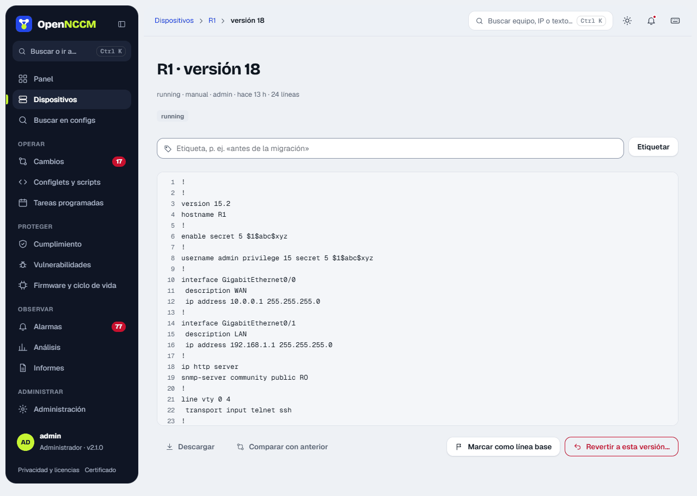
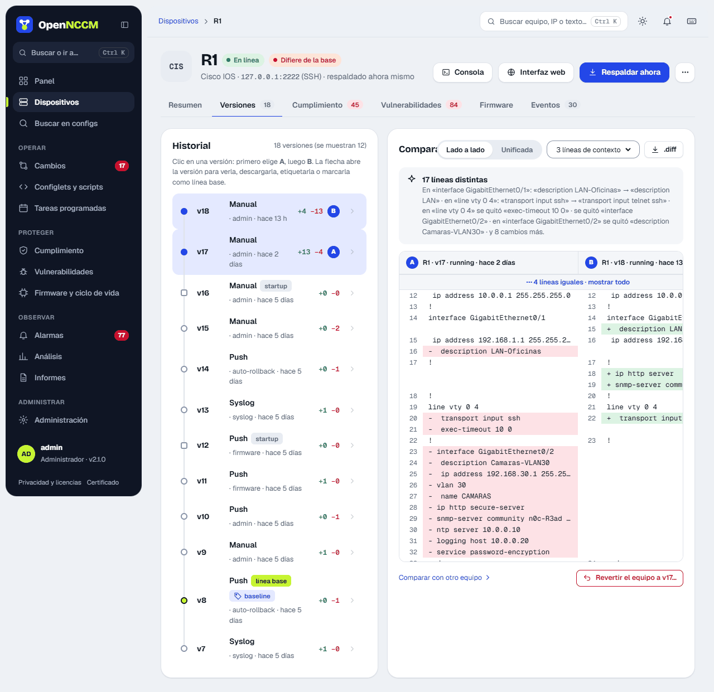
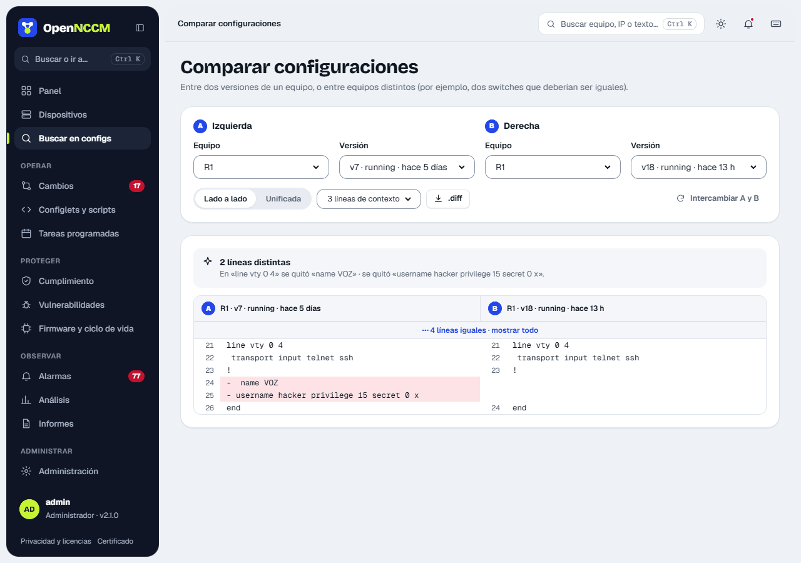
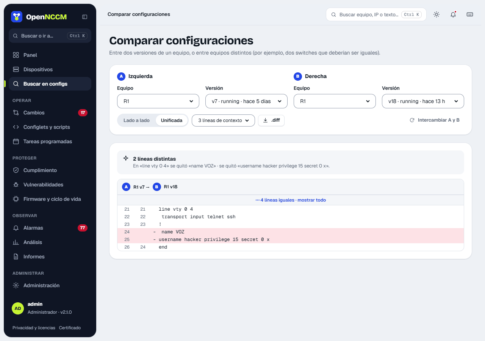

## Cómo funciona

1.  OpenNCCM se conecta al equipo con su credencial y ejecuta el comando de respaldo del perfil (p. ej. `show running-config`, `display current-configuration`, `show configuration | display set`).
2.  Quita las líneas volátiles (marcas de tiempo, checksums) para no registrar cambios falsos.
3.  Si el contenido cambió respecto a la última versión, guarda una versión nueva cifrada, con su huella SHA-256 y las líneas agregadas y quitadas.
4.  Si el perfil lo admite, respalda también la configuración de arranque y compara ambas (conflicto startup/running).
5.  Actualiza el inventario (modelo, serie, versión), compara con la línea base y ejecuta la auditoría de cumplimiento.

Cada versión registra su **origen**: `manual` (botón), `scheduled` (tarea), `syslog` (detectado en tiempo real) o `push` (aplicado por OpenNCCM).

## Ver una versión

En la ficha del equipo, pestaña **Versiones**, la flecha **›** de cada versión la abre en un panel lateral. Desde allí puede **descargar**, **comparar con la anterior**, **etiquetar** (por ejemplo «antes de migración»), **marcar como línea base** o **revertir el equipo a esa versión**.

En un **MikroTik RouterOS**, el menú **…** de la ficha ofrece además **Descargar .rsc (último respaldo)**, el `/export` guardado listo para `/import`, y **Descargar .backup del equipo…**. Este último lo crea el router en el momento (`/system backup save`), OpenNCCM lo trae por SFTP y lo borra del equipo. Se le puede poner una contraseña para cifrarlo. El .backup incluye usuarios y contraseñas y solo se restaura en el mismo modelo; para pasar la configuración a otro equipo, use el .rsc. El usuario de la credencial necesita la política *ftp* (SFTP).

:::tip[Retención]
En Ajustes puede limitar cuántas versiones guardar por equipo. Las versiones etiquetadas (incluida la línea base) nunca se borran.
:::

## Comparación de configuraciones

### Cómo usarlo

1.  En la pestaña **Versiones** de la ficha, pulse dos versiones de la línea de tiempo (la más antigua queda como A y la otra como B): la comparación aparece al lado, en vista **lado a lado** o **unificada**.
2.  **Comparar configuraciones** (desde Buscar en configs o el menú ⋯ del equipo) compara versiones de equipos distintos y permite cambiar el contexto (0, 3, 10 líneas o archivo completo) e intercambiar A y B.

Arriba, **Qué cambió** resume las diferencias en palabras (por ejemplo «en «interface Gi0/1» se agregó «shutdown»»). La vista **lado a lado** muestra la versión A a la izquierda y la B a la derecha, con números de línea: en rojo lo eliminado o modificado, en verde lo agregado o modificado. La vista **unificada** muestra el formato clásico de diff. Las teclas **n** y **p** saltan al cambio siguiente o anterior, y la barra fina de la derecha marca dónde están todos.

