OpenNCCM se instala directamente desde su repositorio de GitHub. En la consola del servidor ejecute:

```bash
curl -fsSL https://raw.githubusercontent.com/Gaaraalex/opennccm/main/install.sh -o install.sh
sudo bash install.sh
```

:::caution[Use estos dos pasos para el asistente]
Si ejecuta `curl … | sudo bash`, `sudo` no pasa el teclado al instalador y los menús no responderían. El instalador lo detecta, no modifica nada y le muestra el comando correcto. La forma con tubería sirve solo para la instalación desatendida (ver [Instalación desatendida](/instalacion/instalar/#instalación-desatendida)).
:::

Se abre un **asistente con menús**. Muévase con las <kbd>flechas</kbd> y <kbd>Tab</kbd>, marque opciones con la <kbd>barra espaciadora</kbd> y confirme con <kbd>Enter</kbd>. Si pulsa Enter en todas las pantallas obtiene una instalación segura con los valores recomendados.

### Bienvenida y comprobación del servidor

Antes de preguntar nada, el instalador verifica que el servidor sea Ubuntu 22.04 o 24.04 de 64 bits, que haya conexión a internet y a GitHub, que alcancen el disco (3 GB libres) y la memoria, y que el puerto 443 esté libre. Si algo impide instalar, lo explica y se detiene sin tocar nada.

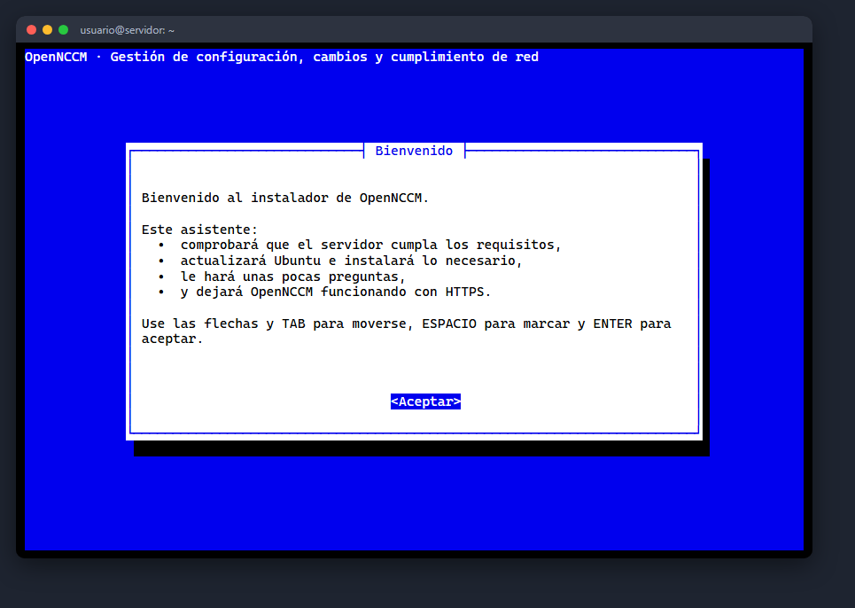

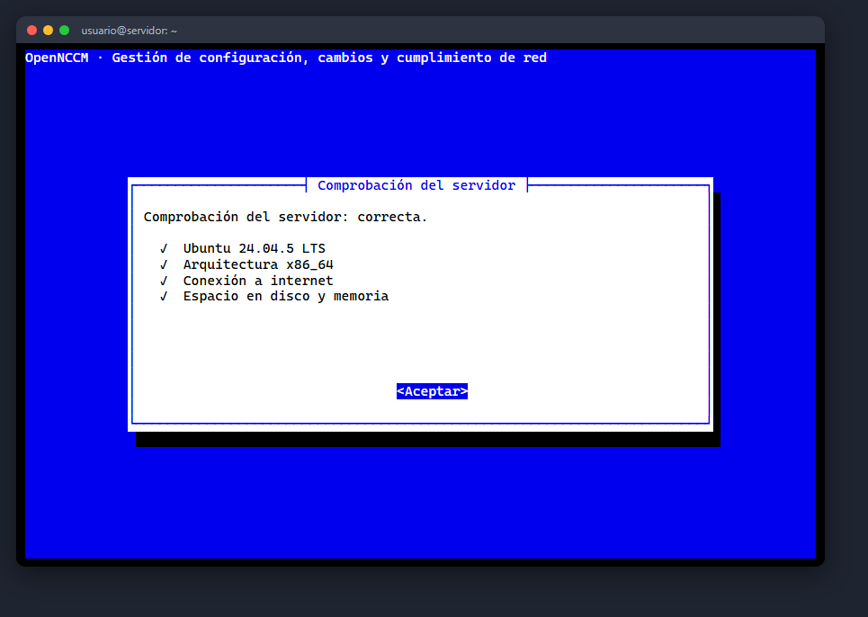

### Actualizaciones de Ubuntu

Recomendado en servidores nuevos: ejecuta `apt update` y `apt full-upgrade`. En cualquier caso, el instalador instala solo los paquetes que falten (git, Python 3, nginx, whiptail, openssl, etc.).

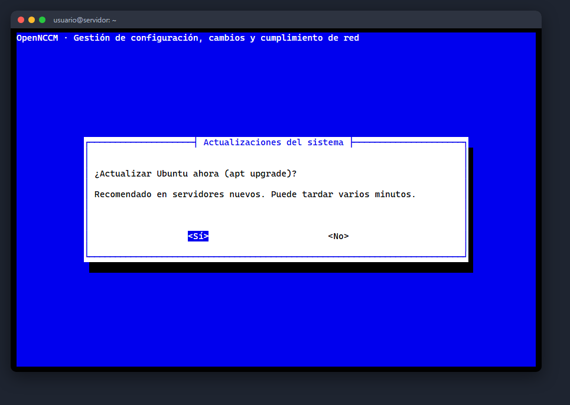

### Dirección, zona horaria y acceso HTTPS

El asistente detecta las direcciones IP del servidor; elija con la que accederán los usuarios o escriba un nombre DNS. Luego confirme la zona horaria (si no es la correcta, elija región y ciudad en dos menús) y el tipo de acceso web:

| Opción | Cuándo usarla |
| --- | --- |
| Certificado autofirmado | Redes internas (recomendado). El navegador mostrará un aviso la primera vez. |
| Let's Encrypt | Si el servidor tiene un nombre DNS público y el puerto 80 accesible desde internet. |
| Certificado propio | Si su empresa emite certificados: indique las rutas del .crt y del .key copiados al servidor. |
| Sin HTTPS | Solo laboratorio: la aplicación queda en el puerto 8000 sin cifrar. |

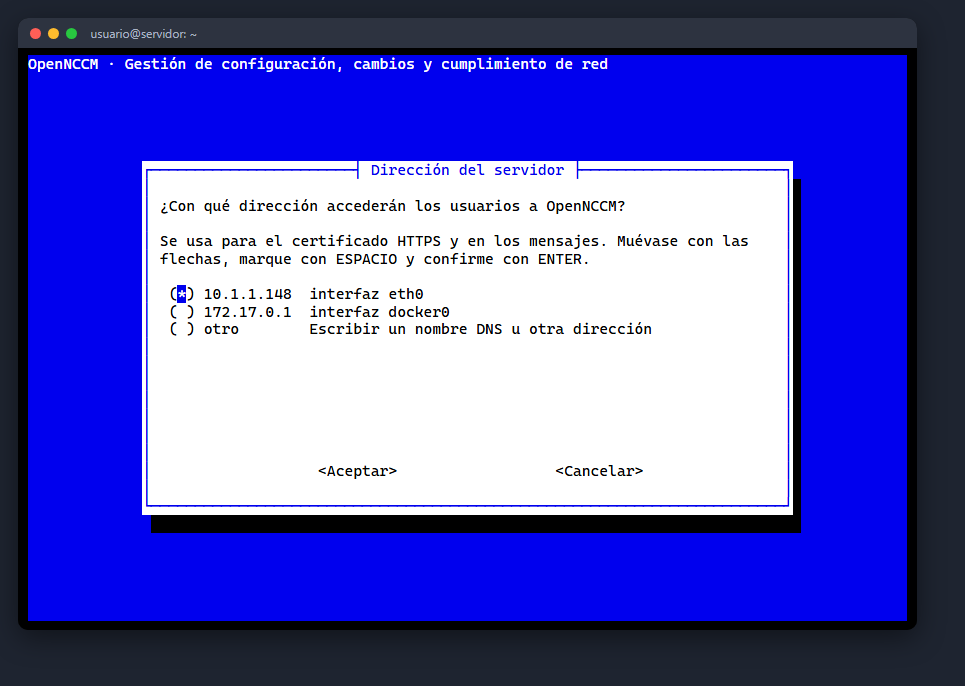

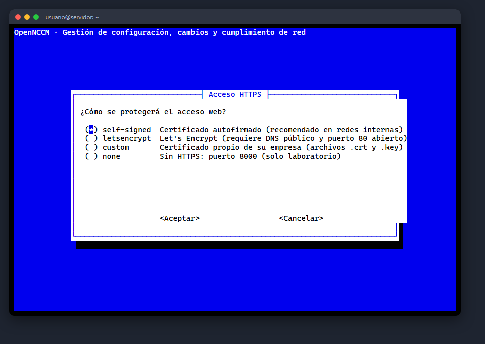

### Base de datos y cortafuegos

**SQLite** está integrada y no requiere mantenimiento (hasta unos 2 000 equipos). Si elige **PostgreSQL**, el instalador lo instala, crea la base y el usuario con una contraseña aleatoria y lo configura. El cortafuegos `ufw` se activa permitiendo SSH, HTTPS y syslog; elija «No» si el servidor ya tiene otro cortafuegos.

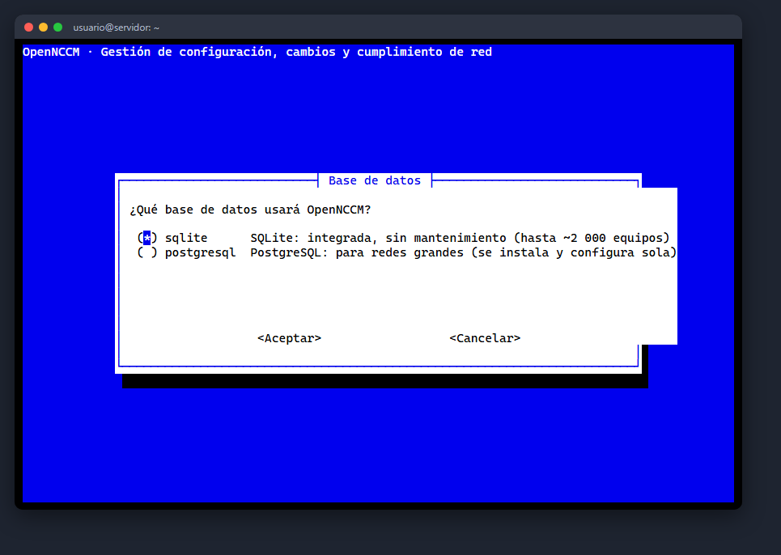

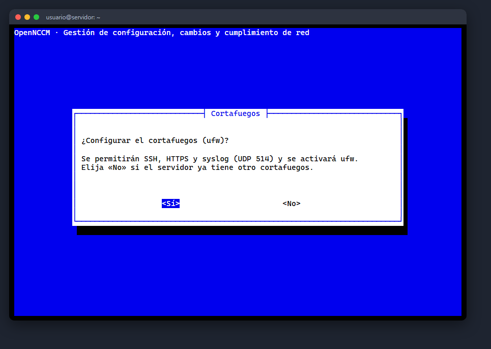

### Administrador y correo

Defina el nombre del usuario administrador y elija entre **generar una contraseña segura** (se muestra al final) o escribirla dos veces (mínimo 8 caracteres). Opcionalmente configure el correo para alertas; también puede hacerlo después en **Ajustes**.

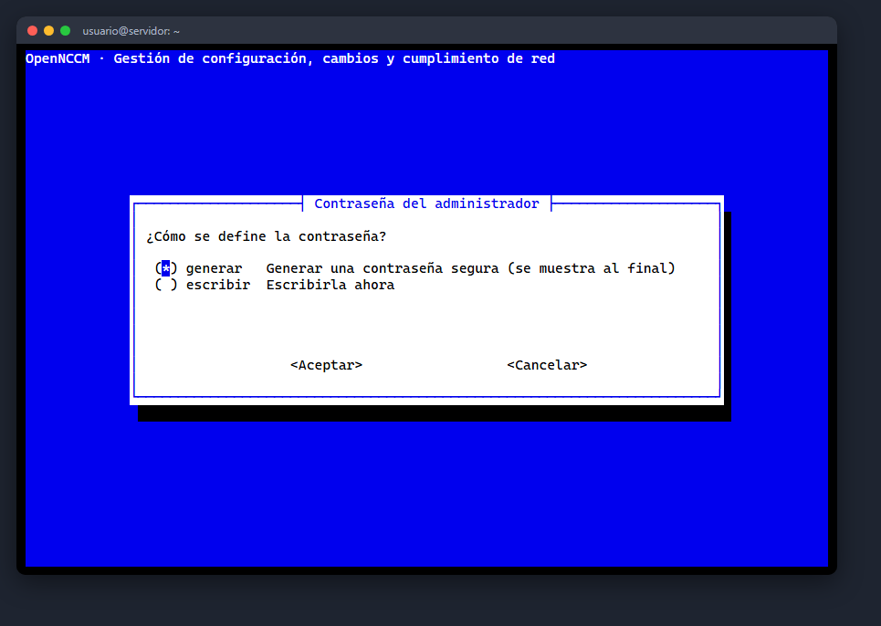

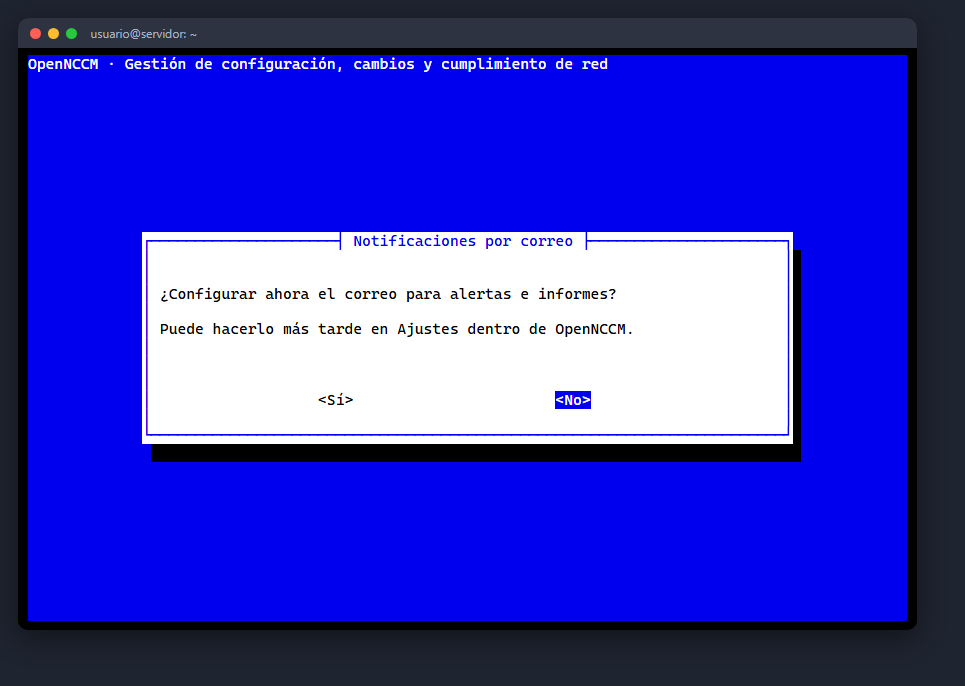

### Resumen, instalación y resultado

Revise el resumen y confirme. Una barra de progreso muestra cada paso; todo queda registrado en `/var/log/opennccm-install.log`. Al terminar se muestran la dirección de acceso y las credenciales, que también se guardan en `/root/opennccm-credenciales.txt` (bórrelo después de cambiar la contraseña).

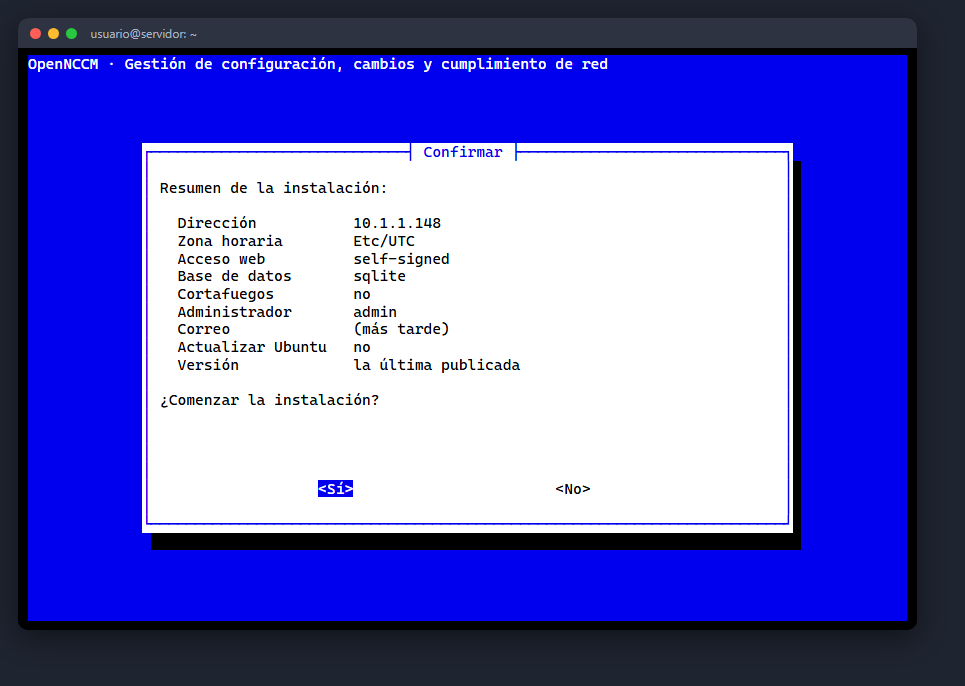

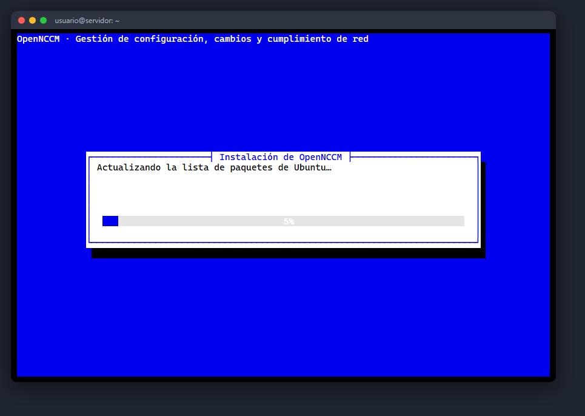

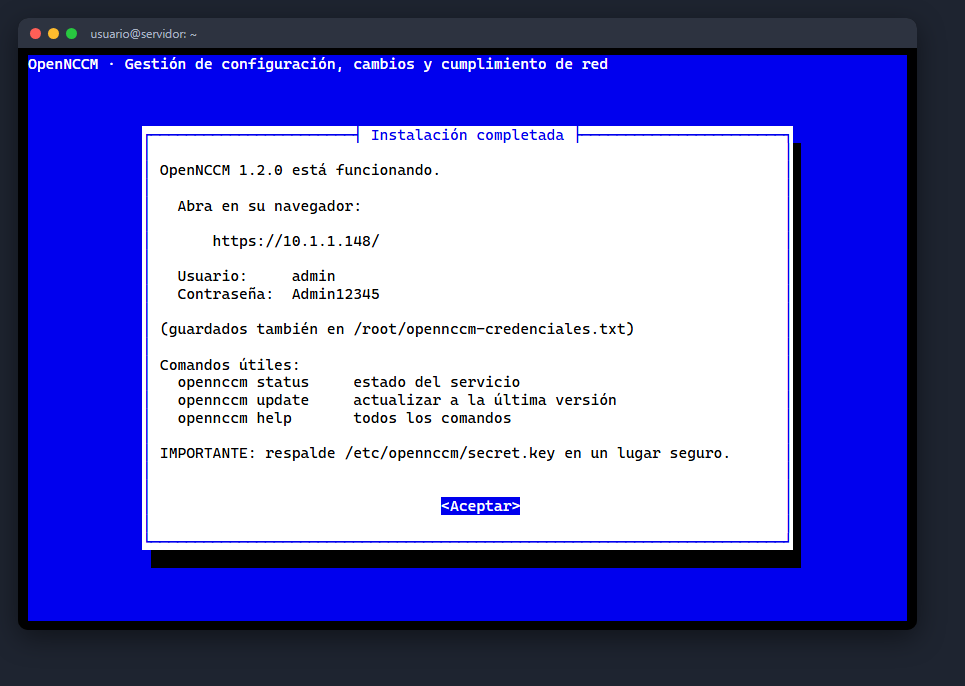

:::caution[Si algo falla]
El asistente muestra en qué paso se detuvo y las últimas líneas del registro. Corrija la causa y vuelva a ejecutar el mismo comando.
:::

### Comprobar que el servicio está activo

```bash
opennccm status
OpenNCCM 1.2.0
✓ Servicio: activo
✓ Aplicación: responde
  Acceso:     https://IP_DEL_SERVIDOR/
```

## Instalación desatendida

Para automatizar (scripts, Ansible, plantillas de VM) agregue `--unattended` y las opciones que necesite. No se hace ninguna pregunta; lo que no indique toma el valor por defecto.

```bash
curl -fsSL https://raw.githubusercontent.com/Gaaraalex/opennccm/main/install.sh | \
    sudo bash -s -- --unattended --host 10.0.0.5 --timezone America/Mexico_City --admin-pass 'UnaClaveSegura123'
```

| Opción | Uso |
| --- | --- |
| `--host IP|NOMBRE` | Dirección de acceso (por defecto, la IP principal) |
| `--timezone ZONA` | Zona horaria (por defecto, la actual) |
| `--tls self-signed|letsencrypt|custom|none` | Tipo de acceso web (por defecto autofirmado) |
| `--domain NOMBRE --email CORREO` | Datos para Let's Encrypt |
| `--cert ARCHIVO --key ARCHIVO` | Certificado propio |
| `--db sqlite|postgresql` | Base de datos |
| `--firewall yes|no` | Configurar ufw (por defecto, solo si ya está activo) |
| `--admin-user`, `--admin-pass` | Administrador inicial (sin `--admin-pass` se genera una contraseña) |
| `--smtp-host`, `--smtp-port`, `--smtp-user`, `--smtp-pass`, `--smtp-from`, `--alert-emails` | Correo para alertas |
| `--syslog-port PUERTO` | Puerto UDP del receptor syslog (por defecto 514) |
| `--no-upgrade` | No actualizar Ubuntu |
| `--version vX.Y.Z` / `--channel main` | Versión concreta / rama de desarrollo |
| `--reinstall` | Repetir la instalación sobre una existente (conserva los datos) |

Ayuda completa: `curl -fsSL …/install.sh | sudo bash -s -- --help`.

### Instalar sin acceso directo a GitHub

Si el servidor no puede salir a internet, descargue desde otra máquina el archivo `opennccm-X.Y.Z.tar.gz` de la página **Releases** del repositorio, cópielo al servidor y ejecute `sudo bash install.sh --source $(pwd)` dentro de la carpeta descomprimida. Igualmente necesitará acceso a los repositorios de Ubuntu y de Python (o un proxy).

### Qué hace el instalador

Si vuelve a ejecutar el comando en un servidor donde OpenNCCM ya está instalado, el instalador lo detecta y le ofrece actualizar en su lugar (ver [Actualizar y volver atrás](/instalacion/actualizar/)).

## Primer acceso

1.  En su PC abra el navegador y vaya a `https://IP_DEL_SERVIDOR/`.
2.  La primera vez el navegador avisará que la conexión «no es privada»: OpenNCCM usa un certificado de su propia autoridad certificadora, que su PC todavía no conoce. Pulse **Configuración avanzada → Continuar** y luego instale esa autoridad (ver [HTTPS y cortafuegos](/instalacion/https-cortafuegos/)): desaparece el aviso y el navegador ofrece **guardar el usuario y la contraseña**.
3.  Ingrese con el usuario y la contraseña que mostró el instalador (también están en `/root/opennccm-credenciales.txt`).

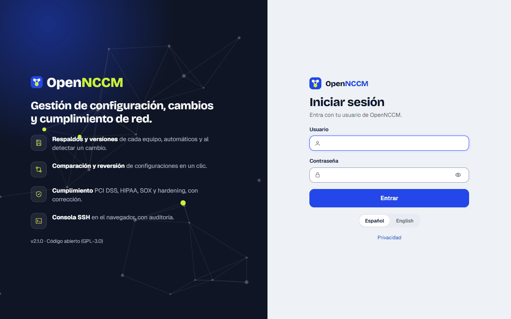

4.  Cambie la contraseña de inmediato: clic en su nombre de usuario (arriba a la derecha) → **Mi cuenta**.

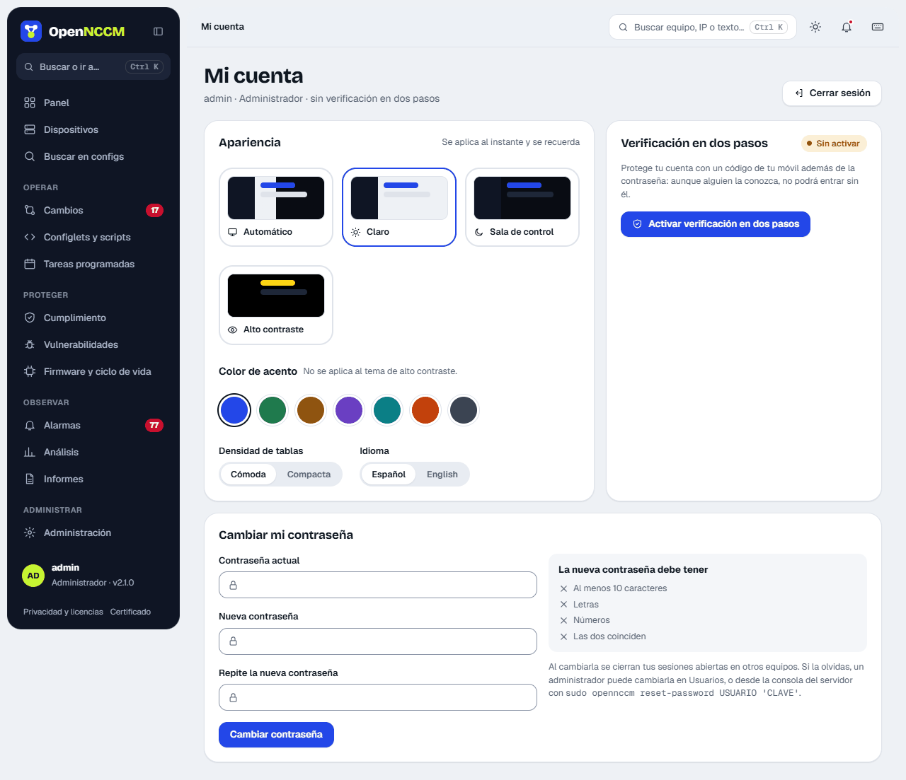

5.  Recomendado: en **Mi cuenta** active la **verificación en dos pasos** con una app de autenticación del teléfono.

:::note[Protección contra fuerza bruta]
Tras 5 contraseñas incorrectas seguidas, la cuenta se bloquea 15 minutos; tras 10 intentos fallidos desde la misma IP, esa dirección se bloquea 15 minutos. Cada intento queda en **Auditoría**.
:::
