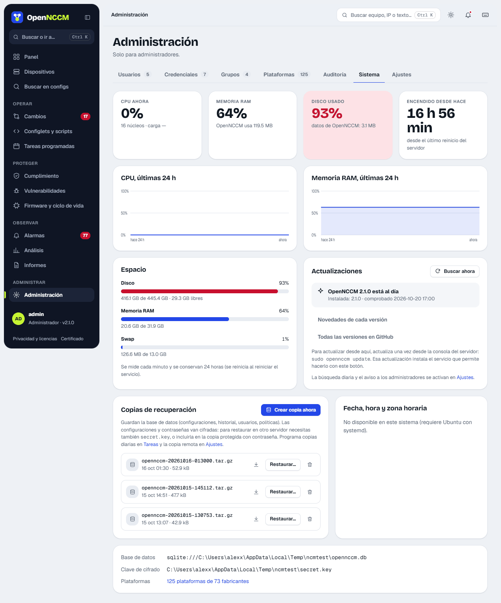

OpenNCCM guarda todo lo importante en dos lugares:

| Ruta | Contenido |
| --- | --- |
| `/var/lib/opennccm` | Base de datos (configuraciones, historial, usuarios, políticas), imágenes de firmware y copias. |
| `/etc/opennccm` | **secret.key** (clave de cifrado) y `opennccm.env` (configuración del servicio). |

## Desde la interfaz

Menú **Sistema → Crear copia ahora**. Programe la copia diaria en **Tareas** y, en **Ajustes → Recuperación ante desastres**, defina cuántas copias conservar y un servidor SFTP remoto donde enviar cada copia.



## Desde la consola

```bash
sudo opennccm backup              # sin la clave
sudo opennccm backup --with-key   # incluye secret.key: proteja el archivo
```

## Restaurar (en el mismo servidor o en uno nuevo)

1.  En un servidor nuevo, instale primero OpenNCCM (ver [Instalar en Ubuntu](/instalacion/instalar/)).
2.  Si la copia no incluye la clave, copie el `secret.key` original a `/etc/opennccm/secret.key`. Si la incluye (`--with-key`), no hace falta: la restauración reemplaza la del servidor.
3.  Restaure:

```bash
sudo opennccm restore /ruta/opennccm-AAAAMMDD-HHMMSS.tar.gz
```

El comando detiene el servicio, restaura y lo vuelve a iniciar. Si la copia incluye la clave, reemplaza la del servidor (la que creó el instalador queda como `secret.key.antes-de-restaurar-FECHA`). Si no la incluye y la clave del servidor no descifra los datos restaurados, avisa de que hay que copiar el `secret.key` original en lugar de decir «Restaurado.». Con PostgreSQL restaura con `pg_restore`; la copia tiene que ser de la misma base de datos (SQLite o PostgreSQL) que el servidor.

:::caution[La clave es imprescindible]
Sin el `secret.key` correcto las configuraciones y contraseñas respaldadas no se pueden descifrar. Guárdela en un lugar seguro, separado de las copias (por ejemplo, en el gestor de contraseñas del equipo).
:::
