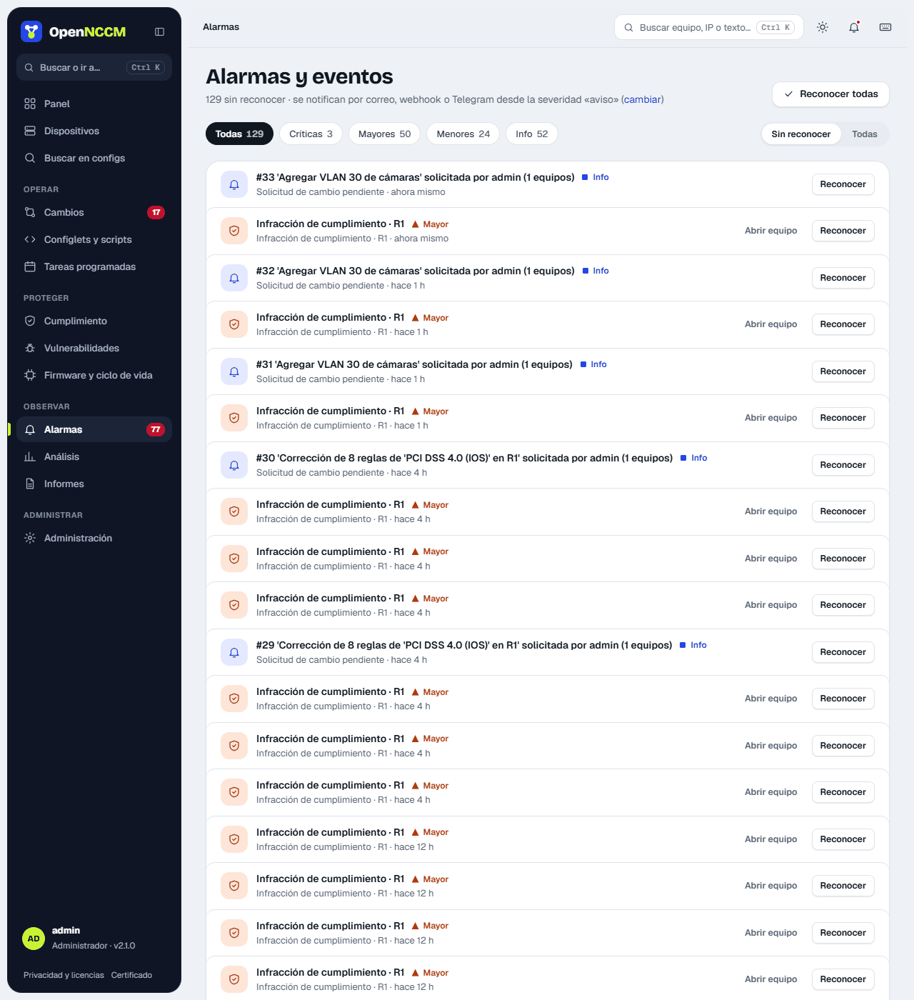
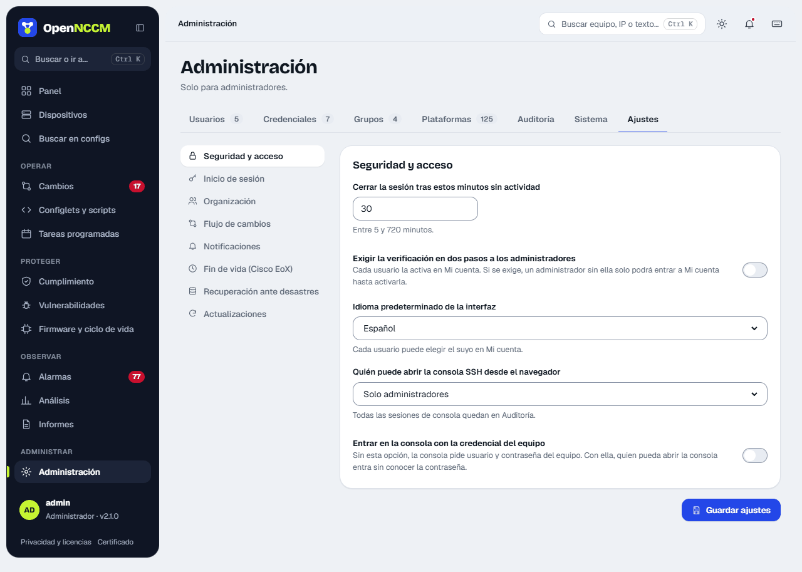

Todo lo relevante genera un **evento** con severidad por color:

| Severidad | Ejemplos |
| --- | --- |
| **critical** | Reversión automática, vulnerabilidad crítica, fallo de copia de recuperación |
| **major** | Respaldo fallido, infracción de cumplimiento crítica, solicitud fallida |
| **warning** | Cambio de configuración, conflicto startup/running, desviación de línea base, infracciones |
| **info** | Syslog recibido, solicitud pendiente o ejecutada, copias creadas |

**Alarmas** se abre en **Sin reconocer** (o **Todas**), con chips por severidad y su recuento. Cada alarma muestra el equipo y hace cuánto ocurrió (el detalle completo aparece al pasar el ratón), con **Abrir equipo** y **Reconocer**; también se pueden reconocer todas (con **Deshacer** en el aviso). Las de severidad igual o mayor a la configurada en Ajustes se envían por correo, webhook (Teams, Slack…) y/o Telegram.

Si la regla «Al cerrar una alarma crítica» de la [base de conocimiento](/observar/base-de-conocimiento/) está activa (lo está por omisión), una alarma **crítica** no se cierra con **Reconocer**: se abre **Cerrar alarma crítica**, donde se elige **Cerrar y documentar** o **Cerrar y enlazar** (a un caso que ya existe). «Reconocer todas» deja abiertas las críticas.

## Configurar las notificaciones

Menú **Ajustes → Notificaciones**. Configure uno o varios canales y pulse **Enviar notificación de prueba**.

| Canal | Qué completar |
| --- | --- |
| Correo | Servidor SMTP, puerto (587 con STARTTLS o 465 con SSL), usuario, contraseña, remitente y destinatarios separados por coma. |
| Microsoft Teams / Slack / Mattermost / Google Chat | URL del *incoming webhook* del canal. |
| Telegram | Token del bot (de @BotFather) y el ID del chat o grupo. |

La «severidad mínima» define qué se notifica: `warning` envía cambios de configuración, infracciones y fallos; `critical` solo reversiones automáticas y vulnerabilidades críticas.

