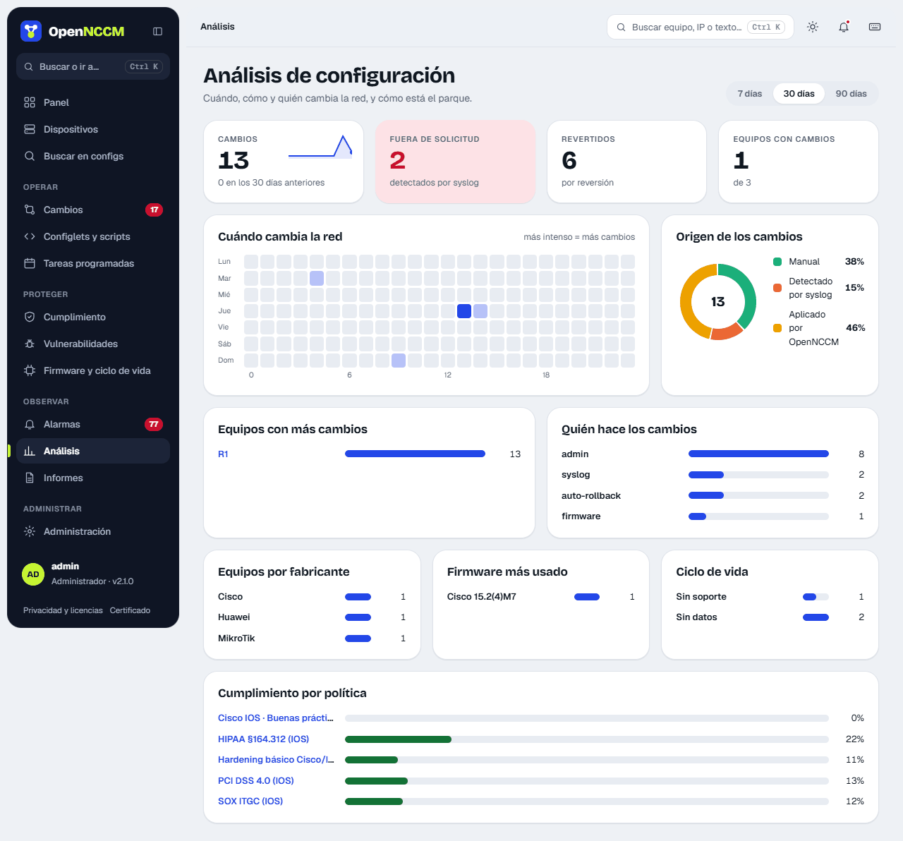

Elija el período (7, 30 o 90 días). La página muestra:

-   **Indicadores**: cambios del período con su minigráfica y la comparación con el período anterior, cambios **fuera de solicitud** (detectados por syslog), cambios **revertidos** y **equipos con cambios**.
-   **Cuándo cambia la red**: mapa de calor por día de la semana y hora (más intenso = más cambios). Sirve para ver cambios fuera del horario laboral.
-   **Origen de los cambios**: anillo con el total en el centro y el porcentaje de cada origen (programado, syslog, manual o aplicado por OpenNCCM).
-   Barras de **equipos con más cambios**, **quién hace los cambios**, **equipos por fabricante**, **firmware más usado**, **ciclo de vida** y **cumplimiento por política**.

Al pasar el cursor sobre una barra o celda aparece su valor exacto. Los nombres de equipos y políticas son enlaces.

## IP y VLAN

**IP y VLAN** (menú lateral) reúne las direcciones IP y las VLAN configuradas en todos los equipos, leídas de su última configuración guardada (no se ejecuta nada en los equipos). Reconoce Cisco y similares, Huawei, EdgeSwitch, VOSS, FortiGate, Junos, VyOS/EdgeRouter, MikroTik, EXOS y airOS; solo IPv4. Avisa de las **IP configuradas en más de un sitio** (en dos equipos o dos interfaces) y de las **VLAN con nombres distintos** según el equipo. Se puede filtrar por grupo o texto y exportar a CSV.

## Mapa de la red

**Mapa de la red** (menú lateral) dibuja los equipos y los enlaces entre ellos, con el puerto de cada extremo. Los enlaces salen de los vecinos **LLDP o CDP** que cada equipo anuncia, leídos en cada respaldo con una orden de solo lectura (por ejemplo `show cdp neighbors detail` en Cisco o `/ip neighbor print` en MikroTik). Lo admiten Cisco, Arista, Juniper, Huawei, HP/Aruba, Dell, Ruckus, Allied, MikroTik, EdgeSwitch, UniFi Switch, EXOS y VOSS / Fabric Engine (`show lldp neighbor`), si tienen LLDP o CDP activado.

-   Cada equipo tiene tres capas: el **anillo** dice el estado, el **icono** del centro qué es (router, switch, antena, firewall o desconocido) y el **distintivo** de la esquina su fabricante (marcas propias de OpenNCCM, no los logotipos de las marcas). El tipo sale del modelo o la plataforma y, si no dicen nada, de las capacidades que anuncia por LLDP o CDP. Los chips **Fabricante** de arriba resaltan los de una marca, y el panel de cada equipo explica **cómo se reconoció**. Los puertos solo se muestran en los enlaces del equipo seleccionado.
-   Los equipos se colorean según su último respaldo. Los **vecinos que no están en OpenNCCM** llevan borde discontinuo: al pulsarlos, **Agregar a OpenNCCM** abre el alta con su nombre e IP.
-   Un vecino se reconoce como equipo de OpenNCCM por su nombre (sin dominio) o, si no, por su IP de gestión.
-   Solo salen **equipos de red**. Si por un puerto se ven **varios equipos por su radio**, son los CPE de los clientes de un punto de acceso: se quitan (el punto de acceso sí sale) y una nota dice cuántos. Si se ve **uno solo**, es el otro extremo de un PtP o la estación, y sale, salvo que sea un modelo de antena de cliente (LiteBeam, NanoStation, NanoBeam, SXT, LHG…), que nunca sale: así no aparecen los clientes que van cada uno en su VLAN. En MikroTik, en un puerto con varios vecinos por cable solo cuenta el visto por LLDP.
-   Los **enlaces inalámbricos** (un extremo es una radio: ath0, wlan1…) se dibujan con línea discontinua.
-   En **Ajustes › Mapa de la red** se eligen los **tipos de equipo descubiertos** que salen: MikroTik, Ubiquiti, Juniper, Cisco, Huawei, HP/Aruba, Extreme y otros. El tipo se reconoce por lo que anuncia el vecino (plataforma, modelo), por el fabricante de su MAC (los switches UniFi que no dicen su modelo) o por el nombre de sus puertos. Los equipos que ya están en OpenNCCM salen siempre. Bajo el mapa se nombran los vecinos que no salen por su tipo.
-   Al elegir un equipo se ven los **puertos** de sus enlaces, junto a cada extremo; con más de 8 enlaces, solo el del vecino (los propios están en la lista *Enlaces* del panel). Al pasar el ratón por un enlace se ven los dos. El panel ocupa su propio espacio a la derecha (abajo en pantallas estrechas) y el mapa se mueve para que se vean el equipo y sus vecinos.
-   Las **redes aisladas** (equipos sin enlaces conocidos entre sí) se colocan juntas, en filas; el selector **Red** muestra solo una.
-   Se puede filtrar por grupo, buscar y arrastrar los equipos. Para recorrerlo: arrastrar el fondo, la rueda o los botones + y − para el zoom, «Ver todo el mapa» y «Pantalla completa». Debajo, la lista de enlaces.
-   **RoMON (MikroTik, desactivado de fábrica):** con **Buscar también los MikroTik por RoMON** en **Ajustes › Mapa de la red**, el respaldo de cada MikroTik con RoMON activado ejecuta además `/tool romon discover duration=10 proplist=address,hops,path,identity,version,board` (RouterOS 7 y 6) y el mapa muestra los MikroTik que alcanza, aunque estén a varios saltos o sin dirección IP. RoMON no dice por qué puerto se conectan: se unen al salto anterior del camino con una **línea punteada** («Por RoMON (sin puerto)»), salvo que ya haya un enlace LLDP/CDP entre los dos. No cuentan para el [análisis de impacto](/cambios/solicitudes/) ni para [Puertos sin uso](/observar/informes/#puertos-sin-uso). Toman su IP de los vecinos MNDP/LLDP o de las tablas ARP, si alguno la conoce. Suma unos 10 segundos al respaldo de cada MikroTik.
-   Se desactiva en **Ajustes › Mapa de la red** (entonces los respaldos no leen vecinos).

### Distribución: cómo ordenar los equipos

El menú **Distribución** de la barra del mapa elige cómo se colocan los equipos:

| Distribución | Cómo quedan |
| --- | --- |
| Libre | Se acomodan solos según sus enlaces (la de siempre). |
| Escalonada ↓ · Escalonada → | Del equipo central hacia abajo (o hacia la derecha), un salto por fila. |
| Radial | El central al medio y un anillo por salto. |
| Por sitio | Un recuadro por sitio o red; el sitio de cada equipo se cambia desde su panel. |
| Por función | Columnas: núcleo, routers, switches, inalámbricos y otros. |
| Circular | Todos en un círculo. |
| Árbol plegable | Abre y cierra cada rama desde el central. |
| Sobre un plano | Cada equipo en su lugar real sobre un plano o mapa que sube un administrador («Subir plano»). |
| Mi distribución | La que se guardó arrastrando equipos: **Guardar** la deja solo para uno o, los administradores, para todo el equipo; «Volver a la automática» la descarta. |

En las que parten de un equipo central se elige cuál (por defecto, el que tiene más enlaces). Con «Recordar esta distribución la próxima vez» el mapa vuelve a abrirse igual.

### Nodos

Un nodo agrupa los equipos de un mismo lugar (una sucursal, una torre, un edificio). Se crean en **Administración › Nodos** o al crear o editar un equipo, con el campo **Nodo** (como las credenciales: se elige uno de la lista o «+ Crear nodo nuevo…»). Sobre el mapa, el filtro **Nodo** muestra solo los equipos asignados a ese nodo; «Todos» los vuelve a mostrar.

## Aviso de vecino nuevo o perdido

Con **Avisar cuando cambian los vecinos** (**Ajustes › Mapa de la red**, apagado de fábrica) OpenNCCM crea una [alarma](/observar/alarmas/) cuando aparece un equipo que antes no estaba o deja de verse uno que sí estaba. Usa las lecturas de LLDP, CDP, MNDP y RoMON que ya hace el mapa en cada respaldo: no agrega consultas a los equipos.

-   La primera lectura de cada equipo, y todo lo que se ve al activar el aviso, se toma como conocido: no crea alarmas.
-   **Vecino nuevo:** avisa en la primera lectura en que aparece (nivel Aviso de fábrica). **Vecino perdido:** avisa solo si falta en 2 lecturas seguidas (se cambia en Ajustes), para no avisar por un corte de segundos (nivel Alta de fábrica). Si vuelve a verse, la alarma se cierra sola y queda en el historial con la duración del corte.
-   En **Alarmas**, el filtro **Vecinos** muestra solo estas. **Ver detalle** abre la ficha del vecino: puerto (con su VLAN y descripción), nombre que anuncia, qué dice ser, MAC con su fabricante, IP y qué había antes en ese puerto. Desde ahí: **Es conocido, no avisar más**, **Ver en el mapa** y **Preparar «shutdown» del puerto**, que crea una [solicitud de cambio](/cambios/solicitudes/) (no se apaga nada sin aprobación). En un vecino perdido se ven cuándo se vio por última vez, en cuántas lecturas faltó, el estado del puerto y qué depende de él.
-   En el mapa, **Resaltar cambios de vecinos** (encendido) marca los nuevos con borde ámbar y la etiqueta «NUEVO», y dibuja los perdidos en rojo discontinuo, con una ✕ en su enlace. Un equipo que está en OpenNCCM no se pinta entero como nuevo o perdido: el enlace perdido se dibuja aparte, en su puerto. El panel **Cambios de vecinos · últimas 24 h** lista los nuevos, los perdidos y los que volvieron. El resaltado se apaga al reconocer la alarma o a las 24 h.
-   **No avisar por:** teléfonos IP y puntos de acceso (según lo que anuncian por LLDP), puertos con 802.1X y equipos de las ubicaciones elegidas. **Vecinos conocidos** lista los que no avisan al aparecer; quitar uno que sigue conectado hace que avise como nuevo en la próxima lectura.
-   Las alarmas salen por los mismos canales que las demás (correo, webhook y Telegram).
