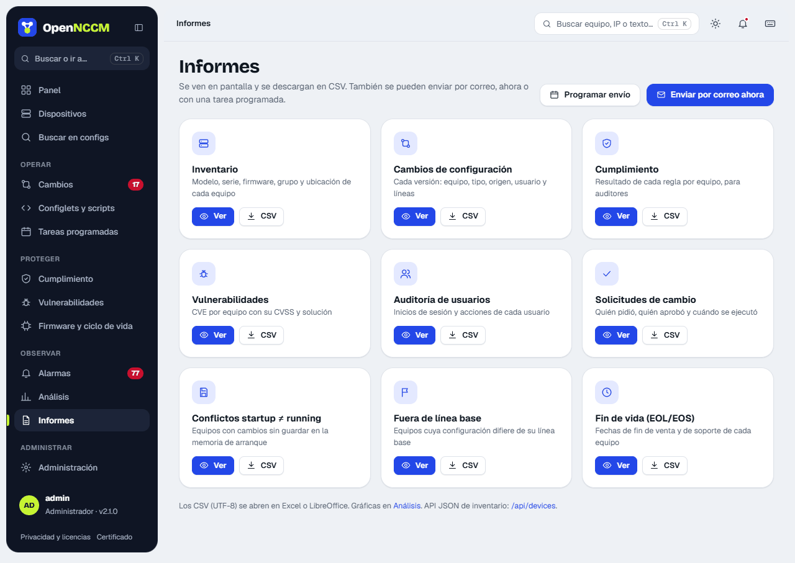
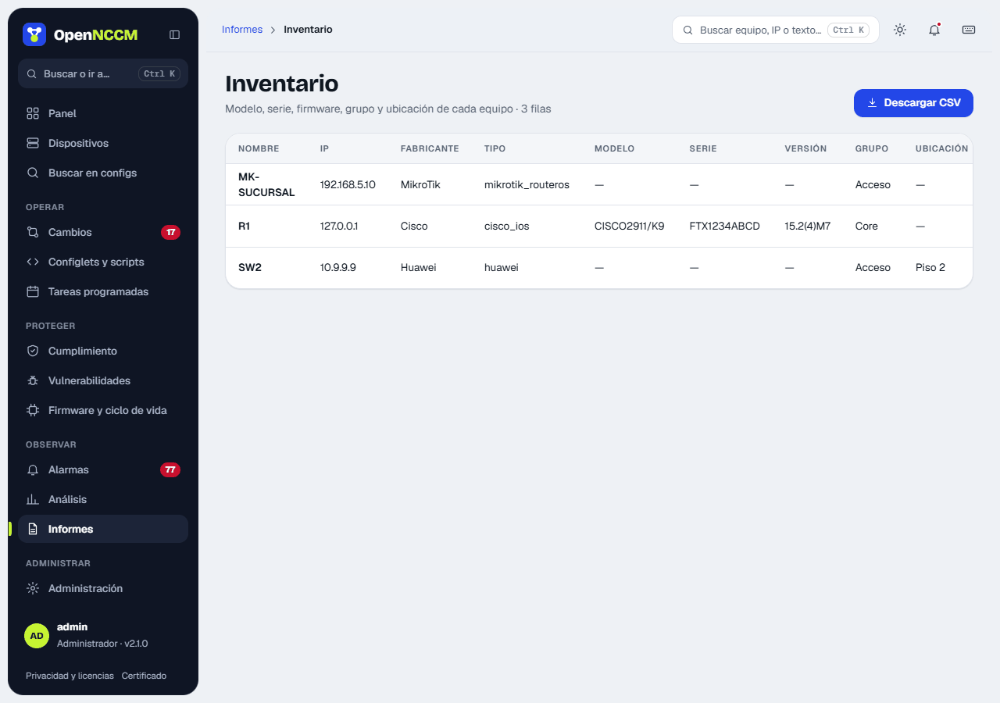

Cada informe es una tarjeta con **Ver** (en pantalla, con el periodo de 7, 30, 90 días o un año cuando aplica) y **CSV** (UTF-8, se abre directamente en Excel). Los administradores pueden **enviarlos por correo ahora** o **programar el envío**.

| Informe | Contenido |
| --- | --- |
| Inventario | Nombre, IP, fabricante, modelo, serie, versión, grupo, estado, conflictos y línea base |
| Cambios de configuración | Cada versión nueva con fecha, origen, usuario y líneas |
| Cumplimiento | Resultado por equipo, política y regla |
| Conflictos startup ≠ running | Equipos con cambios sin guardar |
| Fuera de línea base | Equipos con línea base y si se desviaron |
| Fin de vida (EOL/EOS) | Fechas y estado de cada equipo |
| Vulnerabilidades | CVE por equipo |
| Licencias por vencer | Servicios de la licencia de cada equipo (hoy, la feature key de WatchGuard) que vencen en los próximos 90 días o ya vencieron, lo más urgente primero |
| Puertos sin uso | Puertos de acceso de los switches sin enlace hace más de 30, 60 o 90 días ([ver abajo](#puertos-sin-uso)) |
| Documento de la red | PDF o Word con lo que OpenNCCM sabe de la red ([ver abajo](#documento-de-la-red)) |
| Solicitudes de cambio | Quién pidió, quién aprobó y el resultado |
| Auditoría de usuarios | Inicios de sesión y acciones (solo administradores) |

## Puertos sin uso

**Informes → Puertos sin uso** muestra, por switch, cuántos puertos de acceso están en uso, sin enlace hace más de 30, 60 o 90 días y libres (apagados o marcados «SIN-USO»), con los **switches casi llenos** (menos del 10 % libre). Se filtra por sitio (la «Ubicación» de cada equipo) y VLAN, y se exporta en CSV.

-   No cuenta los uplinks (puertos con un vecino LLDP/CDP que es switch, router o firewall), las troncales, los puertos con 802.1X ni los que tienen una excepción (**Marcar como excepción**).
-   OpenNCCM anota en cada respaldo la última vez que cada puerto tuvo enlace, desde la versión 2.24.0. No hay historial anterior: el informe dice desde cuándo hay datos y, mientras no pase el plazo elegido, no presenta un puerto como «sin enlace hace 90 días» ni muestra más días de los que hay datos.
-   **Preparar «shutdown» como solicitud de cambio** arma la configuración de cada fabricante (descripción `SIN-USO-AAAA-MM` y apagado), guarda la descripción anterior para revertir y la envía a aprobación, con su [análisis de impacto](/cambios/solicitudes/#análisis-de-impacto-qué-se-cae-si-toco-este-equipo). Está para Cisco IOS/IOS-XE/NX-OS, Arista, EdgeSwitch y similares, Aruba, HPE ProCurve, Huawei/Comware, Juniper, Extreme EXOS y MikroTik.

Apagar los puertos sin uso también es una mejora de seguridad: nadie puede conectar un equipo en un puerto olvidado.

## Documento de la red

**Informes → Documento de la red** genera un PDF o un Word (.docx) de un sitio, un grupo o toda la red, con las secciones que se elijan: inventario (modelo, serie y firmware), mapa de la red, VLAN y direcciones IP, enlaces entre equipos, cumplimiento y vulnerabilidades y el último respaldo de cada equipo. Opcionalmente lleva una portada con el logo (PNG o JPEG, se sube con su propio botón, se ve en la vista previa y se puede **Quitar**) y el nombre del cliente, y puede ocultar las IP públicas. En el mapa, cada grupo de equipos enlazados se arma por niveles, los grupos van uno al lado del otro y los equipos sin enlaces al final, en una grilla. Cada título va en la misma página que su tabla, las tablas tienen el mismo ancho, la columna «Sitio» solo sale si hay más de uno y Cumplimiento avisa si todavía no se auditó. Las contraseñas, comunidades SNMP y claves nunca salen: el documento no lleva configuraciones.

Los documentos generados quedan en la lista con **Ver** (el PDF en el navegador), **Descargar** y, si la red cambió desde entonces («La red cambió: 3 equipos nuevos, 1 VLAN y 2 firmwares»), **Regenerar**. Cada documento generado y descargado queda en Auditoría.
