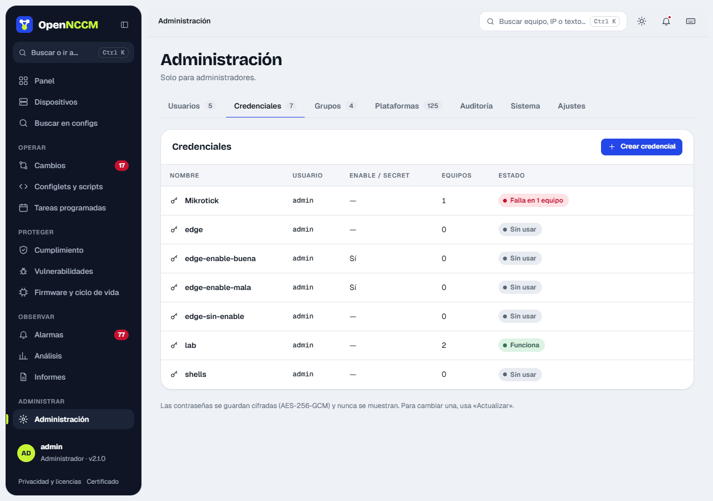
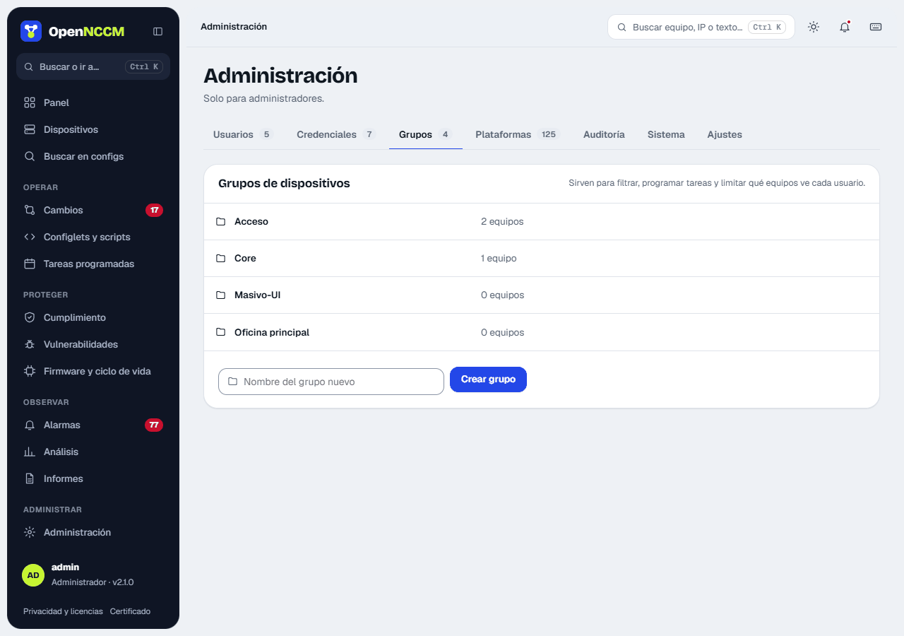

## Credenciales de los equipos

Menú **Credenciales**. Cree un perfil por cada combinación de usuario/contraseña que usen sus equipos (por ejemplo «red-admin» y «firewalls»). Si sus equipos Cisco requieren `enable`, complete también «Enable / secret». Las contraseñas se guardan cifradas y nunca se vuelven a mostrar.

En la misma página cree los **grupos** de dispositivos (sede, función o cliente). Los grupos sirven para tareas, políticas, filtros y para limitar qué equipos ve cada usuario.

**Credenciales:** perfiles de usuario, contraseña y contraseña privilegiada (*enable*) para conectarse a los equipos. Si el equipo entra en modo usuario («>») y la credencial no tiene *enable*, OpenNCCM prueba la contraseña de ingreso; si no sirve, el error indica en qué credencial escribirla. Se guardan cifradas con AES-256-GCM y nunca se muestran. Están en **Administración → Credenciales**: la tabla indica cuántos equipos usa cada una y su estado (funciona, falla en N equipos o sin usar). **Crear credencial** y **Actualizar** abren un panel lateral; al actualizar, deje en blanco lo que no quiera cambiar.

**Grupos** (pestaña **Administración → Grupos**): agrupan equipos (sede, rol, cliente) para filtrar, programar tareas, aplicar políticas y restringir usuarios. La tabla muestra cuántos equipos tiene cada uno, con **Ver equipos**; se crean con el campo del pie. Se llega aquí también con el botón **Grupos** de la página Dispositivos, y un grupo se puede crear al editar un equipo. Para asignar un equipo a un grupo: ábralo y pulse **asignar grupo** (o **Editar**). Al eliminar un grupo, sus equipos quedan sin grupo.

