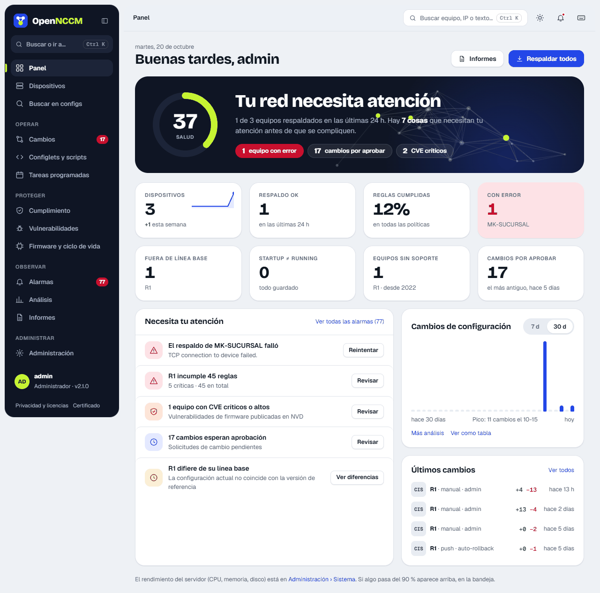
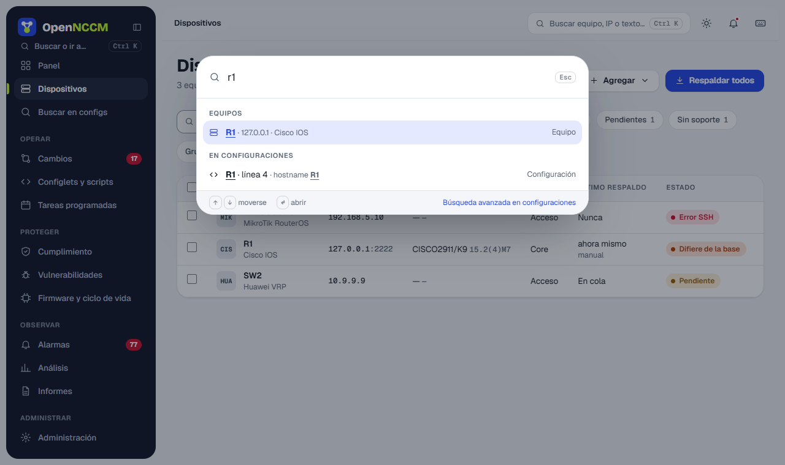

OpenNCCM mantiene un historial completo y cifrado de la configuración de cada equipo de red, detecta cuándo y cómo cambia, controla quién puede cambiarla y verifica que cumpla con sus políticas.

## Recorrido típico

1.  Un administrador carga credenciales, grupos y dispositivos.
2.  OpenNCCM respalda cada equipo (manual, programado o al recibir syslog) y guarda una versión nueva solo si hubo cambios.
3.  Cada respaldo dispara la auditoría de cumplimiento y la comparación con la línea base.
4.  Los cambios, infracciones y fallos generan alarmas y notificaciones.
5.  Los operadores proponen cambios (configlets, correcciones, reversiones, firmware); un administrador los aprueba.
6.  Los informes y la página de Análisis muestran el estado de toda la red.

## Menú principal

La barra lateral agrupa las páginas por tarea: **Operar** (Cambios, Configlets, Tareas), **Proteger** (Cumplimiento, Vulnerabilidades, Firmware y ciclo de vida), **Observar** (Alarmas, Análisis, Informes) y **Administrar** (usuarios, credenciales, grupos, plataformas, auditoría, sistema y ajustes, en pestañas). Los números junto a Cambios y Alarmas indican lo pendiente. El botón del encabezado de la barra la pliega para dejar solo los iconos.

Con **Ctrl K** (o el buscador de la barra superior) se abre una paleta para ir a cualquier página, abrir un equipo por nombre, IP, modelo o serie, [encontrar dónde está conectada una MAC o una IP](/equipos/buscar-mac-ip/), lanzar acciones o buscar un texto en todas las configuraciones. Los avisos de cada acción aparecen abajo a la derecha; cuando la acción se puede deshacer (por ejemplo, reconocer alarmas) el aviso trae el botón **Deshacer**.

## Panel

### Salud de la red

Una puntuación de 0 a 100 resume el estado: 40 % equipos respaldados en las últimas 24 horas, 30 % reglas de cumplimiento que pasan, 15 % equipos sin CVE críticos o altos y 15 % equipos con soporte del fabricante. Debajo, una frase y unas etiquetas dicen qué la está bajando.

| Indicador | Qué cuenta |
| --- | --- |
| Dispositivos | Equipos gestionados, con su tendencia y cuántos se agregaron esta semana. |
| Respaldo OK | Equipos respaldados correctamente en las últimas 24 horas. |
| Reglas cumplidas | Porcentaje de comprobaciones de cumplimiento (equipo × regla) que pasan. |
| Con error | Equipos cuyo último respaldo falló (en rojo si hay alguno). |
| Fuera de línea base · Startup ≠ running | Equipos que difieren de su línea base o con cambios sin guardar. |
| Equipos sin soporte · Cambios por aprobar | Equipos sin soporte del fabricante y solicitudes pendientes (con la más antigua). |

Cada indicador lleva a la lista filtrada. **Necesita tu atención** lista los asuntos más importantes ordenados por gravedad (respaldos fallidos, CVE críticos, infracciones, equipos fuera de línea base, cambios por aprobar…), cada uno con su botón de acción. Al lado, la gráfica **Cambios de configuración** muestra los cambios por día de los últimos 7 o 30 días.

### Rendimiento del servidor (solo administradores)

En **Administración → Sistema** los administradores ven el estado del propio servidor de OpenNCCM: uso de CPU ahora (y carga), memoria RAM, disco usado y espacio que ocupan los datos de OpenNCCM, y el tiempo encendido. Dos gráficas muestran el uso de CPU y de memoria de las últimas 24 horas (promedios cada 5 minutos; pase el ratón para ver cada valor) y unas barras muestran disco, memoria y swap usados, libres y totales. Si el disco o la memoria superan el 90 %, su indicador se marca en rojo.
