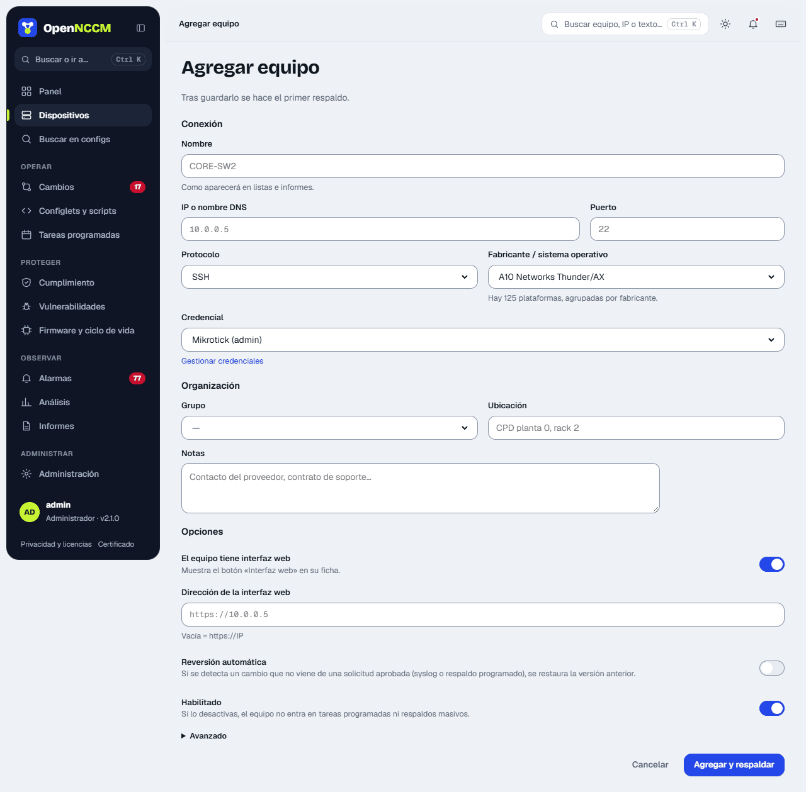
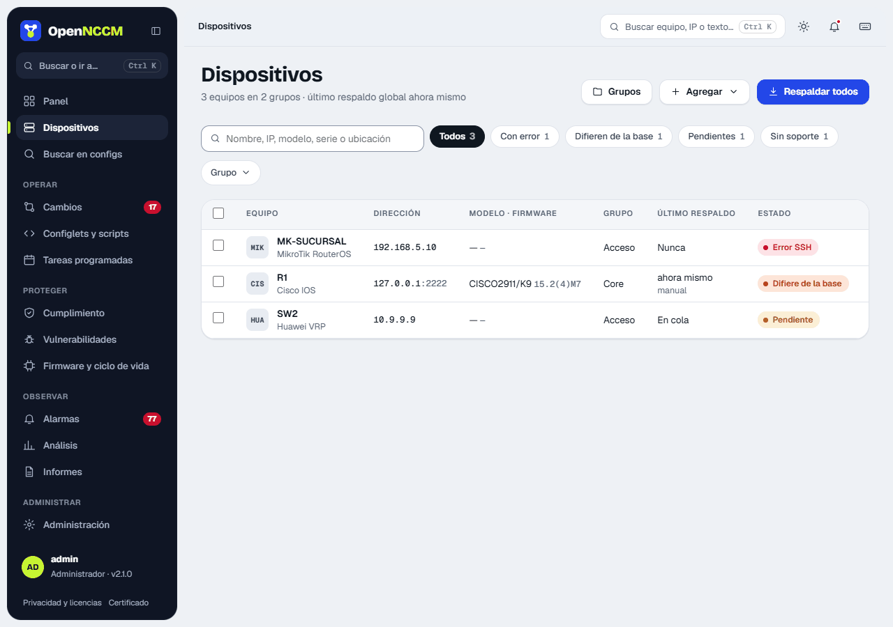

## Agregar dispositivos

Menú **Dispositivos → + Agregar**. Complete nombre, IP, fabricante/sistema operativo, protocolo, credencial y grupo. Al guardar, OpenNCCM hace el primer respaldo automáticamente.



## Importación masiva por CSV

Para muchos equipos, prepare un CSV en Excel (guardar como «CSV UTF-8») con estas columnas y cárguelo al pie de la página **Dispositivos**:

```bash
name,host,device_type,credential,group,port,protocol,location
core-sw1,10.0.0.1,cisco_ios,red-admin,Core,22,ssh,Datacenter
fw-01,10.0.0.254,fortinet,firewalls,Seguridad,22,ssh,Datacenter
edge-r1,10.0.1.1,juniper_junos,red-admin,WAN,22,ssh,Sucursal Norte
```

El valor de `device_type` de cada plataforma está en **Administración → Plataformas** (página `/vendors`). Los grupos que no existan se crean solos.

## Verificar el primer respaldo

Abra el dispositivo. Si el estado es **ok** verá su modelo, número de serie, versión de firmware y la primera versión de configuración. Si es **error**, el recuadro rojo indica la causa (ver [Solución de problemas](/instalacion/problemas/)).


