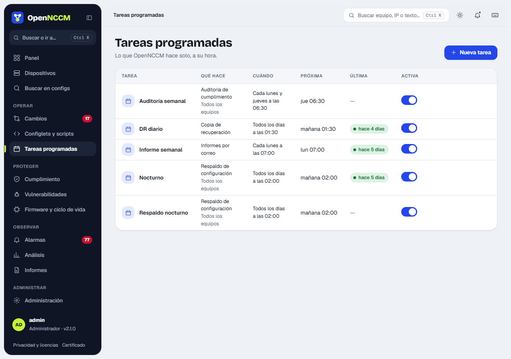

Menú **Tareas**. Las expresiones usan el formato cron de 5 campos: minuto, hora, día, mes y día de la semana.

| Tarea | Acción | Cron | Significado |
| --- | --- | --- | --- |
| Respaldo nocturno | Respaldo de configuración | `0 2 * * *` | Todos los días a las 02:00 |
| Copia de recuperación | Copia de recuperación de OpenNCCM | `30 3 * * *` | Todos los días a las 03:30 |
| Auditoría semanal | Auditoría de cumplimiento | `0 6 * * 1` | Lunes a las 06:00 |
| Vulnerabilidades | Escaneo de vulnerabilidades (NVD) | `0 4 * * 0` | Domingos a las 04:00 |
| Informe semanal | Enviar informes por correo | `0 7 * * 1` | Lunes a las 07:00 |

