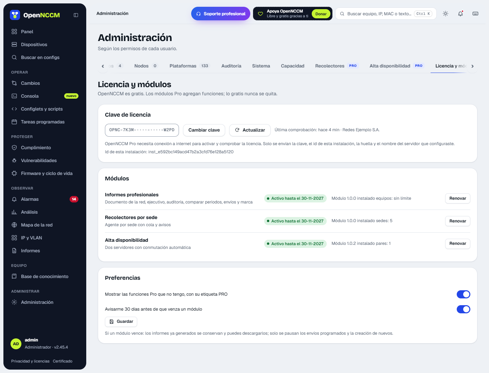

OpenNCCM es gratis y de código abierto, sin límites de equipos ni de tiempo. **OpenNCCM Pro** suma tres módulos opcionales de pago para quien los necesite; lo gratis nunca se quita:

| Módulo | Para qué |
| --- | --- |
| [Informes profesionales](/pro/informes/) | Informe ejecutivo mensual, auditoría de cumplimiento firmada, Documento de la red, inventario para gerencia con el costo de renovación, envíos programados por correo y tu marca en los informes |
| [Recolectores por sede](/pro/recolectores/) | Un recolector en cada sede respalda los equipos de su red y manda las copias a este servidor, aunque la sede no tenga acceso directo |
| [Alta disponibilidad](/pro/alta-disponibilidad/) | Un segundo servidor en espera copia los datos cada minuto y toma el control solo si el principal cae |

Planes y precios: [comunidad.opennccm.com/pro](https://comunidad.opennccm.com/pro).

## Activar una clave

1.  Compra el módulo (o pide una prueba) en [comunidad.opennccm.com/pro](https://comunidad.opennccm.com/pro). La clave llega por correo y se ve en **Mi cuenta › Licencias**.
2.  En OpenNCCM, entra a **Administración › Licencia y módulos**, pega la clave y pulsa **Activar**.
3.  Desde que la licencia es válida, los módulos que incluye **se bajan, se instalan y quedan funcionando solos**, sin reiniciar. Cada módulo dice «Módulo X.Y instalado» y su vigencia («Activo hasta el …»).

La tarjeta muestra la clave enmascarada, **Cambiar clave**, **Actualizar** (vuelve a comprobar la licencia ahora) y la última comprobación. Una clave sirve en un servidor a la vez (un par de [Alta disponibilidad](/pro/alta-disponibilidad/) usa la misma clave en los dos). Si la clave ya está en otro servidor, **Activar aquí** la pasa a este; desde **Mi cuenta › Licencias** en la web también puedes liberar una instalación.

**Versiones nuevas de un módulo:** se bajan solas una vez al día. Si el módulo está en uso, se aplican al reiniciar el servicio o con **Reiniciar ahora** («Hay versiones nuevas de los módulos Pro»).

## Prueba gratis

**Pide una prueba gratis** (en la misma pantalla o en cada módulo con **Probar gratis**) abre un formulario con los módulos, tu correo, la organización y para qué lo usarás. No pide tarjeta.

-   Cada servidor puede probar cada módulo **una sola vez**.
-   El correo es el de tu cuenta en comunidad.opennccm.com; si no tienes, se crea al confirmar el correo. Confirma la dirección para que el pedido llegue a revisión.
-   Revisamos cada pedido a mano, normalmente en menos de un día hábil. Mientras tanto la pantalla dice «Pedido de prueba en revisión» (con **Cancelar pedido**).
-   Cuando se aprueba, la pantalla dice «Tu prueba fue aprobada» y la activas con **Activar prueba**. Los días cuentan desde que la activas.
-   Al vencer, los módulos se pausan: lo que generaste se conserva y lo gratis sigue igual. Te avisamos 3 días antes.

## Cuando un módulo vence

| Estado | Qué significa |
| --- | --- |
| **Activo hasta el …** | Funciona con todo |
| **En gracia hasta el …** | La licencia venció hace poco (15 días de gracia; las pruebas no tienen): sigue funcionando para que tengas tiempo de renovar |
| **Venció el …** | El módulo se pausa. **No se borra nada**: los informes ya generados se ven y se descargan; se pausan los envíos programados y la creación de nuevos. Los recolectores y la conmutación automática de Alta disponibilidad se detienen hasta renovar |
| **Pausado** | No se pudo comprobar la licencia (por ejemplo, sin internet durante mucho tiempo). Vuelve solo al comprobarla |

En **Preferencias** puedes elegir **Mostrar las funciones Pro que no tengo, con su etiqueta PRO** y **Avisarme 30 días antes de que venza un módulo**.

## Qué se envía

OpenNCCM Pro necesita conexión a internet hacia `comunidad.opennccm.com` (HTTPS) para activar y comprobar la licencia. Solo se envían la clave, el id de esta instalación, la huella y el nombre del servidor que configuraste. La huella es un código que no identifica tu red. Nunca se envían configuraciones, equipos, direcciones ni usuarios.

Al pedir una prueba se envían además el correo, la organización y los módulos elegidos.

:::note[Licencia del código]
OpenNCCM sigue bajo la GPL-3.0. Una excepción (archivo `LICENSE-EXCEPTION`, según la sección 7 de la GPL) permite usar módulos que no son libres a través de la Interfaz de Módulos, sin cambiar la licencia del resto del código.
:::
