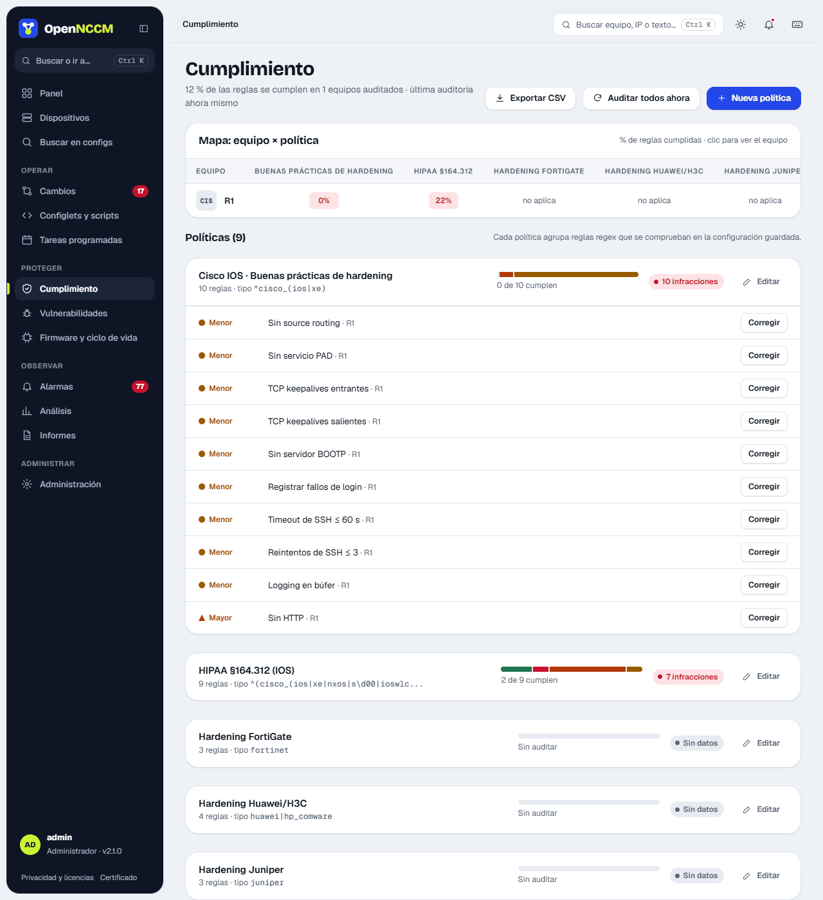
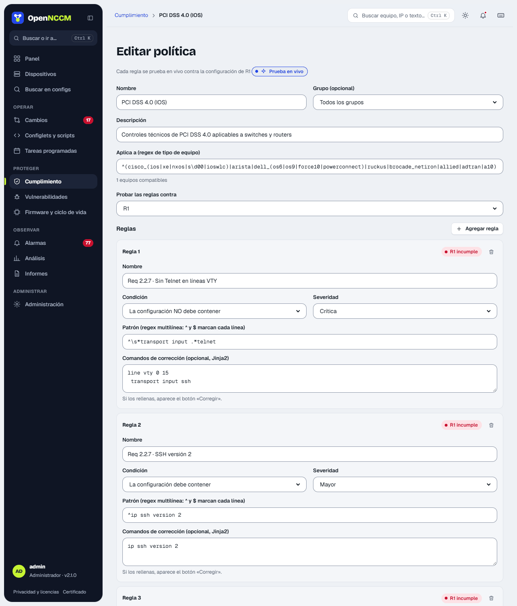

## Cómo funciona

-   Una **política** agrupa **reglas** y se aplica a los equipos cuyo device\_type coincide con su filtro (y opcionalmente a un grupo).
-   Cada regla es una expresión regular que la configuración **debe contener** o **no debe contener**, con una severidad (critical, major, minor) y, opcionalmente, comandos de **corrección**.
-   La auditoría se ejecuta sola tras cada respaldo, y también a pedido o programada.

## Paquetes incluidos

| Política | Reglas | Ejemplos de controles |
| --- | --- | --- |
| PCI DSS 4.0 (IOS) | 15 | Sin Telnet (Req 2.2.7), sin HTTP, sin comunidades SNMP por defecto, contraseñas ≥ 12, bloqueo por intentos, sesión ≤ 15 min, AAA, ACL de gestión, syslog, NTP, banner |
| HIPAA §164.312 (IOS) | 9 | Control de acceso, cierre automático de sesión, auditoría de comandos, transmisión cifrada, SNMPv3 |
| SOX ITGC (IOS) | 8 | Archivo de configuración, registro y *accounting* de comandos, autenticación centralizada |
| Cisco IOS · Buenas prácticas | 10 | Source routing, PAD, keepalives, BOOTP, timeouts de SSH |
| PCI DSS 4.0 (Junos) | 7 | Telnet, web HTTP, root por SSH, reintentos, idle-timeout, syslog, NTP |
| Extreme VOSS · Seguridad básica | 12 | Sin Telnet, FTP, TFTP ni rlogin; SSH; web solo HTTPS; SNMP sin comunidades por defecto; cierre de sesión ≤ 15 min; RADIUS/TACACS+; syslog; NTP; banner |
| Ubiquiti EdgeSwitch/UniFi · Seguridad básica | 7 | Sin la cuenta «ubnt»; SSH; sin Telnet ni HTTP sin cifrar; SNMP sin comunidades por defecto; syslog; SNTP |
| MikroTik RouterOS · Seguridad básica | 13 | Telnet, FTP, www y API desactivados; Winbox y MAC-Telnet limitados; cortafuegos de entrada; SNMP; syslog; NTP |
| Juniper Junos · Seguridad básica | 13 | Sin Telnet, FTP ni J-Web HTTP; root sin SSH; bloqueo por intentos; sesión inactiva; RADIUS/TACACS+; SNMP; syslog; NTP; banner |
| Ubuntu / Debian · Seguridad básica | 8 | SSH sin root con contraseña ni contraseñas vacías; solo root con UID 0; sudo sin contraseña solo para comandos concretos; cortafuegos activo; actualizaciones automáticas de seguridad; NTP; sin Telnet, rsh ni TFTP |
| FortiGate · Seguridad básica | 11 | Sin Telnet ni HTTP en interfaces; sesión ≤ 15 min; hosts de confianza; política de contraseñas; cifrado fuerte; SNMP; syslog/FortiAnalyzer; NTP |
| WatchGuard Fireware · Seguridad básica | 10 | Web UI y administración (WSM y CLI) no abiertas a Internet; bloqueo de cuentas; sesión inactiva ≤ 15 min; SNMP sin comunidades por defecto y v3; NTP; envío de logs; bloqueo de paquetes falsificados; aviso antes del inicio de sesión. Sin corrección automática: se corrige en la Web UI o en Policy Manager |
| Hardening básico (Cisco, Huawei, Juniper, FortiGate) | 3 – 9 | Controles esenciales por fabricante |

Las reglas son controles técnicos de referencia. El cumplimiento normativo completo requiere además procesos y evidencias que no dependen del equipo. Los paquetes nuevos de cada versión se cargan solos al actualizar; si se borra uno, no vuelve a aparecer. Las reglas que dependen de direcciones de cada red (servidores de syslog o NTP, redes de gestión) no tienen corrección automática: indican qué falta y el comando se escribe con las direcciones reales. Una solicitud de cambio con direcciones de ejemplo (192.0.2.x, 198.51.100.x, 203.0.113.x) no se puede aprobar.

## Cómo usarlo

1.  El **mapa equipo × política** muestra el porcentaje de reglas que cumple cada equipo en cada política (verde, ámbar o rojo); un clic lleva al equipo. Debajo, cada política muestra una barra por gravedad y, al desplegarla, las reglas que fallan y en qué equipos. La severidad se distingue también por la forma (rombo crítica, triángulo mayor, círculo menor). Cada regla con corrección muestra su sello («Sin verificar» o «Verificada · versión») y **Corregir** (o **Corregir en N equipos…**), que abre un diálogo con los comandos, los equipos para marcar (una solicitud por equipo), el aviso con el foro y un reporte de GitHub ya escrito, y la casilla obligatoria «Revisé los comandos…». En la ficha del equipo, **Corregir N** («Las correcciones son comandos que cambian la configuración») abre «Corregir N infracciones en EQUIPO»: cada corrección con su casilla, su sello y sus comandos, y **Crear solicitud (N correcciones)** crea una sola solicitud con las marcadas. **Corregir** en una regla abre el mismo diálogo con esa sola corrección.
2.  Para crear o cambiar una política: **Nueva política** o **Editar** abren el editor en un panel lateral. Cada regla tiene nombre, condición (debe o no debe contener), severidad, patrón y corrección opcional, y se **prueba en vivo** contra la configuración del equipo elegido mientras se escribe («cumple» / «incumple»). **Guardar** guarda la política y todas sus reglas a la vez.
3.  Use **Auditar todos ahora** después de cambiar reglas.

