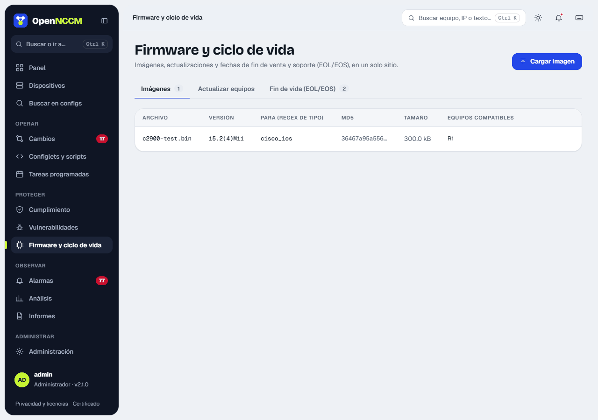
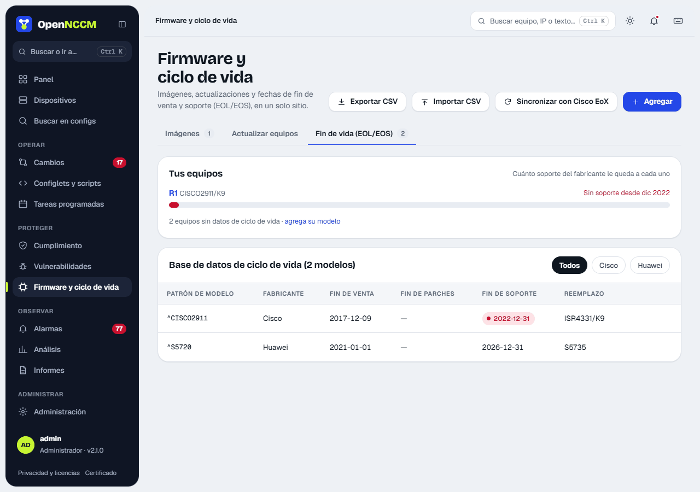

| Plataforma | Destino | Configuración de arranque |
| --- | --- | --- |
| Cisco IOS | `flash:` | `no boot system` + `boot system flash:IMAGEN` |
| Cisco IOS-XE (modo bundle) | `bootflash:` | `boot system bootflash:IMAGEN` |
| Cisco NX-OS | `bootflash:` | `boot nxos bootflash:IMAGEN` |
| Cisco ASA | `disk0:` | `boot system disk0:/IMAGEN` |
| Arista EOS | `flash:` | `boot system flash:IMAGEN` |
| Juniper Junos | `/var/tmp` | `request system software add … no-validate` |
| MikroTik RouterOS | raíz del router (SFTP, tamaño comprobado) | Se instala solo al reiniciar (`/system reboot`) |
| Ubiquiti airMAX (airOS) y airFiber | `/tmp/fwupdate.bin` (SCP, tamaño comprobado) | `fwupdate -m` graba y reinicia (método de Ubiquiti) |
| Ubiquiti EdgeRouter | `/tmp` (SCP) | `add system image …` y `reboot` |

En MikroTik, airOS, airFiber y EdgeRouter, OpenNCCM **respalda el equipo antes** de tocar el firmware y no sigue si el respaldo falla. MikroTik también se puede actualizar **en línea**, sin cargar el paquete: **MikroTik: actualizar desde MikroTik** elige el canal (stable o long-term) y el router lo descarga de MikroTik (`/system package update`); si ya tiene la última versión no hace nada, y sin «Instalar y reiniciar» solo lo descarga para el próximo reinicio. Probado en RouterOS reales en la CI (7.23.8 → 7.25 con el paquete, y en línea). Los AP, switches y USG de UniFi actualizan el firmware desde el controlador UniFi Network.

## Cómo usarlo

1.  (admin) **Firmware y ciclo de vida → Imágenes → Cargar imagen**: arrastre el archivo, indique la versión y para qué device\_type es. La tabla muestra el MD5, el tamaño y los equipos compatibles.
2.  Pestaña **Actualizar equipos** (o **Usar** en la imagen): elija la imagen; se marcan solos los equipos compatibles que tienen otra versión. Si corresponde, marque **Reiniciar cada equipo al terminar** y pulse **Crear solicitud de actualización**. También puede hacerlo desde la ficha de cada equipo.
3.  Un administrador revisa los pasos previstos y aprueba. El resultado muestra si el archivo ya existía, si se transfirió y si el MD5 coincidió.
4.  Tras el reinicio, OpenNCCM vuelve a respaldar el equipo a los 15 minutos para actualizar la versión en el inventario.

## Actualizaciones disponibles

OpenNCCM comprueba una vez al día si hay una versión más nueva del firmware de cada equipo, y lo que mejora. La pestaña **Actualizaciones disponibles** de **Firmware y ciclo de vida** lista todos los equipos (primero los que tienen versión nueva); cada equipo muestra la etiqueta **Firmware X disponible** y, en su pestaña Firmware, la sección **Actualizaciones de firmware**. Cuando aparece una versión nueva se registra un aviso en Alarmas, una sola vez por versión. Un equipo nuevo se comprueba en cuanto hace su primer respaldo, sin esperar a la comprobación diaria, y la tarjeta **Actualizar firmware** muestra la versión disponible también en los equipos que OpenNCCM no puede actualizar.

| Equipos | De dónde sale la versión | Descarga |
| --- | --- | --- |
| MikroTik RouterOS | Sitio oficial de MikroTik (estable y long-term), con sus novedades | Sí, el archivo de la arquitectura del equipo |
| Ubiquiti EdgeSwitch, EdgeRouter, UniFi Switch | Catálogo oficial de Ubiquiti, por modelo | Sí |
| Ubuntu Server y Debian | Tabla oficial de versiones (distro-info-data): la LTS o estable más nueva y la fecha de fin de soporte de la instalada | No: se actualiza en el propio servidor (`do-release-upgrade`) |
| Cisco, Fortinet, Juniper, Palo Alto, Arista, WatchGuard y otros con CPE | Diccionario de versiones de NVD (NIST): la más nueva de su rama y la más reciente | No: el fabricante pide cuenta |

-   **Qué mejora**: cuántos CVE de la versión instalada ya no afectan a la nueva (con los críticos y altos), las novedades del fabricante cuando las publica y el enlace a sus notas de la versión.
-   **Descargar a la biblioteca** (administradores, MikroTik y Ubiquiti): baja el archivo del sitio oficial, comprueba la suma SHA-256 que publica el fabricante y lo guarda en Imágenes. Si la suma no coincide, el archivo se descarta. Después se instala como cualquier imagen: solicitud, aprobación y respaldo previo.
-   Para los fabricantes que piden cuenta, OpenNCCM avisa de la versión nueva y lo que mejora; el archivo se descarga del portal del fabricante y se sube con **Cargar imagen**.
-   **Comprobar ahora** (en la ficha del equipo) y **Comprobar todos ahora** lo hacen al momento, en segundo plano. Un administrador puede desactivar la comprobación diaria con **Comprobar a diario**. Solo se consultan los sitios de MikroTik, Ubiquiti y NVD, sin enviar datos de los equipos.

La versión de NVD es la más reciente que NVD conoce, no un anuncio oficial: confírmela con el fabricante. Si NVD no conoce ninguna versión igual o posterior a la instalada, OpenNCCM indica que no puede saber si hay una más nueva.

:::caution[Antes de actualizar en producción]
Lea las notas del fabricante (espacio libre, rutas de actualización, modo *install* en IOS-XE) y pruebe en un equipo de laboratorio. En Cisco, habilite `ip scp server enable`.
:::

## Fin de vida (EOL/EOS)

**Para qué sirve:** saber qué equipos ya no se venden, ya no reciben parches o están por quedarse sin soporte, para planificar su reemplazo.

### Cómo funciona

La **base de ciclo de vida** asocia un patrón del modelo (expresión regular sobre el modelo del inventario) con sus fechas. Cada equipo toma la primera entrada que coincide y recibe un estado:

| Estado | Condición |
| --- | --- |
| **Sin soporte** | Pasó la fecha de fin de soporte. |
| **Sin parches de software** | Pasó el fin de mantenimiento de software. |
| **Fin de soporte < 12 meses** | El soporte termina dentro de un año. |
| **Fin de venta** | Ya no se vende, pero tiene soporte. |
| **Vigente** | Ninguna de las anteriores. |
| **Sin datos** | No hay entrada para su modelo. |

### Cómo cargar las fechas

-   **A mano:** botón **Agregar** de la pestaña **Fin de vida (EOL/EOS)**; mientras escribe el patrón indica con qué equipos coincide. Cada modelo de la tabla se puede editar o eliminar.
-   **CSV:** botón **Importar CSV**, columnas `vendor,model_pattern,end_of_sale,end_of_sw_maintenance,end_of_support,replacement,url`.
-   **API Cisco EoX:** con credenciales de apiconsole.cisco.com en Ajustes, el botón **Sincronizar con Cisco EoX** completa las fechas de todos los modelos Cisco del inventario.

