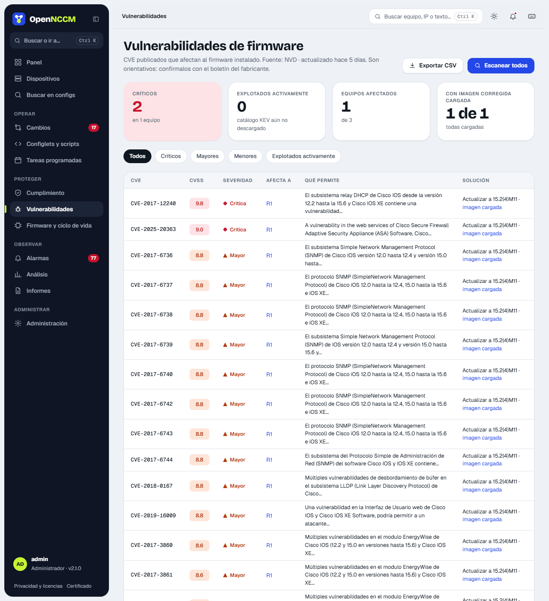

## Cómo funciona

Con la versión de firmware leída del inventario, OpenNCCM consulta la base pública **NVD** del NIST. Usa el identificador CPE del fabricante cuando existe (Cisco IOS/IOS-XE/NX-OS/IOS-XR/ASA, Junos, EOS, AOS-CX, FortiOS, PAN-OS, RouterOS, Ubiquiti EdgeSwitch, UniFi Switch, EdgeRouter, airMAX, airFiber y AP UniFi, WatchGuard Fireware, ZTE, Huawei, Dell y otros: 70 tipos de equipo en total) y, si NVD registra el firmware por modelo, el CPE del modelo del equipo. En Junos convierte la versión al formato de NVD, que separa versión y actualización («21.4R3-S5» se busca como «21.4:r3-s5») y búsqueda por palabras en el resto. Pide los CVE en páginas pequeñas y reintenta cada una si NVD corta la respuesta, así que también funciona con versiones que tienen muchos CVE (por ejemplo, Cisco IOS 12.4). Para Extreme VOSS / Fabric Engine, NVD casi no registra vulnerabilidades: la ficha del equipo lo indica y enlaza a los avisos de seguridad de Extreme; lo mismo con el USG de Ubiquiti, que enlaza a sus avisos de seguridad. Guarda el ID CVE, la puntuación CVSS, la severidad y el enlace, y genera una alarma crítica si hay CVE críticos. Además descarga (como mucho una vez al día) el catálogo **KEV** de CISA y marca los CVE **«explotado activamente»**.

## Cómo usarlo

-   En un equipo: menú **⋯ → Buscar CVE de firmware**. La búsqueda va en segundo plano: la pestaña Vulnerabilidades muestra «Buscando en NVD…» y se actualiza sola al terminar (con muchos CVE puede tardar unos minutos). Si NVD no responde, se conservan los resultados anteriores. Para todos: **Vulnerabilidades → Escanear todos** o una tarea programada.
-   La página agrupa los resultados por CVE (qué equipos afecta, qué permite y la solución: si ya hay una imagen corregida cargada, lo indica con un enlace). Arriba, los indicadores de críticos, explotados activamente, equipos afectados y equipos con imagen corregida; los filtros separan por severidad o «Explotados activamente».
-   Sin clave de API, NVD permite unas 5 consultas cada 30 segundos y OpenNCCM espera lo necesario. Una clave gratuita lo acelera (unas 50 consultas): se pone en **Ajustes › Vulnerabilidades (NVD)**, donde se guarda cifrada, o en `NCM_NVD_API_KEY` del archivo `opennccm.env`, que tiene prioridad.

Los resultados dependen de cómo NVD registre cada versión: confirme siempre con el boletín del fabricante.
