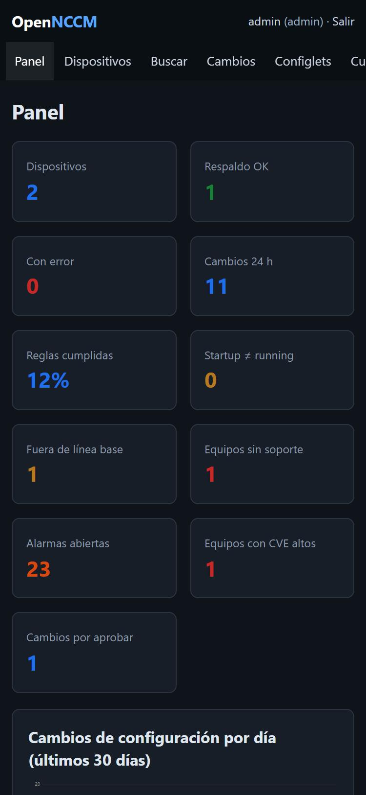

La interfaz se adapta a pantallas pequeñas: abajo aparece una barra con Panel, Equipos, Cambios, Alarmas y Más (que abre la barra lateral completa) y los indicadores se muestran en dos columnas. Si el teléfono usa tema oscuro, la aplicación también.

No requiere instalar ninguna app: basta con abrir la dirección del servidor en el navegador del teléfono (dentro de la VPN o la red de gestión).

## API JSON

Para scripts y otras herramientas, cada usuario crea sus **tokens de API** en **Mi cuenta › Tokens de API** (con nombre y caducidad opcional de 30, 90 o 365 días). El token se muestra **una sola vez**; OpenNCCM solo guarda su huella, así que si se pierde hay que crear otro. Se envía en la cabecera `Authorization: Bearer ncm_…`, actúa con los permisos y los grupos de su dueño, solo sirve para `/api/…` (no para la interfaz web) y se puede revocar en cualquier momento.

| Petición | Qué hace | Rol |
| --- | --- | --- |
| `GET /api/devices` | Inventario: nombre, IP, tipo, modelo, serie, versión, estado y último respaldo. | Lector |
| `GET /api/devices/{id}` | Ficha del equipo (grupo, ubicación, notas, último error, línea base). | Lector |
| `GET /api/devices/{id}/versions` | Versiones guardadas (hasta 500), con origen y líneas cambiadas. | Lector |
| `GET /api/devices/{id}/config[?version=N]` | Configuración en texto: la última o la versión N. | Lector |
| `POST /api/devices/{id}/backup` | Respalda ahora; devuelve `first`, `changed`, `unchanged` o `error`. | Operador |
| `POST /api/devices` | Alta con JSON: `name`, `host`, `device_type` y opcionales `port`, `protocol`, `credential`, `group`, `location`, `notes`. | Administrador |

Sin token o con uno caducado se responde 401; sin permiso, 403. Las altas, respaldos y lecturas de configuración por la API quedan en Auditoría.

`GET /healthz` devuelve `{"status":"ok"}` para sistemas de monitoreo.

