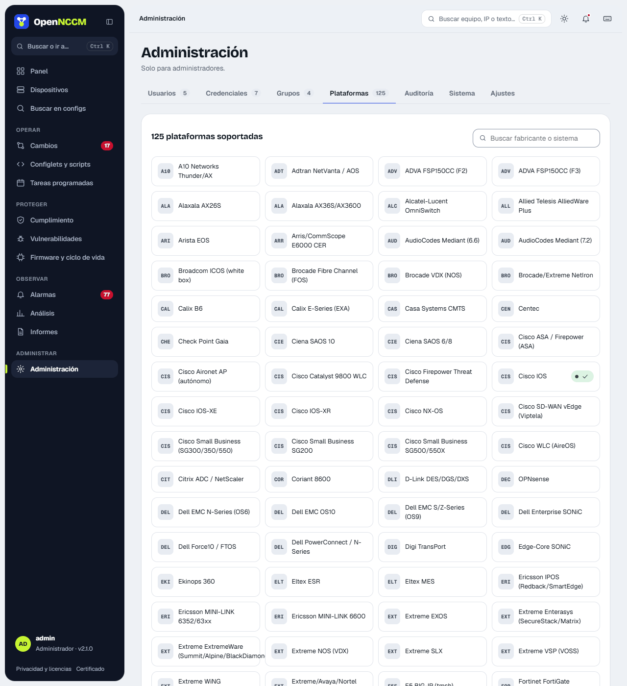

**Administración → Plataformas**. Muestra las 133 plataformas en fichas (las comprobadas en su red llevan una marca) y, en **Comandos de cada plataforma**, su `device_type` y los comandos que se ejecutan en cada una: **respaldo**, **arranque** (startup, para detectar cambios sin guardar) e **inventario** (modelo, serie y versión); además el tipo de reversión y si admite actualización de firmware.

-   **Buscador** y **filtro por fabricante**; la casilla **Solo las de mi red** muestra únicamente las plataformas que usted usa.
-   **Comprobado en su red**: se marca solo cuando un equipo de esa plataforma hace su primer respaldo correcto, con la cantidad de equipos y la fecha (y si usa un comando personalizado).
-   **por verificar**: comando tomado de la documentación del fabricante, aún sin probar en un equipo real.

La configuración se obtiene mostrando el resultado del comando dentro de la misma sesión SSH: no se crean archivos en el equipo ni se necesita FTP/TFTP. **WatchGuard Fireware** se respalda con `export config to console` (la configuración completa en XML) y, una sola vez, guarda cifrada su *feature key* tal como se pega para restaurarla (Serial Number, License ID, Name, Model, Version, una línea Feature por función, Expiration y Signature), que se descarga desde la ficha del equipo. El detalle sale de la CLI (`show feature-key` y `show feature-key ID`); la firma no, así que OpenNCCM entra un momento a la Web UI del Firebox (System › Feature Key, puerto 8080 o el de la «Interfaz web» del equipo) con la misma credencial, la lee y cierra la sesión. Si no puede entrar, guarda el detalle sin firma (la ficha dice «sin firma: aún no sirve para restaurar»), avisa una sola vez por motivo y lo reintenta: pasada una hora si la Web UI no respondió y al día siguiente si rechazó el ingreso, para no insistir con la contraseña. En **Servicios**, la ficha muestra cuándo vence cada suscripción (antivirus, IPS, LiveSecurity…), en ámbar si faltan 60 días o menos y en rojo si ya venció; OpenNCCM avisa a los 60, 30 y 7 días y al vencer, una sola vez por fecha, y mientras algo esté por vencer relee la feature key una vez al día para ver la renovación. El informe [Licencias por vencer](/observar/informes/) lista lo de todos los equipos. Basta un usuario de solo lectura (Device Monitor) para todo. Para recuperar ese mismo Firebox también puede guardar su [imagen completa cifrada (.fxi)](/equipos/dispositivos/#watchguard-configuración-xml-e-imagen-completa-fxi), con una credencial de administrador. Si un comando no sirve para su versión, defina un **comando de respaldo personalizado** en el dispositivo. Para equipos sin perfil propio (SonicWall, Riverbed, Infoblox…) use **Genérico SSH** con un comando personalizado.

**pfSense y OPNsense** tienen perfil propio: OpenNCCM atraviesa el menú de consola (opción «8) Shell») y respalda el archivo `config.xml` completo, el mismo que exporta la web. Use el usuario `admin`/`root` (el archivo solo lo lee root); el inventario trae versión, modelo y número de serie. Los cambios se siguen haciendo desde la web del cortafuegos. Desde la 2.34 cada uno es su propia plataforma en la consola, en Recetas y en Configlets, con sus recetas. **Alpine Linux** respalda red, DNS, paquetes instalados (`apk world`), servicios, SSH y reglas del cortafuegos.

**Ubuntu Server / Debian** (Ubuntu 26.04, 24.04 y 22.04 LTS; Debian 12 y 13) respalda solo configuración en texto: nombre, red (netplan o `/etc/network/interfaces`), DNS, SSH, cuentas y grupos, sudo, repositorios, paquetes instalados a mano (no la versión de cada uno, que cambia a diario), servicios activados, tareas de cron, hora (chrony o timesyncd) y cortafuegos (ufw, iptables y nftables, sin contadores de paquetes). **Nunca** copia contraseñas (`/etc/shadow`), claves privadas, certificados ni datos, y las contraseñas de wifi de netplan salen como `***`. Un respaldo típico ocupa unos 20–60 KB. Algunos archivos (netplan, crontab de root) y el cortafuegos solo se leen como root: dé al usuario de OpenNCCM `sudo` sin contraseña, mejor solo para esos comandos de lectura; sin `sudo` se respalda el resto. El inventario lee la versión de `/etc/os-release`, y **Actualizaciones disponibles** avisa de la nueva LTS y de la fecha de fin de soporte.

**Ubiquiti airMAX, airFiber y UniFi.** airMAX M (M2, M5 con airOS 6), airMAX AC (airOS 8), airFiber (AF5XHD, AF60, AF24HD, AF5X) y los AP UniFi guardan toda su configuración en `/tmp/system.cfg`, que es lo que se respalda; la versión y el modelo salen de `/etc/version` y `/etc/board.info` (o de `info` en UniFi), y el número de serie es la MAC, como lo muestra Ubiquiti. El USG se respalda con `show configuration commands`. Los switches, AP y USG de UniFi los configura el controlador UniFi Network: los cambios y su reversión se hacen allí. En airMAX, airFiber y los AP UniFi la copia se descarga como `system.cfg`, lista para restaurar: en airOS, *System › Configuration Management › Upload Configuration*.

**ZTE.** Las OLT GPON/EPON **ZXA10** de la serie C300 (C300, C320, C350 y C220), las OLT **ZXA10 TITAN** (C600, C610, C620, C650 y C680) y los switches y routers **ZXR10** (ZXROS: 2900E, 5900E, 5960, 8900E, 9900, M6000…) se respaldan con `show running-config`, por SSH o Telnet. La versión y el modelo salen de `show system-group` (C300), `show software` (TITAN) o `show version` (ZXR10), y las tarjetas de `show card`. En las OLT de la serie C300, el número de serie sale de la tarjeta de control (SMXA, SCXN…) con `show card slotno N` (ranura 3 o 4 en la C320, 10 u 11 en la C300), y la ficha dibuja el frente por ranuras desde la configuración, cada tarjeta con su número y su tipo («Ranura 2 · GTGH»): los puertos PON con cuántas ONU tienen y los uplinks de 1 G y 10 G. No se guardan datos de los clientes (nombres ni descripciones de las ONU). Desde la 2.42, en la C300 y la C320 se ve el [chasis entero](/equipos/dispositivos/#olt-zte-c300-y-c320-el-chasis-entero). Desde la 2.41, el frente también muestra qué puertos están activos: un PON lo está si tiene al menos una ONU en línea («12 de 14 ONU en línea», y cuántas en LOS, DyingGasp u OffLine), y los uplinks muestran su enlace y su velocidad. Para ver la serie y el frente después de actualizar, **Respaldar ahora** en cada OLT. La configuración de una OLT incluye cada ONU: con miles de ONU tarda en leerse (hasta 15 minutos).

**MikroTik SwitchOS** (SwOS y SwOS Lite) no tiene SSH: OpenNCCM descarga por HTTP (puerto 80) el mismo respaldo `backup.swb` que su interfaz web, y lee de él el modelo, la versión y la serie. No admite cambios por comandos ni consola; para restaurar, *Restore Backup* en SwitchOS con el archivo descargado.

**ArubaOS** (controladoras y Mobility Access Switch como el S2500): al conectar, OpenNCCM pasa al modo privilegiado con la contraseña de **Enable / secret** de la credencial; si no tiene, prueba la de ingreso y, si tampoco sirve, lo dice. El modelo sale de `show version`, la serie de `show inventory` y los puertos de `show port status` (en el S2500-48P, los 48 de cobre y los 4 SFP+), y la ficha muestra su parte trasera.

